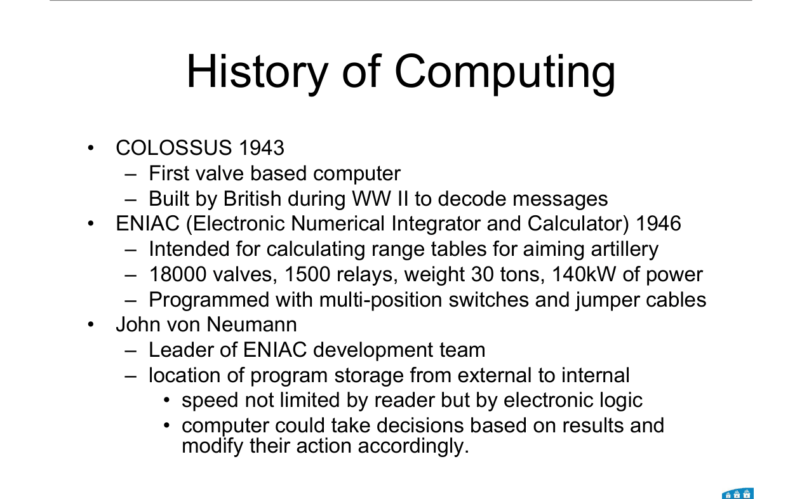
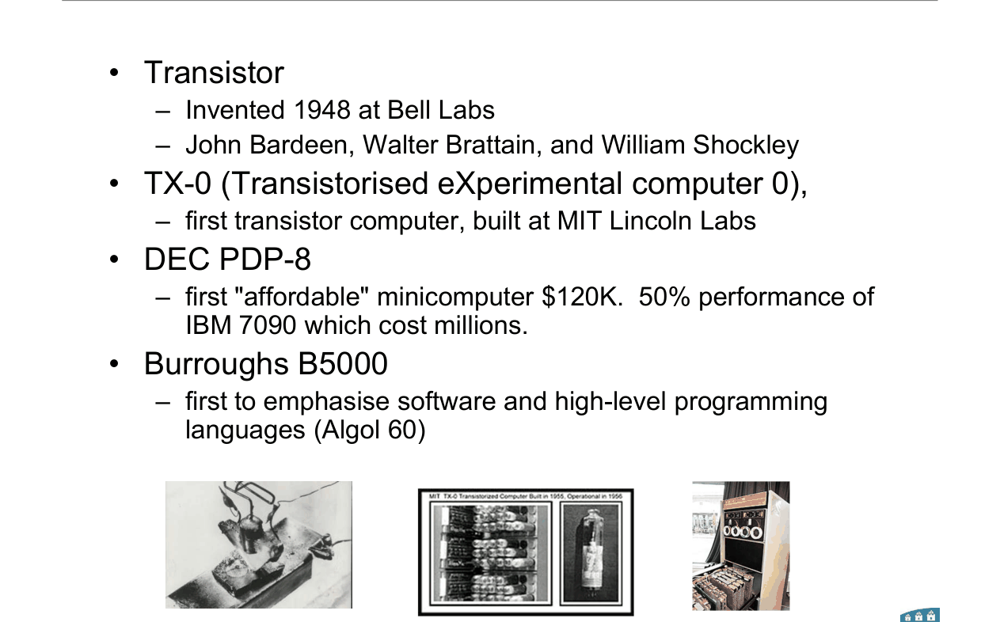
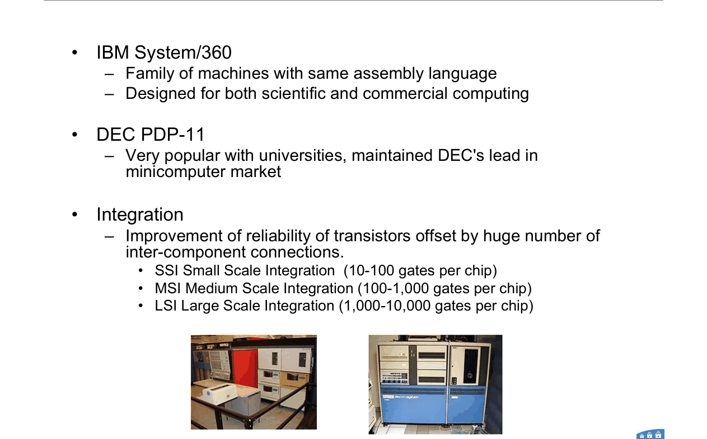
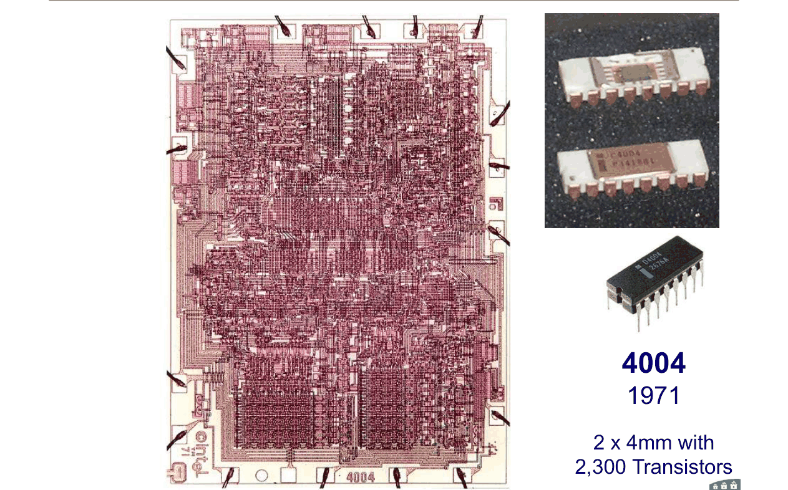
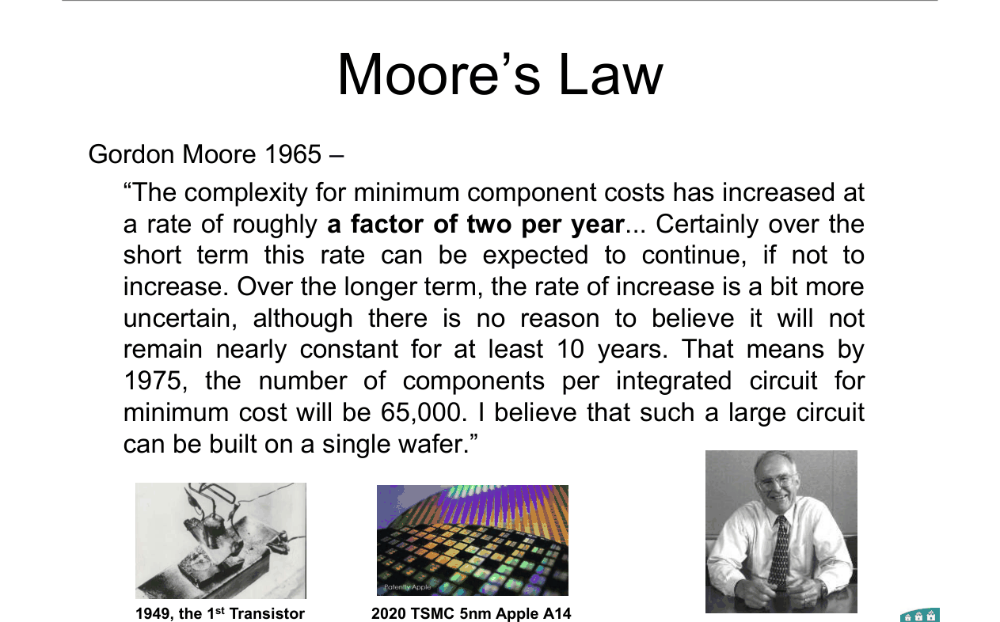
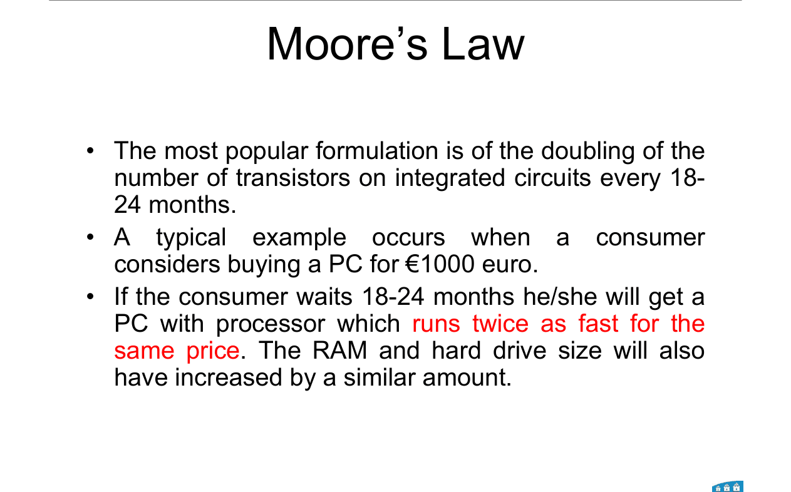
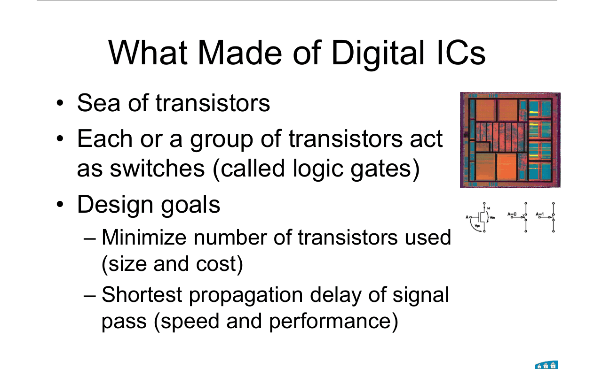

# Topic 1 — History, Moore's law, chip facts

Slide exercises: none

Slides: Lecture 1, all

---

## The big idea

Digital chips are a sea of tiny switches called transistors.

Groups of transistors make **logic gates**.

This whole module is about building useful things out of gates.

 

This lecture is worth **a short-answer question at most**.

Learn the numbers in the tables below. Skip the rest.

---

**How to use these notes:**
When you see 🧠, stop.
Answer it on paper first.
Then click to check.

---

## 1. Early computers

| Year | Machine | Learn this |
|---|---|---|
| 1943 | **COLOSSUS** | First **valve** computer. British, WWII, to decode messages. |
| 1946 | **ENIAC** | Artillery range tables. 18,000 valves, 1,500 relays, 30 tons, 140 kW, about 1,000 m³. Programmed with switches and jumper cables. |

 

**John von Neumann** led the ENIAC team.

He moved the program from **outside** the machine to **inside** it.

That gave two wins:
1. Speed was limited by the electronics, not by the reader.
2. The computer could make decisions from its own results.

 

### 🧠 Check
What was von Neumann's big change, and why did it help?

Answer

He stored the program inside the computer instead of outside.

So speed depended on the logic, not on reading the program in.

And the machine could change what it did based on its own results.

---

## 2. The transistor and the first transistor machines

| Year / name | Learn this |
|---|---|
| **1948 transistor** | Bell Labs. Bardeen, Brattain and Shockley. |
| **TX-0** | First transistor computer. MIT Lincoln Labs. |
| **DEC PDP-8** | First "affordable" minicomputer. $120K. Half the speed of the IBM 7090, which cost millions. |
| **Burroughs B5000** | First to focus on software and high-level languages (Algol 60). |
| **IBM System/360** | A **family** of machines sharing one assembly language. For science and business. |
| **DEC PDP-11** | Very popular with universities. |

---

## 3. Integration scales

More gates on one chip means fewer wires between chips.

Wires between chips were the weak point.

| Name | Gates per chip |
|---|---|
| SSI, small scale | 10 to 100 |
| MSI, medium scale | 100 to 1,000 |
| LSI, large scale | 1,000 to 10,000 |

 

### 🧠 Check
A chip has 500 gates. Which scale is it?

Answer

**MSI**, because 500 is between 100 and 1,000.

---

## 4. Two chips to remember

| Year | Chip | Transistors |
|---|---|---|
| 1971 | **Intel 4004** | **2,300**, on a 2 × 4 mm die |
| 2017 | **Xeon Platinum 8180** | **8.0 billion** |

The slides show every chip in between. You don't need those.

---

## 5. Moore's law

**What Moore said in 1965:**

Components per chip **double roughly every year**.

He predicted **65,000** per chip by 1975.

 

**The popular form today:**

Transistor count **doubles every 18 to 24 months**.

Example from the slide: wait 18 to 24 months and €1000 buys a PC twice as fast.

 

**Why it kept coming true:**

The industry used it as a **target**.

Each company assumed its rivals would keep up with it.

So it became a **self-fulfilling prophecy**.

 

### 🧠 Check
Why is Moore's law called a self-fulfilling prophecy?

Answer

It started as a forecast.

Then chip makers treated it as a goal, because they feared rivals would hit it.

So they made it come true.

---

## 6. What a digital chip is made of

A sea of transistors.

Each transistor, or small group of them, acts as a **switch**. These are the logic gates.

 

**Two design goals:**
1. **Fewest transistors**, for smaller size and lower cost.
2. **Shortest propagation delay**, for speed.

These two goals are why we simplify circuits in Topics 6 to 9.

 

### 🧠 Check
Name the two design goals for a digital IC.

Answer

Use the fewest transistors (size and cost).

Have the shortest propagation delay (speed).

---

## 7. Course admin (just the numbers)

| Part | Weight |
|---|---|
| Labs | 30% |
| Home assignments | 30% |
| Exams | 40%: mid-term **10%**, final **30%** |

Miss an assessment with no approved Extenuating Circumstances form: **zero**.

Textbook: Morris Mano, *Digital Design*, 4th edition.

---

Next: [End-of-topic test](../questions/01-overview.md)
