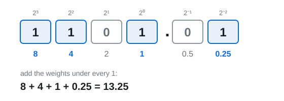
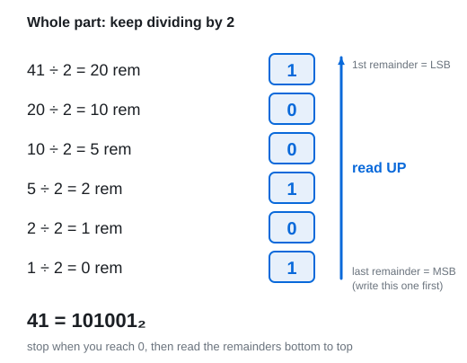
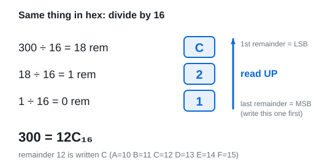
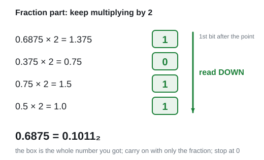
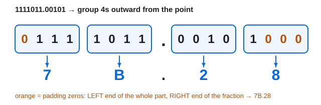

# 02 · Number systems

Lecture 2, slides 4–18 and 22–25 · ●●● · [**Quiz →**](https://albinjoby82-ops.github.io/DE_Lock-In/quiz.html?t=02)

---

## 0. The one idea behind all of it

A **base** is how many digit symbols you have.

| Name | Base | Digits | Place values, right to left |
|---|---|---|---|
| Decimal | 10 | 0–9 | 1, 10, 100, 1000 … |
| Binary | 2 | 0, 1 | 1, 2, 4, 8, 16 … |
| Octal | 8 | 0–7 | 1, 8, 64, 512 … |
| Hex | 16 | 0–9, **A B C D E F** | 1, 16, 256, 4096 … |

**Each place is worth base × the place to its right.** That's all a number system is.

You already do this in decimal without thinking:

`472` = 4 × **100** + 7 × **10** + 2 × **1**

Hex runs out of single digits after 9, so it uses letters:

| A | B | C | D | E | F |
|---|---|---|---|---|---|
| 10 | 11 | 12 | 13 | 14 | 15 |

They just keep counting after 9. Each letter is **one digit**.

Every question in this topic is one of three moves:

| From → to | Move | Section |
|---|---|---|
| anything → decimal | multiply each digit by its place value, add | 1 |
| decimal → anything | divide the whole part, multiply the fraction | 2, 3 |
| binary ↔ octal / hex | group the bits | 4 |

---

## 1. Into decimal: digit × place value, then add

**Rule:** write the place values above the digits, multiply, add.
Left of the point the powers go 0, 1, 2 … Right of the point they go −1, −2 …

**Binary.** Each digit is 0 or 1, so just add the place values under every 1.

| 2⁷ | 2⁶ | 2⁵ | 2⁴ | 2³ | 2² | 2¹ | 2⁰ | . | 2⁻¹ | 2⁻² | 2⁻³ |
|---|---|---|---|---|---|---|---|---|---|---|---|
| 128 | 64 | 32 | 16 | 8 | 4 | 2 | 1 | . | 0.5 | 0.25 | 0.125 |

**Octal.** Place values 64, 8, 1.

`157₈` = 1 × 64 + 5 × 8 + 7 × 1 = 64 + 40 + 7 = **111**

**Hex.** Place values 256, 16, 1. Swap any letter for its number first.

`3C₁₆` = 3 × 16 + **12** × 1 = 48 + 12 = **60**

> **Apply:** 1011.101₂ = ?

Answer

8 + 2 + 1 + 0.5 + 0.125 = **11.625**

> **Apply:** 2F₁₆ = ?

Answer

F = 15. 2 × 16 + 15 = **47**

> **Apply:** 64₈ = ?

Answer

6 × 8 + 4 = **52**

---

## 2. Decimal → any base: the whole part

**Rule:** divide by the base. Write down the remainder. Divide the answer again. Stop at 0. Read the remainders **upward**.

**Why upward?** Dividing by the base chops off the **last** digit as the remainder. In decimal: 472 ÷ 10 = 47 rem **2**, and 2 is the last digit of 472. So your first remainder is the rightmost digit (LSB), and you build the number right to left.

> **Apply:** 25 → binary.

Answer

25 ÷ 2 = 12 r **1**, 12 ÷ 2 = 6 r **0**, 6 ÷ 2 = 3 r **0**, 3 ÷ 2 = 1 r **1**, 1 ÷ 2 = 0 r **1**. Read up: **11001**.
Check: 16 + 8 + 1 = 25 ✓

**Same method for hex or octal.** Divide by 16 or 8 instead. In hex, a remainder from 10 to 15 becomes its letter.

Check: 1 × 256 + 2 × 16 + 12 = 300 ✓

> **Apply:** 123 → hex.

Answer

123 ÷ 16 = 7 r **11 → B**, 7 ÷ 16 = 0 r **7**. Read up: **7B₁₆**.
Check: 7 × 16 + 11 = 123 ✓

> **Apply:** 41 → octal.

Answer

41 ÷ 8 = 5 r **1**, 5 ÷ 8 = 0 r **5**. Read up: **51₈**.
Check: 5 × 8 + 1 = 41 ✓

---

## 3. Decimal → any base: the fraction part

**Rule:** multiply the fraction by the base. The whole number that pops out (left of the point) is the next digit. Keep only the fraction and repeat. Stop at 0. Read the digits **downward**.

**Why downward?** Multiplying by the base pushes the **first** digit after the point over to the left of the point. In decimal: 0.375 × 10 = **3**.75, and 3 is the first digit of .375. So your first result is the digit right after the point.

> **Apply:** 0.375 → binary.

Answer

0.375 × 2 = **0**.75, 0.75 × 2 = **1**.5, 0.5 × 2 = **1**.0 → stop. Read down: **0.011₂**.
Check: 0.25 + 0.125 = 0.375 ✓

**Hex: multiply by 16.** `0.15625`: × 16 = **2**.5, then 0.5 × 16 = **8**.0 → stop. Answer **0.28₁₆**.

> **Apply:** 0.6875 → hex.

Answer

0.6875 × 16 = **11**.0 → **B**, and the fraction is 0, so stop. Answer **0.B₁₆**.

**Watch out:** some fractions never reach 0 (0.1 in binary goes on forever). Stop after however many digits the question asks for.

**Number with both parts?** Do the whole part and the fraction separately, then join them with the point: 41.6875 = 101001 . 1011 = **101001.1011₂**.

---

## 4. Binary ↔ hex / octal: group the bits

**Why it works:** 16 = 2⁴, so one hex digit is **exactly 4 bits**. 8 = 2³, so one octal digit is **exactly 3 bits**. You never need decimal in between.

| 0 | 1 | 2 | 3 | 4 | 5 | 6 | 7 |
|---|---|---|---|---|---|---|---|
| 0000 | 0001 | 0010 | 0011 | 0100 | 0101 | 0110 | 0111 |
| **8** | **9** | **A** (10) | **B** (11) | **C** (12) | **D** (13) | **E** (14) | **F** (15) |
| 1000 | 1001 | 1010 | 1011 | 1100 | 1101 | 1110 | 1111 |

You don't need to memorise this table. Build any row from the place values 8 4 2 1: D = 13 = 8 + 4 + 1 → `1101`. Octal uses only the last three: 4 2 1.

**Rule:** start at the point and group **outward**: 4s for hex, 3s for octal. If the end group is short, pad it with zeros on the **outside**.

Worked: `11010110₂ → hex`. Split into `1101 0110` → D, 6 → **D6₁₆**.

Worked: `101001₂ → octal`. Split into `101 001` → 5, 1 → **51₈**. (That's 41, same as section 2 ✓)

**Trap:** the fraction pads on the **right**. `.00101` → `.0010 1000` = **.28**, not .25. If you pad on the left, you change the value.

**Going back:** write each hex digit as 4 bits (or each octal digit as 3).

> **Apply:** 1011.1₂ → hex.

Answer

1011 = **B**. Fraction `.1` → pad right → `.1000` = **8**. Answer **B.8₁₆**.

> **Apply:** 3A₁₆ → binary, then → octal.

Answer

3 = 0011, A = 1010 → **111010₂**. Group in 3s: 111 010 → **72₈**.

---

## Exam drill (the slide exercise)

**Convert 123.15625 to binary and to hex.**

Answer

Whole part, ÷ 2: 123 → 61 r1 → 30 r1 → 15 r0 → 7 r1 → 3 r1 → 1 r1 → 0 r1. Read up: **1111011**.
Fraction, × 2: 0.3125 → **0**, 0.625 → **0**, 1.25 → **1**, 0.5 → **0**, 1.0 → **1**. Read down: **.00101**.

**1111011.00101₂**

Hex by grouping (diagram in section 4): `0111 1011 . 0010 1000` → **7B.28₁₆**.
Check: 7 × 16 + 11 = 123 ✓, 2/16 + 8/256 = 0.15625 ✓

**Traps**
- Whole part: remainders read **up**. Fraction: digits read **down**.
- Pad the fraction on the **right**.
- Octal ↔ hex: go through binary.
- Always check by converting back to decimal.

---

## Test yourself

**▶ [Topic 02 quiz](https://albinjoby82-ops.github.io/DE_Lock-In/quiz.html?t=02)** (answers checked as you go, **New numbers** for fresh practice)  
[Mixed quiz: topics 01 + 02](https://albinjoby82-ops.github.io/DE_Lock-In/quiz.html?mix=01,02&n=15)  
[All quizzes](https://albinjoby82-ops.github.io/DE_Lock-In/)

Next: [03 · Binary arithmetic](03-binary-arithmetic.md)
