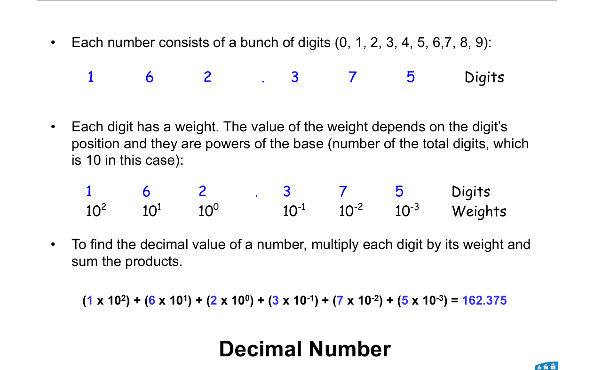
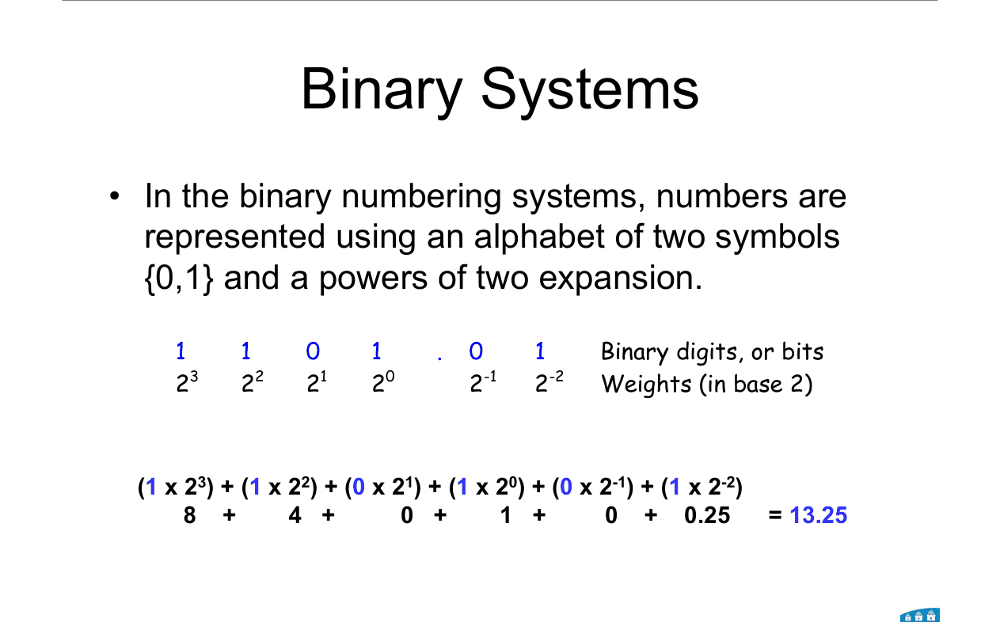
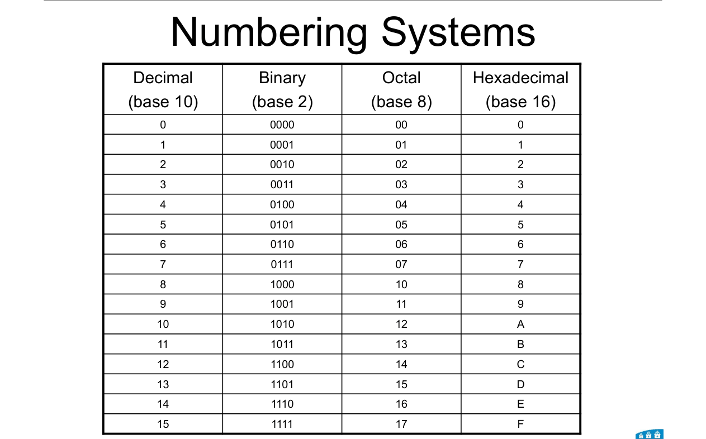
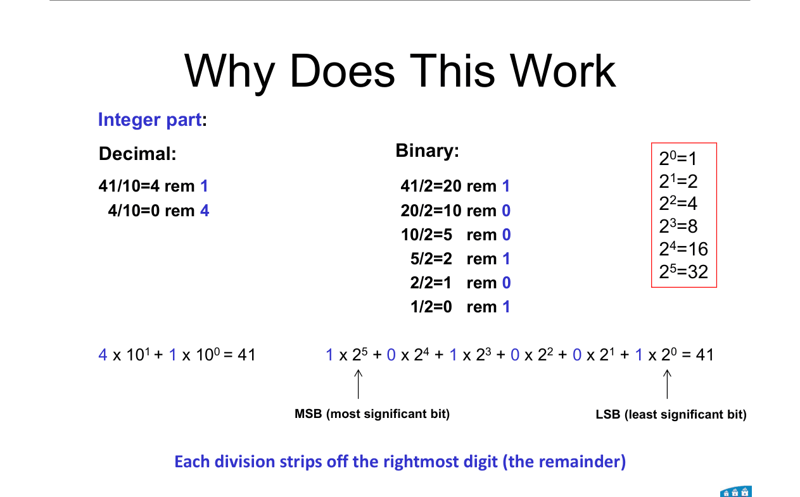
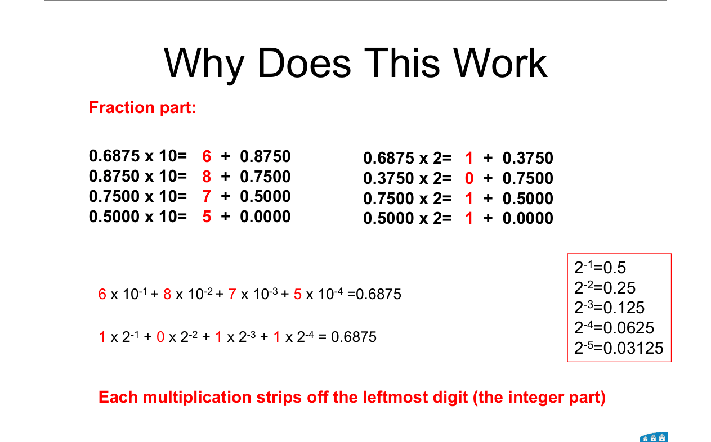
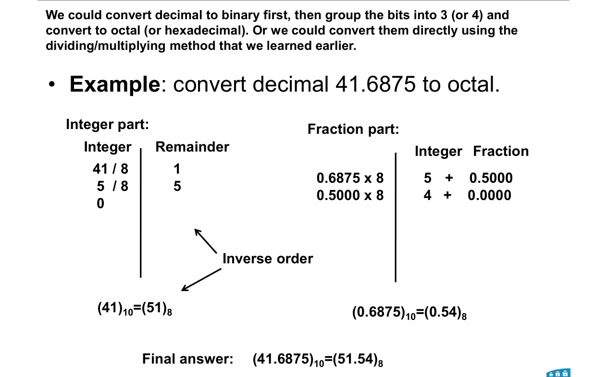
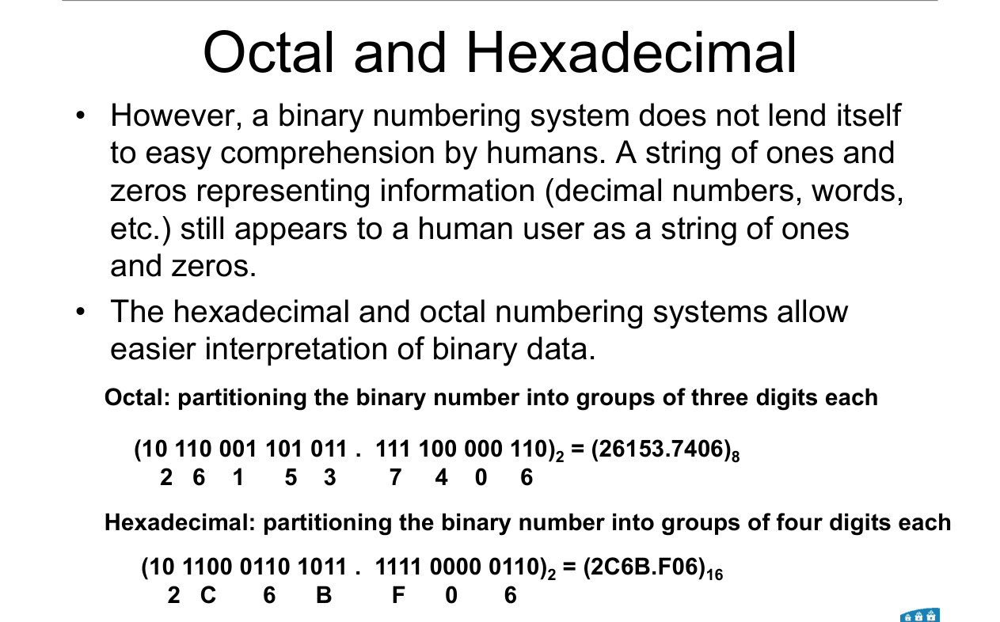
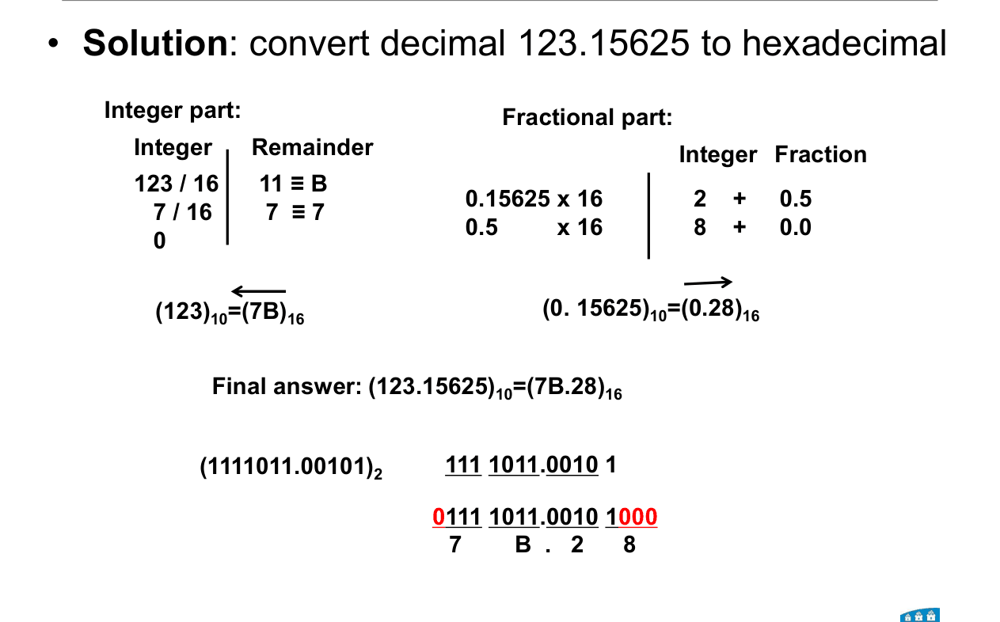

# Topic 2 — Number systems: binary, octal, hex, conversions

Slide exercises: 123.15625 → binary, 123.15625 → hex

Slides: Lecture 2, pages 4 to 18 and 22 to 25

---

## The big idea

A computer is made of switches.

A switch has only two states: open or closed.

So computers count with just two symbols: **0** and **1**.

That's **binary**.

 

Every conversion in this topic is one of two moves:
1. **Divide and multiply** by the base (decimal → anything).
2. **Group bits** (binary → octal or hex).

---

**How to use these notes:**
When you see 🧠, stop.
Answer it on paper first.
Then click to check.

---

## 1. What a number really means

**How to read this diagram:**

Top row: the digits of 162.375.

Middle row: the **weight** of each position. Powers of 10.

Bottom line: multiply each digit by its weight, then add.

 

Positions to the **left** of the point are 0, 1, 2, …

Positions to the **right** are −1, −2, −3, …

This is called a **positional** number system.

---

### 📐 Rule 1: value of a number in base B

$$\text{value} = \sum \text{digit} \times B^{\text{position}}$$

| Symbol | Means |
|---|---|
| B | the **base**: how many symbols there are (10 for decimal, 2 for binary) |
| digit | one symbol of the number |
| position | 0, 1, 2 … left of the point. −1, −2 … right of the point. |

**Why it works:**
Each position is worth B times the one to its right.

**Use it when:**
You need to convert **any base → decimal**.

---

## 2. Binary

Same idea. Base 2. Only the symbols 0 and 1.

Each binary digit is called a **bit**.

 

**Example from the slide:**

1101.01₂ = 8 + 4 + 0 + 1 + 0 + 0.25 = **13.25**

 

**Names:**
- **MSB** = most significant bit. The leftmost one, worth the most.
- **LSB** = least significant bit. The rightmost one.

 

**Learn these by heart:**

| 2⁰ | 2¹ | 2² | 2³ | 2⁴ | 2⁵ | 2⁶ | 2⁷ | 2⁸ |
|---|---|---|---|---|---|---|---|---|
| 1 | 2 | 4 | 8 | 16 | 32 | 64 | 128 | 256 |

| 2⁻¹ | 2⁻² | 2⁻³ | 2⁻⁴ | 2⁻⁵ |
|---|---|---|---|---|
| 0.5 | 0.25 | 0.125 | 0.0625 | 0.03125 |

 

### 🧠 Check
Convert 1011.101₂ to decimal.

Answer

8 + 0 + 2 + 1 + 0.5 + 0 + 0.125

= **11.625**

---

## 3. Octal and hex

Binary is hard for humans to read.

**Octal** (base 8) and **hex** (base 16) are short ways to write binary.

 

**How to read this table:**

Each row is the same number written four ways.

 

**Hex needs 16 symbols**, so after 9 it uses letters:

| A | B | C | D | E | F |
|---|---|---|---|---|---|
| 10 | 11 | 12 | 13 | 14 | 15 |

**Know 0 to 15 in 4-bit binary cold.** For example 1010 = A, 1111 = F.

 

### 🧠 Check
What is 1101 in hex? What is C in binary?

Answer

1101 = 8 + 4 + 1 = 13 = **D**

C = 12 = **1100**

---

## 4. Decimal → binary

**How to read this diagram:**

Left half: the **whole number** part, 41. Divide by 2 again and again.

Right half: the **fraction** part, 0.6875. Multiply by 2 again and again.

The arrows show which way to read the answer.

---

### 📐 Rule 2: decimal → base B

**Step 1.** Split into a whole part and a fraction part.

**Step 2. Whole part:** divide by B. Write down the remainder. Repeat until you reach 0.

Read the remainders **bottom-up**. The last remainder is the MSB.

**Step 3. Fraction part:** multiply by B. Write down the whole-number part. Keep the fraction. Repeat until the fraction is 0.

Read the whole parts **top-down**.

**Step 4.** Join them with a point.

 

**Why it works:**

Each divide strips off the **rightmost** digit, so the first remainder is the LSB.

Each multiply pulls out the **leftmost** fraction digit, so the first one sits right after the point.

**Use it when:**
Converting decimal to binary, octal (B = 8) or hex (B = 16).

**Watch out:**
Some fractions never reach 0. Then stop after the number of bits the question asks for.

---

**Worked example: 41.6875 → binary**

| Whole part | Remainder |
|---|---|
| 41 ÷ 2 = 20 | 1 ← LSB |
| 20 ÷ 2 = 10 | 0 |
| 10 ÷ 2 = 5 | 0 |
| 5 ÷ 2 = 2 | 1 |
| 2 ÷ 2 = 1 | 0 |
| 1 ÷ 2 = 0 | 1 ← MSB |

Read upward: **101001**

 

| Fraction | × 2 | Whole part |
|---|---|---|
| 0.6875 | 1.375 | 1 ← first after point |
| 0.375 | 0.75 | 0 |
| 0.75 | 1.5 | 1 |
| 0.5 | 1.0 | 1 ← fraction is 0, stop |

Read downward: **.1011**

 

41.6875 = **101001.1011₂**

 

### 🧠 Check
Convert 13 to binary.

Answer

13 ÷ 2 = 6 r 1
6 ÷ 2 = 3 r 0
3 ÷ 2 = 1 r 1
1 ÷ 2 = 0 r 1

Read upward: **1101**

---

## 5. Decimal → octal or hex directly

Same Rule 2, with B = 8 or 16.

 

**41.6875 → octal:**

41 ÷ 8 = 5 r **1**. 5 ÷ 8 = 0 r **5**. Read up: **51**.

0.6875 × 8 = 5.5 → **5**. 0.5 × 8 = 4.0 → **4**. Read down: **.54**.

41.6875 = **51.54₈**

 

**For hex, a remainder of 10 to 15 becomes a letter.**

123 ÷ 16 = 7 r 11 → **B**. 7 ÷ 16 = 0 r **7**. Read up: **7B**.

 

### 🧠 Check
Convert 0.15625 to hex.

Answer

0.15625 × 16 = 2.5 → **2**

0.5 × 16 = 8.0 → **8**

Answer: **0.28₁₆**

---

## 6. Binary → octal or hex: grouping

**How to read this diagram:**

Top line: the bits split into groups of **3**. Each group becomes one octal digit.

Bottom line: the same bits in groups of **4**. Each group becomes one hex digit.

---

### 📐 Rule 3: binary → octal or hex

**Step 1.** Start at the point.

**Step 2.** Group bits going **outward** from the point. 3 bits for octal, 4 for hex.

**Step 3.** Pad with zeros at the **outer ends only**.
- Whole part: add zeros on the **left**.
- Fraction part: add zeros on the **right**.

**Step 4.** Swap each group for its digit.

**Why it works:**
8 = 2³ and 16 = 2⁴. So each octal digit is exactly 3 bits, and each hex digit is exactly 4 bits.

**Use it when:**
Going between binary and octal or hex, either way.

**Hex or octal → binary:** do it backwards. Write each digit as 4 (or 3) bits.

---

**Worked example from the slide:**

10110001101011.111100000110₂

Octal: 010 110 001 101 011 . 111 100 000 110 = **26153.7406₈**

Hex: 0010 1100 0110 1011 . 1111 0000 0110 = **2C6B.F06₁₆**

 

**⚠️ The trap: pad the fraction on the RIGHT.**

1111011.00101 → 0111 1011 . 0010 **1**000 = **7B.28**

Not 7B.25. If you pad on the left you get the wrong digit.

 

### 🧠 Check
Convert 1011.1₂ to hex.

Answer

Whole part: 1011 = **B**

Fraction: .1 → pad on the right → .1000 = **8**

Answer: **B.8₁₆**

 

### 🧠 Check
A memory dump shows the byte FF. What is it in binary?

Answer

F = 1111, so FF = **11111111**

One byte = 8 bits = two hex digits.

---

## Method: any conversion question

1. **Into decimal?** Use Rule 1: digit × weight, add up.
2. **Out of decimal?** Use Rule 2: divide the whole part, multiply the fraction.
3. **Between binary and octal or hex?** Use Rule 3: group outward from the point.
4. **Between octal and hex?** Go through binary.
5. **Check** your answer by converting back to decimal.

---

Next: [End-of-topic test](../questions/02-number-systems.md)
