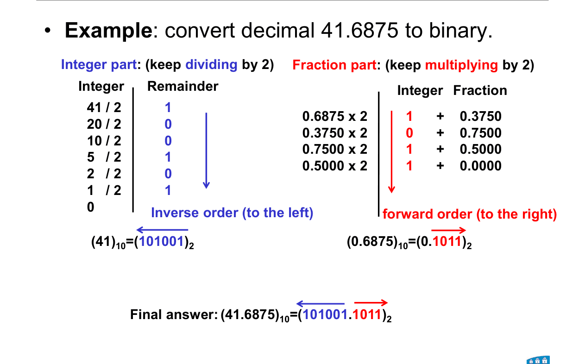

# 02 · Number systems

Lecture 2, slides 4–18 and 22–25 · ●●● · [**Quiz →**](https://albinjoby82-ops.github.io/DE_Lock-In/quiz.html?t=02)

Every question here is one of three moves: **weights** (into decimal), **divide / multiply** (out of decimal), **group bits** (binary ↔ octal / hex).

---

## 1. Into decimal: add the weights

**Rule:** each place is worth baseposition. Left of the point: 0, 1, 2 … Right: −1, −2 …

| 2⁷ | 2⁶ | 2⁵ | 2⁴ | 2³ | 2² | 2¹ | 2⁰ | . | 2⁻¹ | 2⁻² | 2⁻³ |
|---|---|---|---|---|---|---|---|---|---|---|---|
| 128 | 64 | 32 | 16 | 8 | 4 | 2 | 1 | . | 0.5 | 0.25 | 0.125 |

> **Apply:** 1011.101₂ = ?

Answer

8 + 2 + 1 + 0.5 + 0.125 = **11.625**

> **Apply:** 2F₁₆ = ? (F = 15)

Answer

2 × 16 + 15 = **47**

---

## 2. Out of decimal: divide the whole part, multiply the fraction

**Rule:**
- Whole part: divide by the base, keep remainders, read them **upward** (last one = MSB).
- Fraction: multiply by the base, keep the whole-number parts, read them **downward**.

| 41 ÷ 2 | rem | | 0.6875 × 2 | bit |
|---|---|---|---|---|
| 20 | 1 ↑ LSB | | 1.375 | 1 ↓ first |
| 10 | 0 | | 0.75 | 0 |
| 5 | 0 | | 1.5 | 1 |
| 2 | 1 | | 1.0 | 1 stop |
| 1 | 0 | | | |
| 0 | 1 MSB | | | |

41.6875 = **101001.1011₂**

> **Apply:** 25 → binary.

Answer

25→12 r1, 12→6 r0, 6→3 r0, 3→1 r1, 1→0 r1. Read up: **11001**.

> **Apply:** 123 → hex. (Remainders 10–15 become A–F.)

Answer

123 ÷ 16 = 7 r **11 = B**, 7 ÷ 16 = 0 r **7**. Read up: **7B₁₆**.

> **Apply:** 0.15625 → hex.

Answer

0.15625 × 16 = 2.5 → **2**, 0.5 × 16 = 8.0 → **8**. Answer **0.28₁₆**.

---

## 3. Binary ↔ octal / hex: group outward from the point

**Rule:** groups of **3** (octal) or **4** (hex), starting at the point and going **outward**. Pad zeros only at the **outer ends**.

**Trap:** the fraction pads on the **right**. `.00101` → `.0010 1000` = **.28**, not .25.

Hex digits: A=10, B=11, C=12, D=13, E=14, F=15. Know 0–F as 4 bits cold.

> **Apply:** 1011.1₂ → hex.

Answer

1011 = **B**. Fraction `.1` → `.1000` = **8**. Answer **B.8₁₆**.

> **Apply:** 3A₁₆ → binary, then → octal.

Answer

3 = 0011, A = 1010 → **111010₂**. Group in 3s: 111 010 → **72₈**.

---

## Exam drill (the slide exercise)

**Convert 123.15625 to binary and to hex.**

Answer

123 → 1111011 (from 64+32+16+8+2+1).
0.15625 × 2: 0.3125 → 0, 0.625 → 0, 1.25 → 1, 0.5 → 0, 1.0 → 1. So .00101.

**1111011.00101₂**

Hex by grouping (diagram above): **7B.28₁₆**. Check: 7×16 + 11 = 123 ✓, 2/16 + 8/256 = 0.15625 ✓

**Traps**
- Remainders read **up**, fraction bits read **down**.
- Pad the fraction on the **right**.
- Octal ↔ hex: go through binary.
- Always check by converting back.
