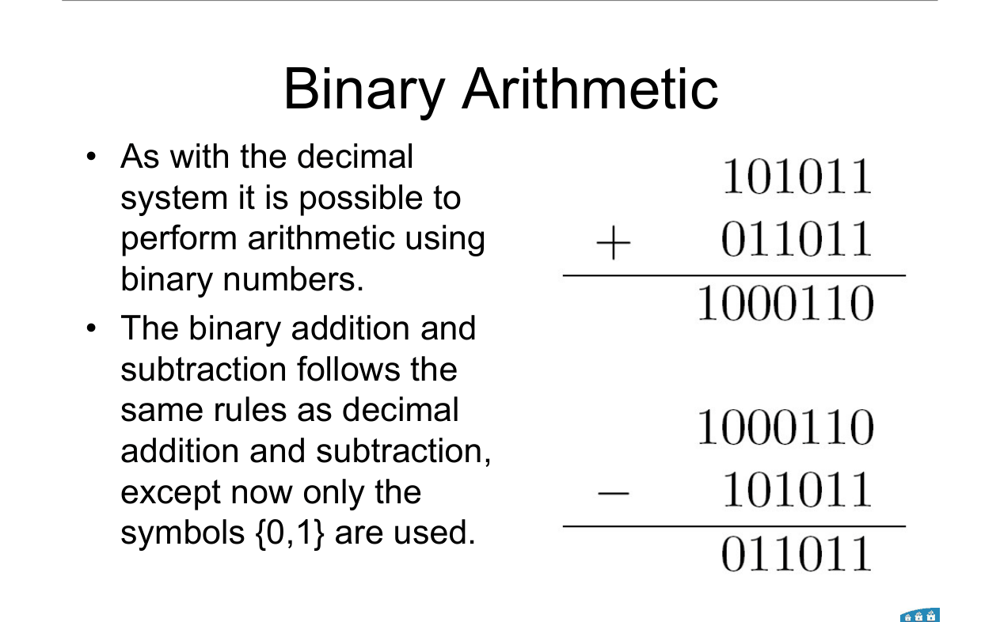
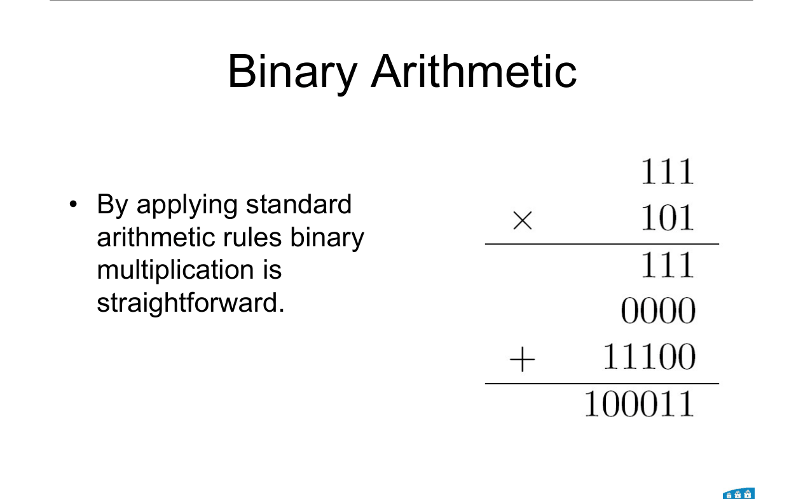
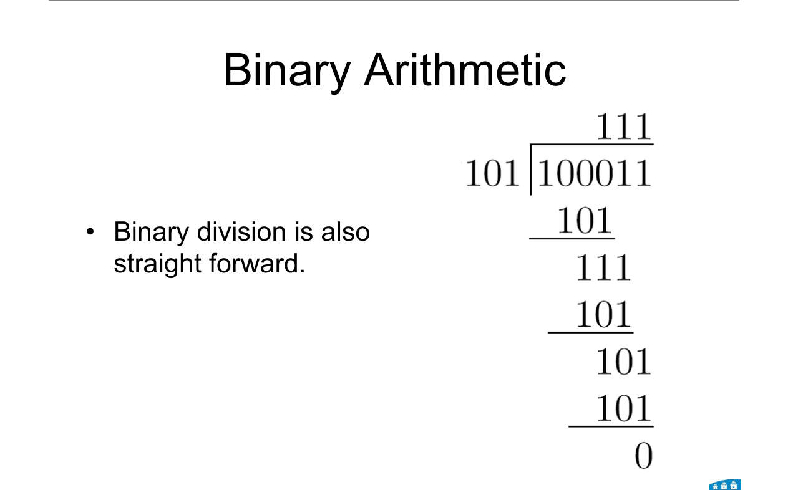

# Topic 3 — Binary arithmetic: + − × ÷

Slide exercises: add, subtract and multiply 111 and 101. Divide 10010001 by 1011.

Slides: Lecture 2, pages 19 to 21 and 26 to 29

---

## The big idea

Binary sums work just like decimal sums.

The only difference: you carry when you reach **2**, not 10.

<br>

Why it matters later:
- Topic 4 uses binary addition for negative numbers.
- Topic 10 builds circuits that do these sums.

---

**How to use these notes:**
When you see 🧠, stop.
Answer it on paper first.
Then click to check.

---

## 1. Addition



**How to read this diagram:**

Top: 101011 + 011011 = 1000110.

Bottom: the same numbers subtracted back. 1000110 − 101011 = 011011.

---

### 📐 Rule 1: adding bits

| Sum | Write | Carry |
|---|---|---|
| 0 + 0 | 0 | 0 |
| 0 + 1 | 1 | 0 |
| 1 + 1 | 0 | 1 |
| 1 + 1 + 1 (with a carry in) | 1 | 1 |

**Why it works:**
1 + 1 = 2, and 2 in binary is **10**. So write 0 and carry 1.

1 + 1 + 1 = 3 = **11**. So write 1 and carry 1.

**Use it when:**
Adding any binary numbers. Work from right to left, like in decimal.

---

**Worked example: 111 + 101**

```
  carries  1 1 1
             1 1 1
         +   1 0 1
         ---------
           1 1 0 0
```

Right column: 1 + 1 = 10 → write 0, carry 1.

Middle: 1 + 0 + 1 = 10 → write 0, carry 1.

Left: 1 + 1 + 1 = 11 → write 1, carry 1.

Answer: **1100** (7 + 5 = 12 ✓)

<br>

### 🧠 Check
Add 1011 + 0110.

<details><summary>Answer</summary>

1 + 0 = 1
1 + 1 = 10 → 0, carry 1
0 + 1 + 1 = 10 → 0, carry 1
1 + 0 + 1 = 10 → 0, carry 1

Answer: **10001** (11 + 6 = 17 ✓)

</details>

---

## 2. Subtraction

---

### 📐 Rule 2: subtracting bits

| Difference | Write | Borrow |
|---|---|---|
| 0 − 0 | 0 | 0 |
| 1 − 0 | 1 | 0 |
| 1 − 1 | 0 | 0 |
| 0 − 1 | 1 | 1 |

**Why 0 − 1 = 1 with a borrow:**
You borrow 2 from the next column. 2 − 1 = 1.

**Use it when:**
Subtracting by hand.

**Note:** circuits don't usually subtract like this. They add a negative number instead (Topic 4 and Topic 10).

---

**Worked example: 111 − 101**

```
    1 1 1
  − 1 0 1
  -------
    0 1 0
```

No borrows needed. Answer: **010** (7 − 5 = 2 ✓)

<br>

### 🧠 Check
Subtract 1000 − 0011.

<details><summary>Answer</summary>

Right column: 0 − 1 → borrow. Keep borrowing left until you hit the 1.

1000 − 0011 = **0101** (8 − 3 = 5 ✓)

</details>

---

## 3. Multiplication



**How to read this diagram:**

111 × 101.

Each row is 111 times one bit of 101, shifted left to that bit's place.

Then add the rows.

---

### 📐 Rule 3: shift and add

**Step 1.** For each **1** in the multiplier, write the multiplicand, shifted left to that bit's position.

**Step 2.** For each **0**, write a row of zeros (or skip it).

**Step 3.** Add all the rows.

**Why it works:**
Multiplying by a bit is easy: × 1 copies the number, × 0 gives 0.

The shift is multiplying by 2, 4, 8 … for each place.

**Use it when:**
Multiplying by hand. Topic 10 builds this as a circuit.

---

**Worked example: 111 × 101**

```
        1 1 1
      × 1 0 1
      -------
        1 1 1     ← 111 × 1
      0 0 0       ← 111 × 0, shifted 1
  + 1 1 1         ← 111 × 1, shifted 2
  -----------
    1 0 0 0 1 1
```

Answer: **100011** (7 × 5 = 35 ✓)

<br>

### 🧠 Check
Multiply 11 × 11.

<details><summary>Answer</summary>

```
      1 1
    × 1 1
    -----
      1 1
  + 1 1
  -------
  1 0 0 1
```

**1001** (3 × 3 = 9 ✓)

</details>

---

## 4. Division



**How to read this diagram:**

101 goes into 100011.

Same long division as decimal. The answer, 111, is on top.

---

### 📐 Rule 4: long division

**Step 1.** Bring down bits until the divisor fits (part ≥ divisor).

**Step 2.** Write **1** in the answer. Subtract the divisor.

**Step 3.** Bring down the next bit. If the divisor doesn't fit, write **0**.

**Step 4.** Repeat. What's left at the end is the remainder.

**Why it's easier than decimal:**
The divisor either fits once (1) or not at all (0). No guessing.

---

**Worked example: 10010001 ÷ 1011**


| Bring down | Fits 1011? | Answer bit | Left over |
|---|---|---|---|
| 10010 | yes | 1 | 10010 − 1011 = 111 |
| 1110 | yes | 1 | 1110 − 1011 = 11 |
| 110 | no | 0 | 110 |
| 1101 | yes | 1 | 1101 − 1011 = **10** |

Answer: **1101 remainder 10**

Check: 145 ÷ 11 = 13 remainder 2 ✓

<br>

### 🧠 Check
In binary division, the divisor can only fit into the current part how many times?

<details><summary>Answer</summary>

**0 or 1 times.** So every answer bit is just "does it fit?"

</details>

---

## 5. Shifting

Shifting left one place = **× 2**. Like adding a 0 in decimal multiplies by 10.

Shifting right one place = **÷ 2**.

| Binary | Decimal |
|---|---|
| 11 | 3 |
| 110 (shift left 1) | 6 |
| 1100 (shift left 2) | 12 |

(More on this in Topic 10, §8.)

---

## Method: any arithmetic question

1. **Line up** the bits on the right.
2. **Use the rules:** carry at 2, borrow 2, shift-and-add, or "does it fit?"
3. **Always check** by converting to decimal. It takes 10 seconds and catches most mistakes.

---

Next: [End-of-topic test](../questions/03-binary-arithmetic.md)
