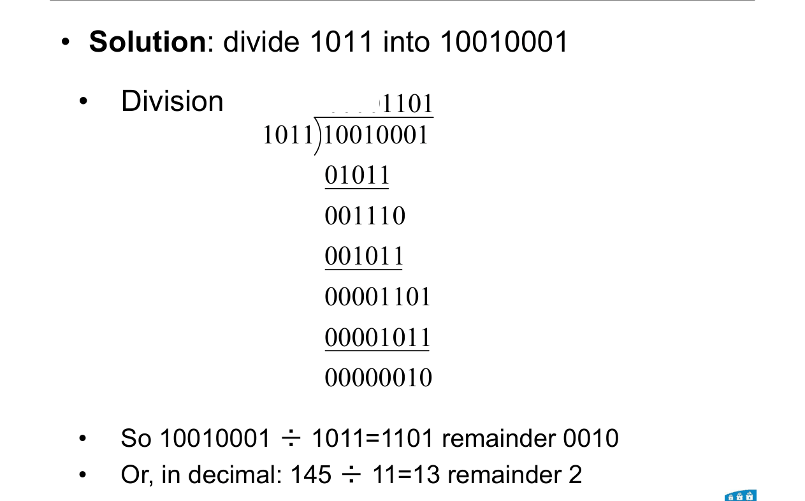

# 03 · Binary arithmetic

Lecture 2, slides 19–21 and 26–29 · ●● · [**Quiz →**](https://albinjoby82-ops.github.io/DE_Lock-In/quiz.html?t=03)

Same as decimal sums, but you carry at **2**, not 10. Always check in decimal.

---

## 1. Add

**Rule:** 1 + 1 = **10** (write 0, carry 1). 1 + 1 + 1 = **11** (write 1, carry 1).

```
  carries  1 1 1
             1 1 1      (7)
         +   1 0 1      (5)
         ---------
           1 1 0 0      (12) ✓
```

> **Apply:** 1011 + 0110
<details><summary>Answer</summary>

Right to left: 1+0=1; 1+1=10 → 0 c1; 0+1+1=10 → 0 c1; 1+0+1=10 → 0 c1. **10001** (11 + 6 = 17 ✓)

</details>

---

## 2. Subtract

**Rule:** 0 − 1 = **1, borrow 1** (you borrow 2 from the next column: 2 − 1 = 1).

Circuits don't do this. They add a negative number instead (Topics 4 and 10).

> **Apply:** 1000 − 0011
<details><summary>Answer</summary>

Borrow ripples left to the 1: **0101** (8 − 3 = 5 ✓)

</details>

---

## 3. Multiply: shift and add

**Rule:** for each **1** in the multiplier, write the multiplicand shifted to that place. Add the rows.

```
        1 1 1      (7)
      × 1 0 1      (5)
      -------
        1 1 1      ← × 1
      0 0 0        ← × 0, shifted 1
  + 1 1 1          ← × 1, shifted 2
  -----------
    1 0 0 0 1 1    (35) ✓
```

Shift left 1 place = × 2. Shift right 1 place = ÷ 2.

> **Apply:** 110 × 11
<details><summary>Answer</summary>

110 + 1100 = **10010** (6 × 3 = 18 ✓)

</details>

---

## 4. Divide: does it fit? (0 or 1)

**Rule:** bring down bits until the divisor fits → write **1** and subtract. If it doesn't fit → write **0**. What's left is the remainder.



| Part | Fits 1011? | Bit | Left over |
|---|---|---|---|
| 10010 | yes | 1 | 111 |
| 1110 | yes | 1 | 11 |
| 110 | no | 0 | 110 |
| 1101 | yes | 1 | **10** |

**1101 r 10** (145 ÷ 11 = 13 r 2 ✓)

> **Apply:** 100011 ÷ 101
<details><summary>Answer</summary>

**111 r 0** (35 ÷ 5 = 7 ✓)

</details>

---

## Exam drill (slide exercises)

**Add, subtract and multiply 111 and 101. Divide 10010001 by 1011.**

<details><summary>Answer</summary>

111 + 101 = **1100** · 111 − 101 = **010** · 111 × 101 = **100011** · 10010001 ÷ 1011 = **1101 r 10**

</details>

**Traps**
- Line the bits up on the **right**.
- 1 + 1 + 1 = 11, not 10.
- Check every answer in decimal. It takes 10 seconds.
