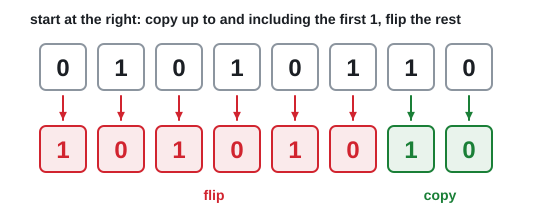
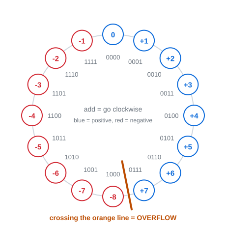

# 04 · Signed numbers and overflow

Lecture 3, slides 4–19 · ●●● · [**Quiz →**](https://albinjoby82-ops.github.io/DE_Lock-In/quiz.html?t=04)

**▶ Explainer videos** (tap to search YouTube):
- [two's complement explained](https://www.youtube.com/results?search_query=two%27s+complement+explained)
- [signed magnitude vs one's complement vs two's complement](https://www.youtube.com/results?search_query=signed+magnitude+vs+one%27s+complement+vs+two%27s+complement)
- [two's complement addition and subtraction](https://www.youtube.com/results?search_query=two%27s+complement+addition+and+subtraction)
- [overflow in two's complement](https://www.youtube.com/results?search_query=overflow+in+two%27s+complement)

---

## 0. The problem this topic solves

A computer stores a number in a **fixed number of bits**, say 4. That gives exactly 16 patterns, `0000` to `1111`. Read as plain binary, they mean **0 to 15**.

But we also need **negative** numbers, like −5. And a circuit has **no minus sign**, only bits.

So we have to **agree** which of the 16 patterns mean negative numbers. There are three ways to agree, and that's all this topic is:

| System | How it makes −5 from +5 (`0101`) |
|---|---|
| Signed magnitude | change the first bit only → `1101` |
| 1's complement | flip every bit → `1010` |
| 2's complement | flip every bit, then add 1 → `1011` |

All three follow two rules:
- **Positive numbers are plain binary**, padded with 0s to fill the bits. +5 is `0101` in all three.
- **The first bit is the sign:** 0 means positive, 1 means negative.

Here are all 16 four-bit patterns and what each system says they mean:

| Bits | Plain binary | Signed magnitude | 1's complement | 2's complement |
|---|---|---|---|---|
| 0000 | 0 | 0 | 0 | 0 |
| 0001 | 1 | 1 | 1 | 1 |
| 0010 | 2 | 2 | 2 | 2 |
| 0011 | 3 | 3 | 3 | 3 |
| 0100 | 4 | 4 | 4 | 4 |
| 0101 | 5 | 5 | 5 | 5 |
| 0110 | 6 | 6 | 6 | 6 |
| 0111 | 7 | 7 | 7 | 7 |
| **1000** | 8 | **−0** | −7 | **−8** |
| 1001 | 9 | −1 | −6 | −7 |
| 1010 | 10 | −2 | −5 | −6 |
| 1011 | 11 | −3 | −4 | **−5** |
| 1100 | 12 | −4 | −3 | −4 |
| 1101 | 13 | **−5** | −2 | −3 |
| 1110 | 14 | −6 | −1 | −2 |
| **1111** | 15 | −7 | **−0** | **−1** |

Look at the top half: positives are the **same** in every system. Only the bottom half (first bit 1) changes. So the **same bits can mean different numbers**. The question always tells you which system to use.

The exam asks four kinds of question:
1. Write a negative number in a given system (sections 1–3).
2. Read a bit pattern as a number (section 4).
3. Add or subtract (section 6).
4. Spot overflow (section 7).

---

## 1. Signed magnitude: a sign bit stuck on the front

**Idea:** first bit = sign, the rest = the size (plain binary). It's how you'd write −5 on paper.

**To make a number negative: change the first bit from 0 to 1.**

| | Sign | Size | 4 bits |
|---|---|---|---|
| +5 | 0 | 101 | `0101` |
| −5 | **1** | 101 | `1101` |

**Why it isn't used much:**
- It has **two zeros**: `0000` (+0) and `1000` (−0).
- Normal adding gives the wrong answer: 5 + (−5) = `0101 + 1101` = `1 0010` → `0010` = 2, not 0. A circuit would need extra logic to subtract instead.

> **Apply:** −3 in 4-bit signed magnitude.

Answer

+3 = `0011`. Change the first bit → **`1011`**.

---

## 2. 1's complement: flip every bit

**To make a number negative: flip every bit** (every 0 becomes 1, every 1 becomes 0).

| | 4 bits |
|---|---|
| +5 | `0101` |
| −5 | `1010` |

**Still not perfect:**
- **Two zeros again**: `0000` and `1111` (−0).
- Adding nearly works, but needs a fix-up step called the end-around carry (section 6).

> **Apply:** −3 in 4-bit 1's complement.

Answer

+3 = `0011`. Flip every bit → **`1100`**.

---

## 3. 2's complement ⭐ the one computers actually use

**To make a number negative: flip every bit, then add 1.**

| Step | 4 bits |
|---|---|
| +5 | `0101` |
| flip every bit | `1010` |
| add 1 | **`1011`** = −5 |

**Why this one wins:** normal adding just works. Watch 5 + (−5):

`0101 + 1011` = `1 0000` → the 5th bit doesn't fit in 4 bits, so drop it → **`0000`** = 0 ✓

There's also only **one zero**, so the spare pattern `1000` becomes an extra number: **−8**.

**Another way to see it:** in 2's complement, the first bit is worth a **negative** amount. In 4 bits it's worth **−8** instead of +8:

| −8 | 4 | 2 | 1 | Value |
|---|---|---|---|---|
| 1 | 0 | 1 | 1 | −8 + 2 + 1 = **−5** |
| 1 | 1 | 1 | 1 | −8 + 4 + 2 + 1 = **−1** |
| 0 | 1 | 1 | 1 | 4 + 2 + 1 = **+7** |

In 8 bits, the first bit is worth −128.

**Quick way to do flip + 1:** start at the right. **Copy** every bit up to and including the first 1. **Flip** everything to the left of it. It gives the same answer, with no adding.

Worked: **−20 in 8 bits.** +20 = `00010100`. Copy `100` (up to the first 1), flip `00010` → `11101`. Answer **`11101100`**.
Check with the −128 weight: −128 + 64 + 32 + 8 + 4 = −20 ✓

> **Apply:** −6 in 4-bit signed magnitude, 1's complement and 2's complement.

Answer

+6 = `0110`. Signed magnitude **`1110`**. 1's complement **`1001`**. 2's complement **`1010`** (flip → 1001, +1 → 1010).

> **Apply:** 2's complement of `00101000`.

Answer

Copy `1000`, flip `0010` → `1101`. **`11011000`**.

---

## 4. Reading a bit pattern (any system)

**Step 1:** first bit 0? It's positive. Read it as plain binary and you're done.

**Step 2:** first bit 1? It's negative. Undo it with **the same system's rule** to get the size. Then put a minus in front.

| System | To undo it |
|---|---|
| Signed magnitude | ignore the first bit, read the rest |
| 1's complement | flip every bit |
| 2's complement | flip every bit, add 1 (or use the −8 / −128 weight) |

Worked: **`110101` (6 bits)**
- As 1's complement: flip → `001010` = 10 → **−10**
- As 2's complement: flip + 1 → `001011` = 11 → **−11**. Check with the weight: −32 + 16 + 4 + 1 = −11 ✓

> **Apply:** what is `1110` in 4-bit 2's complement? And `1000`?

Answer

`1110` = −8 + 4 + 2 = **−2**.
`1000` = **−8** (the extra number 2's complement gets).

---

## 5. Ranges: biggest and smallest

With n bits (sign bit included):

| System | Range | 4 bits | 8 bits | Zeros |
|---|---|---|---|---|
| Plain binary (no negatives) | 0 to 2ⁿ − 1 | 0 to 15 | 0 to 255 | one |
| Signed magnitude, 1's | −(2ⁿ⁻¹ − 1) to +(2ⁿ⁻¹ − 1) | −7 to +7 | −127 to +127 | **two** |
| 2's complement | **−2ⁿ⁻¹** to +(2ⁿ⁻¹ − 1) | **−8** to +7 | **−128** to +127 | one |

2's complement reaches one further on the negative side, because it doesn't waste a pattern on −0.

> **Apply:** range of 6-bit 2's complement?

Answer

−2⁵ to 2⁵ − 1 = **−32 to +31**.

---

## 6. Adding and subtracting

**Subtracting is adding a negative:** A − B = A + (−B). Make −B, then add.

**Add the bits normally** (topic 03). Then deal with any carry that falls off the left end:
- **2's complement:** **throw it away.**
- **1's complement:** **add it back** onto the result (the end-around carry).

Worked: **−2 + 7** in 4 bits

| | 1's complement | 2's complement |
|---|---|---|
| −2 | `1101` | `1110` |
| +7 | `0111` | `0111` |
| add | **1** `0100` | **1** `0101` |
| carry out | add it back: `0100` + 1 | throw it away |
| answer | **`0101`** = +5 ✓ | **`0101`** = +5 ✓ |

> **Apply:** 5 − 3 in 4-bit 2's complement.

Answer

−3 = `1101`. `0101 + 1101` = **1** `0010` → drop the carry → **`0010`** = +2 ✓

---

## 7. Overflow: the answer doesn't fit

4-bit 2's complement only goes from −8 to +7. If the real answer is outside that, the bits roll round to the other end and give a **wrong** answer. That's **overflow**.

Think of it as a clock: adding walks clockwise. Crossing the line between +7 and −8 is overflow.

**How to spot it: only look at the sign bits.**
- Two **positives** give a **negative** → overflow.
- Two **negatives** give a **positive** → overflow.
- A positive plus a negative → **never** overflows (the answer lands between them, so it fits).

Worked: **4 + 5** = `0100 + 0101` = `1001`. Two positives gave a negative (−7) → **overflow**. The real answer, +9, is bigger than +7.

**Trap:** a carry out of the left end is **not** overflow. −2 + 7 above had a carry out and the answer was right.

> **Apply:** 4-bit 2's complement. Does 6 + 3 overflow? Does −4 + −5?

Answer

6 + 3: `0110 + 0011` = `1001` → two positives gave a negative → **overflow**.
−4 + −5: `1100 + 1011` = **1** `0111` → drop the carry → `0111` = +7. Two negatives gave a positive → **overflow**.

---

## Exam drill (slide exercises)

**1.** 2's complement of `01010110`. **2.** Read `110101` as 1's and as 2's complement.

Answer

1. Copy `10`, flip `010101` → **`10101010`**.
2. 1's: **−10**. 2's: **−11**.

**Traps**
- Pad positives with 0s to the full number of bits **before** you negate.
- Same bits, different system, different number. Read which system the question says.
- 1's complement: add the carry back. 2's complement: throw it away.
- Overflow is about the **sign bits**, not the carry out.

---

## Test yourself

**▶ [Topic 04 quiz](https://albinjoby82-ops.github.io/DE_Lock-In/quiz.html?t=04)** (answers checked as you go, **New numbers** for fresh practice)  
[Mixed quiz: topics 03 + 04](https://albinjoby82-ops.github.io/DE_Lock-In/quiz.html?mix=03,04&n=15)  
[All quizzes](https://albinjoby82-ops.github.io/DE_Lock-In/)

Next: [05 · Binary codes](05-binary-codes.md)
