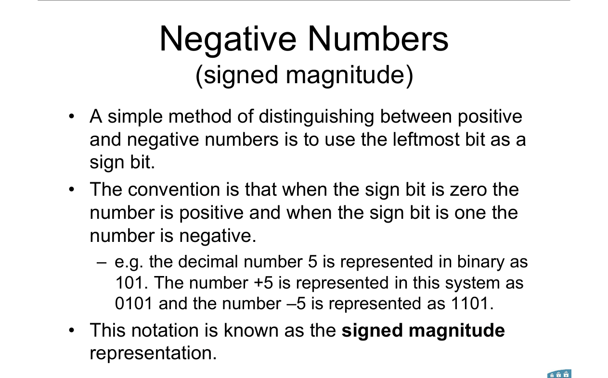
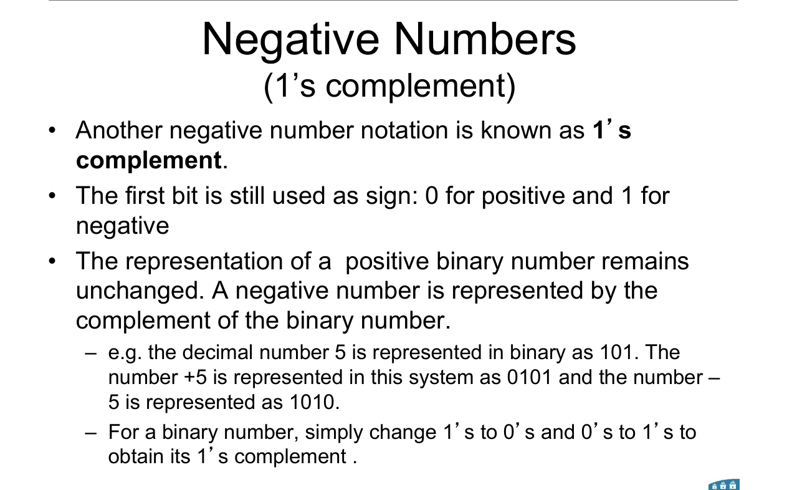
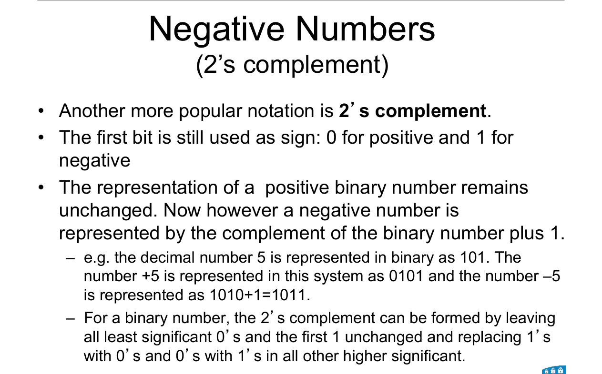
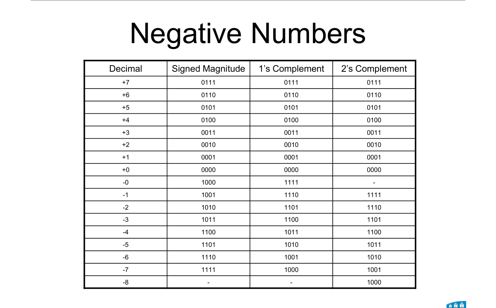
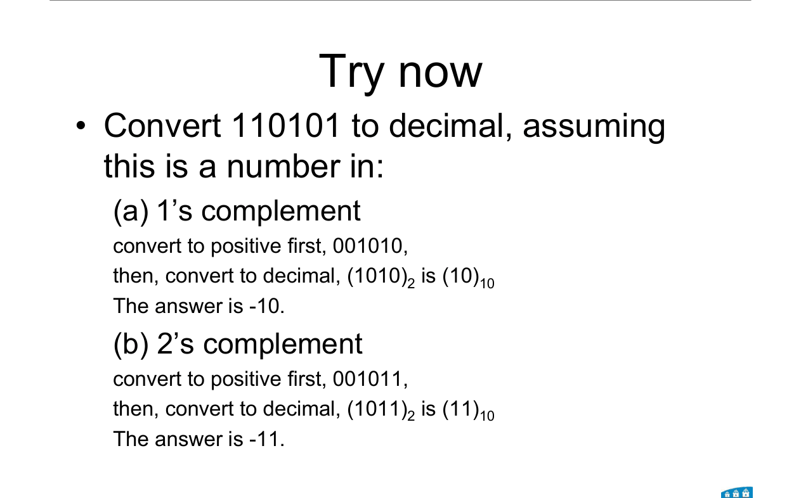
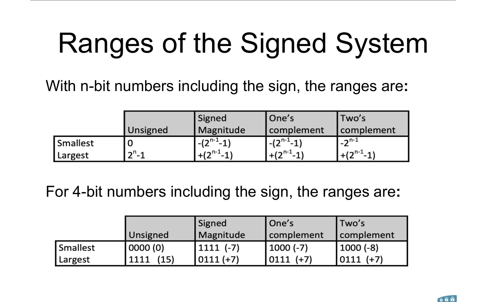
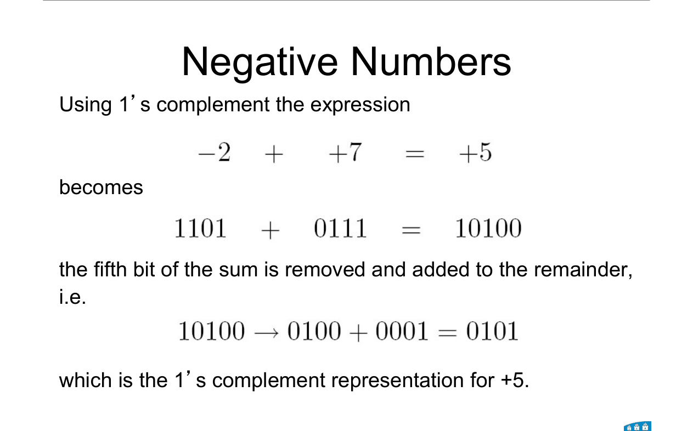
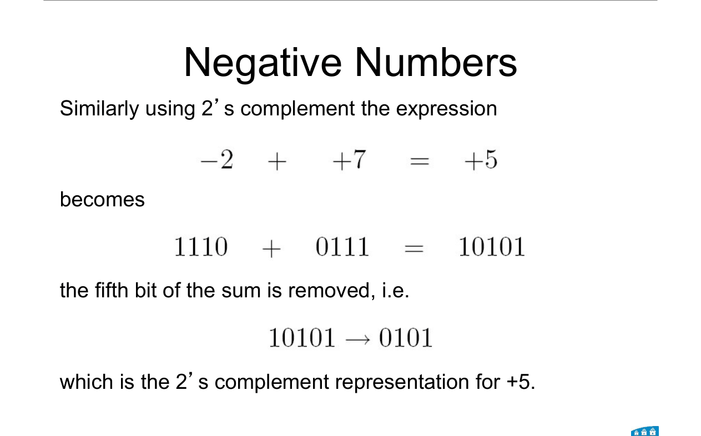
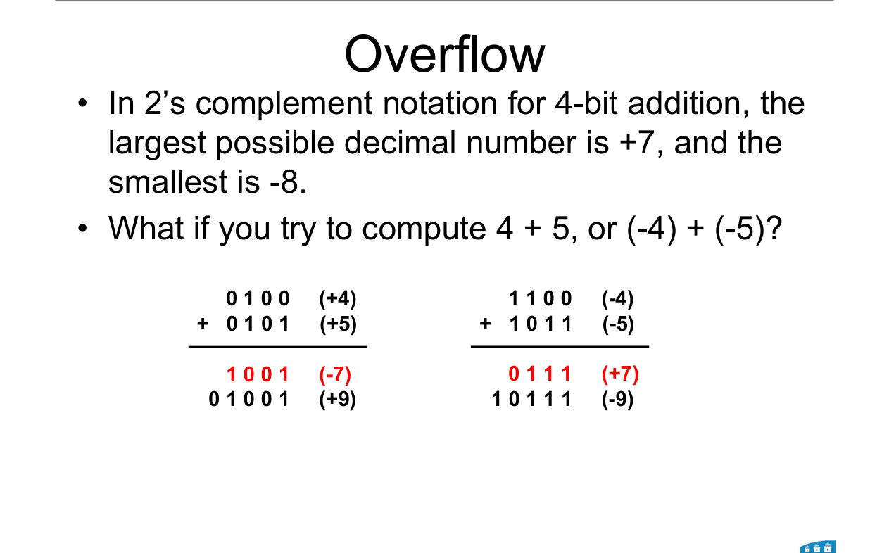
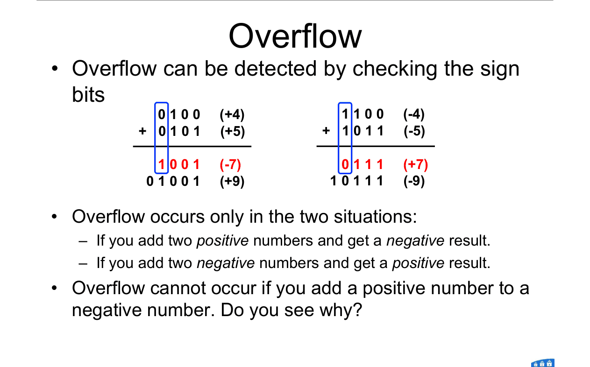

# Topic 4 — Negative numbers, ranges, overflow

Slide exercises: 2's complement of 01010110. Read 110101 as 1's and 2's complement.

Slides: Lecture 3, pages 4 to 19

---

## The big idea

A computer only has 0 and 1. It has no "−" sign.

So we use the **leftmost bit as the sign**:
- **0** = positive
- **1** = negative

<br>

There are three ways to do this.

They all write **positive numbers the same**.

They only differ in how they make a **negative** number.

---

**How to use these notes:**
When you see 🧠, stop.
Answer it on paper first.
Then click to check.

---

## 1. Signed magnitude



The simplest one.

Sign bit + the normal binary number.

To make it negative: **flip the sign bit only.**

<br>

| | 4-bit |
|---|---|
| +5 | **0**101 |
| −5 | **1**101 |

<br>

### 🧠 Check
Write −3 in 4-bit signed magnitude.

<details><summary>Answer</summary>

+3 = 0011. Flip the sign bit: **1011**.

</details>

---

## 2. 1's complement



To make it negative: **flip every bit.**

<br>

| | 4-bit |
|---|---|
| +5 | 0101 |
| −5 | 1010 |

<br>

### 🧠 Check
Write −3 in 4-bit 1's complement.

<details><summary>Answer</summary>

+3 = 0011. Flip every bit: **1100**.

</details>

---

## 3. 2's complement ⭐ the one computers use



To make it negative: **flip every bit, then add 1.**

<br>

| | 4-bit |
|---|---|
| +5 | 0101 |
| flip | 1010 |
| add 1 | **1011** = −5 |

---

### 📐 Rule 1: the 2's complement shortcut

**Start from the right.**

**Copy every 0, and the first 1, unchanged.**

**Flip everything to the left of that 1.**

<br>

Example: 0101**0110** → find the first 1 from the right.

```
  0 1 0 1 0 1 1 0
                ^  copy the 0
              ^    copy the first 1
  ← flip all of these
  1 0 1 0 1 0 1 0
```

01010110 → **10101010**

**Why it works:**
Flipping then adding 1 makes a carry ripple through the trailing 1s and stop at the first 0. The result is the same as the shortcut.

**Use it when:**
You need a 2's complement fast. It gives the same answer as flip + 1, with no adding.

---

<br>

### 🧠 Check
Write −3 in 4-bit 2's complement. Use the shortcut.

<details><summary>Answer</summary>

+3 = 0011.

From the right: the first bit is already a 1. Copy it.

Flip the other three: 001 → 110.

Answer: **1101**.

(Check with flip + 1: 1100 + 1 = 1101 ✓)

</details>

---

## 4. All three side by side



**How to read this table:**

Each row is one decimal number from +7 down to −8.

The three right columns show how each system writes it in 4 bits.

<br>

**Things to notice:**
- The top half (positives) is the **same** in all three.
- Signed magnitude and 1's complement have **two zeros**: +0 and −0.
- 2's complement has **one zero**, so it fits one extra number: **−8**.

---

## 5. Reading a negative number



---

### 📐 Rule 2: negative binary → decimal

**Step 1.** Is the sign bit 1? Then it's negative.

**Step 2.** Negate it with the **same rule** you'd use to make it negative. This gives the positive version.

**Step 3.** Convert that to decimal.

**Step 4.** Put a minus sign in front.

**Why it works:**
Negating twice gets you back where you started.

**Use it when:**
You're given a bit pattern and told which system it uses.

---

**Worked example: 110101**

As **1's complement:** flip → 001010 = 10. So **−10**.

As **2's complement:** flip and add 1 → 001011 = 11. So **−11**.

Same bits, different answer. **Always check which system the question says.**

<br>

### 🧠 Check
What is 1110 in 4-bit 2's complement?

<details><summary>Answer</summary>

Sign bit is 1, so it's negative.

Shortcut: copy "10", flip "11" → 0010 = 2.

Answer: **−2**.

</details>

---

## 6. Ranges



---

### 📐 Rule 3: n-bit ranges

| System | Smallest | Largest | 4-bit |
|---|---|---|---|
| Unsigned | 0 | 2ⁿ − 1 | 0 to 15 |
| Signed magnitude | −(2ⁿ⁻¹ − 1) | +(2ⁿ⁻¹ − 1) | −7 to +7 |
| 1's complement | −(2ⁿ⁻¹ − 1) | +(2ⁿ⁻¹ − 1) | −7 to +7 |
| 2's complement | **−2ⁿ⁻¹** | +(2ⁿ⁻¹ − 1) | **−8** to +7 |

| Symbol | Means |
|---|---|
| n | number of bits, **including** the sign bit |

**Why 2's complement goes one further:**
It doesn't waste a pattern on −0. So 1000 is free to mean −8.

**Use it when:**
"What is the range of an 8-bit 2's complement number?" and overflow questions.

---

<br>

### 🧠 Check
What is the range of 8-bit 2's complement?

<details><summary>Answer</summary>

−2⁷ to 2⁷ − 1 = **−128 to +127**

</details>

---

## 7. Why complements? Adding with signs

With signed magnitude, adding needs extra logic to decide: add or subtract?

With complements, you just **add**. The sign takes care of itself.

That's why computers use complements.

---

### 📐 Rule 4: adding signed numbers

**1's complement:**
Add normally. If a carry comes out of the left end, **remove it and add 1** to the result. This is called the **end-around carry**.

**2's complement:**
Add normally. If a carry comes out of the left end, **just throw it away**.

**Use it when:**
Adding (or subtracting) signed numbers.

**Subtracting:** A − B = A + (−B). Make B negative, then add.

---

**Worked example: −2 + 7 = +5** (from the slides)

**1's complement:**



1101 + 0111 = **1** 0100

Remove the carry and add it back: 0100 + 1 = **0101** = +5 ✓

<br>

**2's complement:**



1110 + 0111 = **1** 0101

Throw the carry away: **0101** = +5 ✓

<br>

### 🧠 Check
Why is 2's complement nicer than 1's complement for adding?

<details><summary>Answer</summary>

2's complement just drops the carry.

1's complement has to add it back on (end-around carry), which is an extra step.

2's complement also has only one zero.

</details>

---

## 8. Overflow



**How to read this diagram:**

Left: 4 + 5 in 4 bits gives 1001. That reads as −7. Wrong!

Right: −4 + −5 gives 0111 after dropping the carry. That reads as +7. Wrong!

The real answers (+9 and −9) don't fit in 4 bits.

---

### 📐 Rule 5: spotting overflow (2's complement)

**Overflow happens only when:**
- two **positive** numbers give a **negative** answer, or
- two **negative** numbers give a **positive** answer.

**Check it by looking at the sign bits.**



**Overflow can never happen when you add a positive and a negative.**

**Why not?**
The answer always lies between the two numbers. Both of those fit, so the answer fits too.

**Use it when:**
"Does this addition overflow?" Look at the two input signs and the output sign.

**Don't confuse:** a carry out of the left end is **not** the same as overflow. In −2 + 7 there's a carry out, but no overflow.

---

<br>

### 🧠 Check
In 4-bit 2's complement, does 6 + 3 overflow?

<details><summary>Answer</summary>

0110 + 0011 = 1001.

Two positives gave a negative (sign bit 1). **Yes, overflow.**

+9 is bigger than +7, the largest 4-bit value.

</details>

---

## Method: any signed-number question

1. **Which system?** Signed magnitude, 1's or 2's complement. Read the question.
2. **How many bits?** Pad positives with 0s on the left to fill them.
3. **Making a negative:** flip sign bit / flip all / flip all + 1 (or the shortcut).
4. **Reading a negative:** negate it, convert, add a minus sign.
5. **Adding:** 1's → end-around carry. 2's → drop the carry.
6. **Overflow:** same signs in, different sign out.

---

Next: [End-of-topic test](../questions/04-signed-numbers.md)
