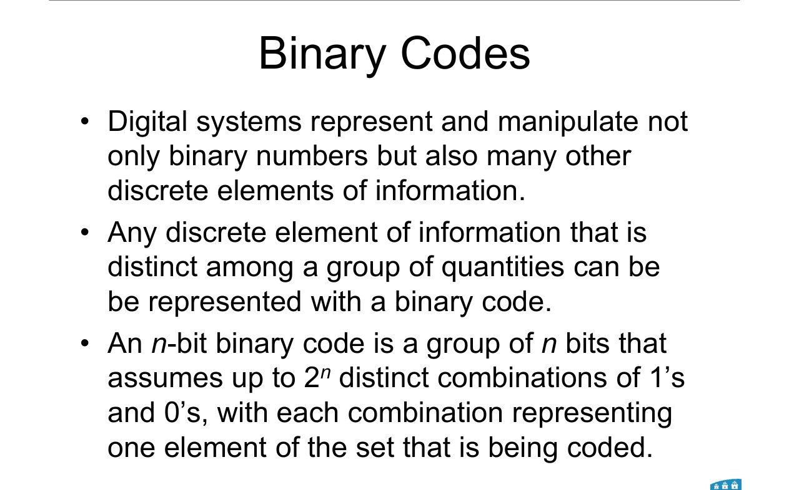
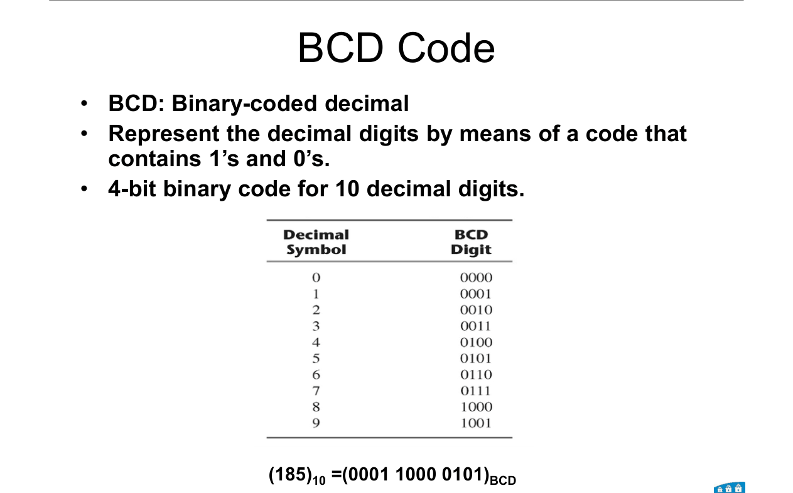
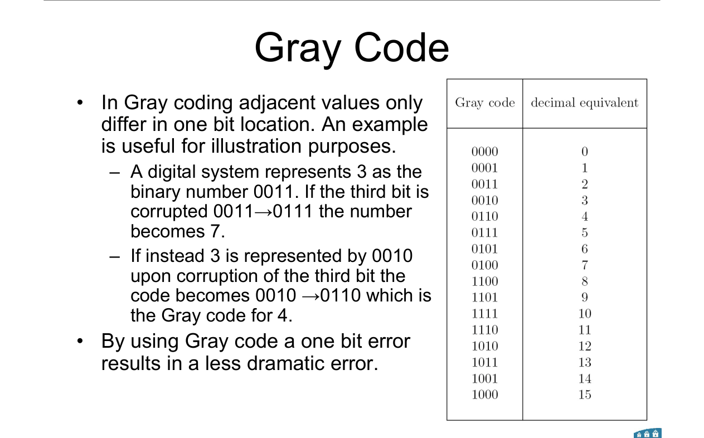
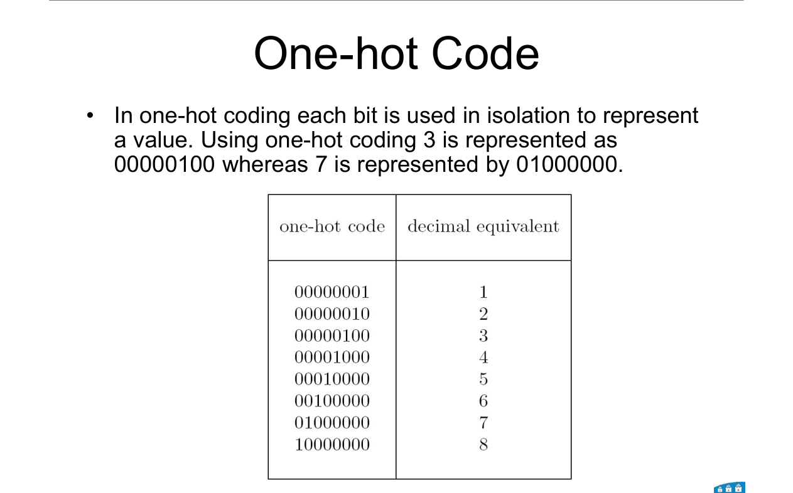

# Topic 5 — Binary codes: BCD, Gray, one-hot

Slide exercises: none (the slides give examples only)

Slides: Lecture 3, pages 20 to 24

---

## The big idea

Bits don't have to mean a binary number.

They can stand for **anything** in a list: digits, letters, states.

That's a **code**.

---

**How to use these notes:**
When you see 🧠, stop.
Answer it on paper first.
Then click to check.

---

## 1. What a code is

---

### 📐 Rule 1: how many things can n bits code?

$$\text{patterns} = 2^n$$

| Symbol | Means |
|---|---|
| n | number of bits in the code |
| 2ⁿ | how many different patterns there are |

**What it means:**
Each pattern stands for one item. So n bits can code up to 2ⁿ items.

**Use it when:**
"How many bits do you need for 10 items?" Find the smallest n with 2ⁿ ≥ 10. That's n = 4.

---

## 2. BCD: binary-coded decimal

Each **decimal digit** gets its **own 4 bits**.

 

**Example from the slide:**

185 → 1 | 8 | 5 → **0001 1000 0101**

 

**Not the same as binary!** 185 in plain binary is 10111001.

Patterns **1010 to 1111** are never used in BCD. There is no digit for them.

 

### 🧠 Check
Write 92 in BCD.

Answer

9 = 1001, 2 = 0010

92 = **1001 0010**

 

### 🧠 Check
Is 0110 1011 valid BCD?

Answer

**No.** 1011 = 11, and there's no BCD digit for 11.

---

## 3. Gray code

In Gray code, **neighbouring values differ in exactly one bit.**

 

**Why that helps (slide example):**

3 in plain binary is 0011. Corrupt the third bit → 0111 = **7**. A big jump.

3 in Gray is 0010. Corrupt the third bit → 0110 = Gray for **4**. A small error.

 

**The 4-bit Gray table:**

| Dec | Gray | Dec | Gray |
|---|---|---|---|
| 0 | 0000 | 8 | 1100 |
| 1 | 0001 | 9 | 1101 |
| 2 | 0011 | 10 | 1111 |
| 3 | 0010 | 11 | 1110 |
| 4 | 0110 | 12 | 1010 |
| 5 | 0111 | 13 | 1011 |
| 6 | 0101 | 14 | 1001 |
| 7 | 0100 | 15 | 1000 |

 

**You'll see Gray order again** in K-maps (Topic 8): 00, 01, 11, 10.

---

### 📐 Rule 2: binary → Gray (quick way, not on the slides)

**Step 1.** Keep the MSB.

**Step 2.** Each next Gray bit = this binary bit **XOR** the binary bit to its left.

(XOR = 1 when the two bits are different. Topic 10 covers it.)

**Example:** 0101

- MSB: 0
- 0 vs 1 → 1
- 1 vs 0 → 1
- 0 vs 1 → 1

Gray = **0111** (= 5 in the table ✓)

**Use it when:**
You need a Gray code and don't remember the table.

---

 

### 🧠 Check
Look at Gray for 7 and 8. How many bits differ?

Answer

7 = 0100, 8 = 1100.

Only **1** bit differs. (In plain binary, 0111 → 1000 changes all 4.)

---

## 4. One-hot code

**One bit per value.**

Exactly **one** bit is 1. All others are 0.

 

| Value | One-hot (8-bit) |
|---|---|
| 1 | 00000001 |
| 3 | 00000100 |
| 7 | 01000000 |
| 8 | 10000000 |

Value k sits in bit position k − 1, counting from the right starting at 0.

 

**Trade-off:**
Uses lots of bits (8 values need 8 bits, not 3).
But it's very easy to tell which value it is.

 

### 🧠 Check
Write 5 in 8-bit one-hot.

Answer

5 → bit position 4 → **00010000**

---

## Summary table

| Code | Rule | 4 in this code |
|---|---|---|
| Binary | normal place values | 0100 |
| BCD | 4 bits per decimal digit | 0100 |
| Gray | neighbours differ by one bit | 0110 |
| One-hot (8-bit) | one bit per value | 00001000 |

---

Next: [End-of-topic test](../questions/05-binary-codes.md)
