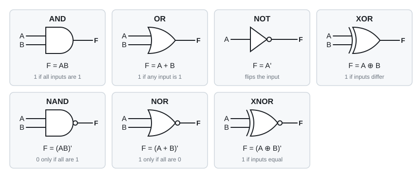
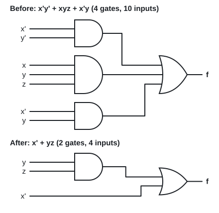

# 06 · Gates and Boolean algebra

Lecture 4, slides 2–13 · ●● · [**Quiz →**](https://albinjoby82-ops.github.io/DE_Lock-In/quiz.html?t=06)

**▶ Explainer videos** (tap to search YouTube):
- [logic gates AND OR NOT NAND NOR XOR](https://www.youtube.com/results?search_query=logic+gates+AND+OR+NOT+NAND+NOR+XOR)
- [Boolean algebra simplification](https://www.youtube.com/results?search_query=Boolean+algebra+simplification)
- [De Morgan's theorem](https://www.youtube.com/results?search_query=De+Morgan%27s+theorem)
- [truth table from Boolean expression](https://www.youtube.com/results?search_query=truth+table+from+Boolean+expression)

Every expression is a circuit. **Shorter expression = fewer gates** = cheaper and faster.

Notation: `x'` = NOT x · `xy` = x AND y · `x + y` = x OR y.

---

## 1. The gates

▶ Video: [logic gates AND OR NOT NAND NOR XOR](https://www.youtube.com/results?search_query=logic+gates+AND+OR+NOT+NAND+NOR+XOR)

**Careful:** in Boolean algebra **1 + 1 = 1**. OR is not adding.

> **Apply:** x = 1, y = 0. Find xy, x + y, (xy)', x ⊕ y.

Answer

xy = **0** · x + y = **1** · (xy)' = **1** · x ⊕ y = **1** (they differ)

---

## 2. Expression → truth table

▶ Video: [truth table from Boolean expression](https://www.youtube.com/results?search_query=truth+table+from+Boolean+expression)

**Rule:** n inputs → **2ⁿ rows** in binary order (000, 001 … 111). Put each row into the expression.

> **Apply:** fill the table for f = (x + y')z + x' (slide 7).

Answer

| xyz | 000 | 001 | 010 | 011 | 100 | 101 | 110 | 111 |
|---|---|---|---|---|---|---|---|---|
| f | 1 | 1 | 1 | 1 | 0 | 1 | 0 | 1 |

When x = 0, x' = 1 so f = 1. When x = 1, f = (1)z = z.

---

## 3. The axioms you use

▶ Video: [De Morgan's theorem](https://www.youtube.com/results?search_query=De+Morgan%27s+theorem)

| Law | OR form | AND form |
|---|---|---|
| Identity / null | x + 0 = x · **x + 1 = 1** | x·1 = x · x·0 = 0 |
| Idempotent | **x + x = x** | **x·x = x** |
| Complement | x + x' = 1 | x·x' = 0 |
| Distributive | **x + yz = (x + y)(x + z)** | x(y + z) = xy + xz |
| De Morgan | (x + y)' = x'y' | (xy)' = x' + y' |

**Three shortcuts** (follow from the axioms):

| Name | Rule |
|---|---|
| Absorption | **x + xy = x** |
| — | **x + x'y = x + y** |
| Consensus | **xy + x'z + yz = xy + x'z** |

**De Morgan in one line:** to complement a whole group, flip every letter **and** swap AND ↔ OR.
(ab + c)' = (a' + b')c'

> **Apply:** simplify a + ab, then x + x'y.

Answer

a + ab = **a** (absorption). x + x'y = **x + y**.

> **Apply:** complement (x + y'z).

Answer

Flip letters, swap operators: **x'(y + z')**.

---

## 4. Worked simplification (slide 12)

▶ Video: [Boolean algebra simplification](https://www.youtube.com/results?search_query=Boolean+algebra+simplification)

**x'y' + xyz + x'y**

| Step | Expression | Why |
|---|---|---|
| 1 | x'(y' + y) + xyz | factor out x' |
| 2 | x' + xyz | y' + y = 1 |
| 3 | **x' + yz** | x' + x·A = x' + A |

> **Apply:** simplify AB + A(B + C) + B(B + C).

Answer

= AB + AB + AC + B + BC = AB + AC + B + BC.
AB and BC are absorbed by B: = **B + AC**.

---

## Exam drill

**1.** Simplify xy + x'z + yz. **2.** Simplify (x + y)(x + y'). **3.** Prove (x + y)(x + z) = x + yz with a truth table or the axioms.

Answer

1. Consensus: **xy + x'z**.
2. Distributive backwards: x + yy' = x + 0 = **x**.
3. Expand: xx + xz + xy + yz = x(1 + z + y) + yz = **x + yz** ✓

**Method:** factor → kill 1s and 0s → look for x + x'y and x + xy → De Morgan any bar over a group → check with a K-map (Topic 8).

---

## Test yourself

**▶ [Topic 06 quiz](https://albinjoby82-ops.github.io/DE_Lock-In/quiz.html?t=06)** (answers checked as you go, **New numbers** for fresh practice)  
[Mixed quiz: topics 05 + 06](https://albinjoby82-ops.github.io/DE_Lock-In/quiz.html?mix=05,06&n=15)  
[All quizzes](https://albinjoby82-ops.github.io/DE_Lock-In/)

Next: [07 · SOP, POS, minterms and maxterms](07-minterms-maxterms.md)
