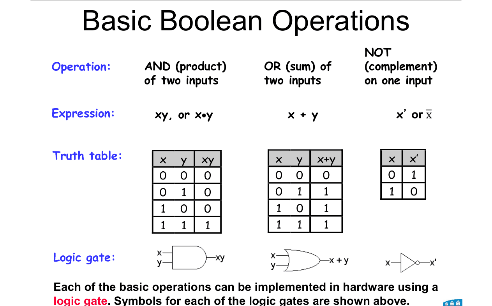
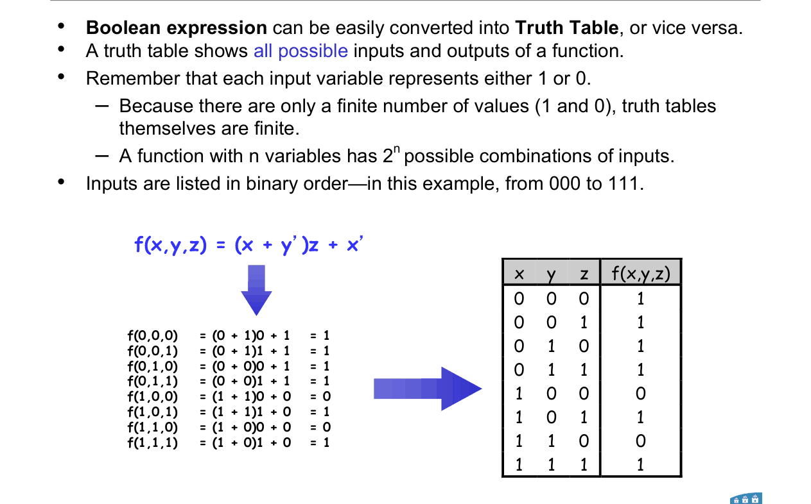
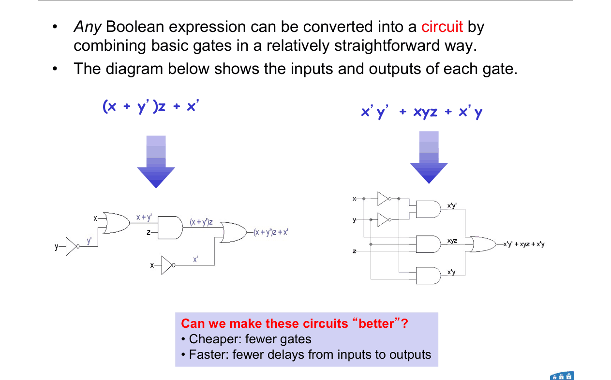
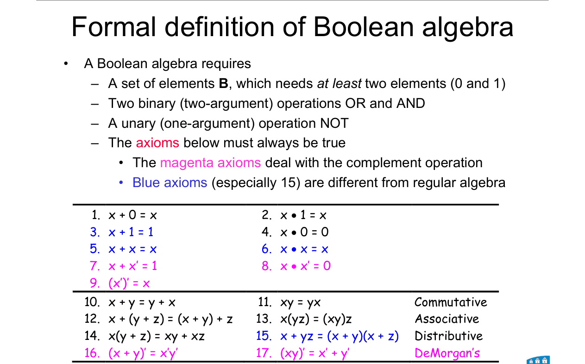
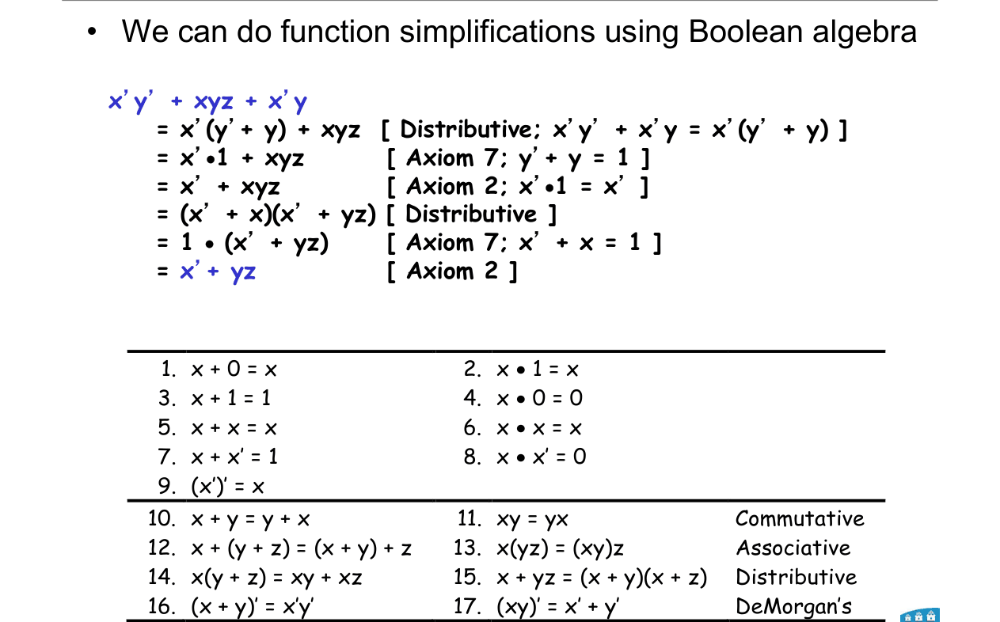
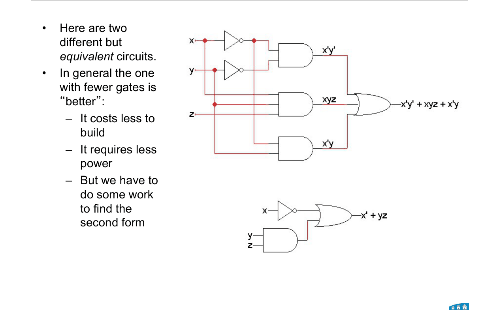

# Topic 6 — Gates, truth tables, Boolean algebra

Slide exercises: simplify x'y' + xyz + x'y

Slides: Lecture 4, pages 2 to 13

---

## The big idea

Each bit can be true (1) or false (0).

We combine bits with **AND**, **OR** and **NOT**.

That gives **Boolean algebra**: maths with only 0 and 1.

 

Why we care:

Every expression becomes a circuit of gates.

A **shorter** expression = **fewer gates** = cheaper, less power, usually faster.

---

**How to use these notes:**
When you see 🧠, stop.
Answer it on paper first.
Then click to check.

---

## 1. The three basic operations

**How to read this diagram:**

Three columns: AND, OR, NOT.

Each one shows how you write it, its truth table, and its gate symbol.

 

| Operation | Write | Output is 1 when… | Gate shape |
|---|---|---|---|
| **AND** | xy or x·y | **both** inputs are 1 | flat back, round front |
| **OR** | x + y | **at least one** input is 1 | curved back, pointy front |
| **NOT** | x' | the input is 0 | triangle with a bubble |

 

**Careful:** in Boolean algebra, 1 + 1 = **1**. OR is not normal adding.

 

### 🧠 Check
x = 1, y = 0. Find xy, x + y and y'.

Answer

xy = 1 · 0 = **0**

x + y = 1 + 0 = **1**

y' = **1**

---

## 2. Truth tables

**How to read this diagram:**

Left: the expression f = (x + y')z + x' worked out for every input.

Right: the results collected into a truth table.

---

### 📐 Rule 1: building a truth table

**Step 1.** n inputs → **2ⁿ rows**.

**Step 2.** List the inputs in **binary order**: 000, 001, 010, … 111.

**Step 3.** Put each row's values into the expression. Write the output.

**Use it when:**
Going from an expression to a truth table. This direction is always easy.

**The other direction** (table → expression) has many answers. Topics 7 and 8 deal with that.

---

 

### 🧠 Check
How many rows does a truth table with 4 inputs have?

Answer

2⁴ = **16** rows.

---

## 3. Expressions become circuits

**How to read this diagram:**

Left: (x + y')z + x' drawn as gates.

Right: x'y' + xyz + x'y drawn as gates.

Each operation in the expression becomes one gate.

 

"Better" circuits are:
- **cheaper:** fewer gates
- **faster:** fewer gates between input and output

---

## 4. The axioms ⭐

These are the rules of Boolean algebra. **Learn them.**

The numbers match the slides. Use them to name each step.

| Law | OR form | AND form |
|---|---|---|
| Identity | 1. x + 0 = x | 2. x · 1 = x |
| Null | 3. x + 1 = 1 | 4. x · 0 = 0 |
| Idempotent | 5. x + x = x | 6. x · x = x |
| Complement | 7. x + x' = 1 | 8. x · x' = 0 |
| Involution | 9. (x')' = x | |
| Commutative | 10. x + y = y + x | 11. xy = yx |
| Associative | 12. x + (y + z) = (x + y) + z | 13. x(yz) = (xy)z |
| Distributive | 15. **x + yz = (x + y)(x + z)** | 14. x(y + z) = xy + xz |
| DeMorgan | 16. (x + y)' = x'y' | 17. (xy)' = x' + y' |

 

**The weird ones** (not true in normal algebra):
- **3.** x + 1 = 1
- **5 and 6.** x + x = x and x · x = x
- **15.** x + yz = (x + y)(x + z). This one does most of the work in simplifications.

---

### 📐 Rule 2: DeMorgan's law

$$(x + y)' = x'\,y' \qquad\qquad (xy)' = x' + y'$$

**What it means:**
To complement a whole expression: **flip every letter, and swap AND ↔ OR.**

**Use it when:**
You see a bar over a whole group. Also in Topic 9 for NAND and NOR.

**Example:** (ab + c)' = (ab)' · c' = (a' + b') c'

---

### 📐 Rule 3: three shortcuts (follow from the axioms, not on the slides)

| Name | Rule | Why it's true |
|---|---|---|
| Absorption | x + xy = x | if x = 1, both sides are 1. If x = 0, both sides are 0. |
| — | x + x'y = x + y | use axiom 15: (x + x')(x + y) = 1 · (x + y) |
| Consensus | xy + x'z + yz = xy + x'z | the yz term is always covered by the other two |

**Use it when:**
Simplifying by hand. They save several steps. Topic 8 uses consensus.

---

 

### 🧠 Check
Simplify a + ab.

Answer

Absorption: **a**

Long way: a · 1 + ab = a(1 + b) = a · 1 = a (axioms 2, 14, 3, 2).

---

## 5. Worked simplification (slide 12)

$$x'y' + xyz + x'y$$

| Step | Expression | Rule |
|---|---|---|
| 1 | x'(y' + y) + xyz | distributive (14): x'y' + x'y = x'(y' + y) |
| 2 | x' · 1 + xyz | axiom 7: y' + y = 1 |
| 3 | x' + xyz | axiom 2: x' · 1 = x' |
| 4 | (x' + x)(x' + yz) | distributive (15) |
| 5 | 1 · (x' + yz) | axiom 7 |
| 6 | **x' + yz** | axiom 2 |

 

**Tip:** steps 3 to 6 are just the shortcut x' + xA = x' + A, with A = yz.

 

**How to read this diagram:**

Top: the original circuit. Bottom: the simplified one.

Same truth table, far fewer gates.

---

## Method: any "simplify" question

1. **Look for a common factor** and pull it out (14). Often this gives (y + y') = 1.
2. **Kill the 1s and 0s** with axioms 1 to 4 and 7, 8.
3. **Look for x + x'y → x + y** and **x + xy → x**.
4. **Bar over a group?** Use DeMorgan first.
5. **Name each step** with its axiom number. Examiners like that.
6. **Check** with a quick truth table if you're unsure. Or use a K-map (Topic 8).

---

Next: [End-of-topic test](../questions/06-boolean-algebra.md)
