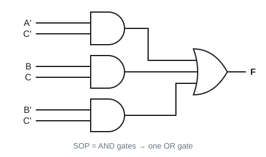
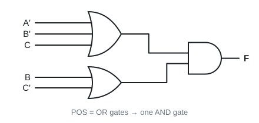
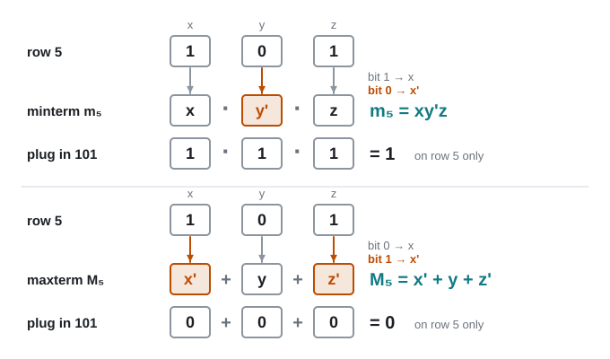
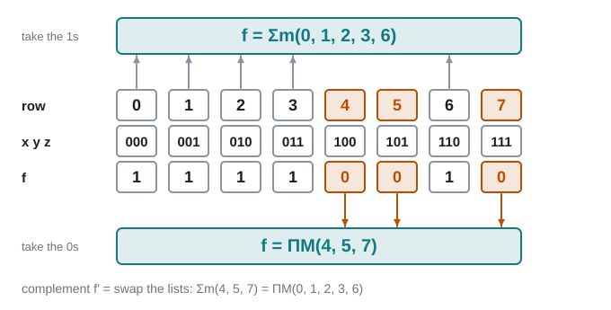

# 07 · SOP, POS, minterms and maxterms

Lecture 4 slides 14–21, Lecture 5 slides 2–9 · ●● · [**Quiz →**](https://albinjoby82-ops.github.io/DE_Lock-In/quiz.html?t=07)

**▶ Explainer videos** (tap to search YouTube):
- [minterms and maxterms](https://www.youtube.com/results?search_query=minterms+and+maxterms)
- [sum of products and product of sums](https://www.youtube.com/results?search_query=sum+of+products+and+product+of+sums)
- [canonical SOP and POS](https://www.youtube.com/results?search_query=canonical+SOP+and+POS)

Any truth table can be written straight down as an expression, two ways:
**rows where f = 1 → Σm** · **rows where f = 0 → ΠM**. Both correct, both long. K-maps (Topic 8) shrink them.

---

## 1. SOP and POS are circuit shapes

▶ Video: [sum of products and product of sums](https://www.youtube.com/results?search_query=sum+of+products+and+product+of+sums)

| Form | Looks like | Circuit |
|---|---|---|
| **SOP** (sum of products) | A'C' + BC + B'C' | AND gates → one OR |
| **POS** (product of sums) | (A' + B' + C)(B + C') | OR gates → one AND |

 

> **Apply:** is (a + b)c + d SOP, POS or neither?

Answer

**Neither** as written. Expand → ac + bc + d, which **is** SOP.

---

## 2. Minterm (m) and maxterm (M) for one row

▶ Video: [minterms and maxterms](https://www.youtube.com/results?search_query=minterms+and+maxterms)

| | Uses | bit 0 → | bit 1 → | Is … on that row only |
|---|---|---|---|---|
| **minterm mᵢ** | AND of all letters | **x'** | x | **1** |
| **maxterm Mᵢ** | OR of all letters | x | **x'** | **0** |

Row 5 = 101 → **m₅ = xy'z** · **M₅ = x' + y + z'**

Orange = the letters that get a bar. Plug 101 back in: m₅ = 1 and M₅ = 0, on that row only.

Minterm and maxterm are complements: mᵢ' = Mᵢ.

> **Apply:** f(x, y, z). Write m₃ and M₃.

Answer

3 = 011 → m₃ = **x'yz** · M₃ = **x + y' + z'**

---

## 3. Σm and ΠM

▶ Video: [canonical SOP and POS](https://www.youtube.com/results?search_query=canonical+SOP+and+POS)

f = 1 on rows 0, 1, 2, 3, 6 →

**f = Σm(0, 1, 2, 3, 6)** = x'y'z' + x'y'z + x'yz' + x'yz + xyz'
**f = ΠM(4, 5, 7)** = (x' + y + z)(x' + y + z')(x' + y' + z')

Same table, read two ways: the 1-rows (grey) give Σm, the 0-rows (orange) give ΠM.

**Rule to switch:** swap Σm ↔ ΠM and take the **missing** numbers.

| | Same function | Complement f' |
|---|---|---|
| Σm | (0, 1, 2, 3, 6) | (4, 5, 7) |
| ΠM | (4, 5, 7) | (0, 1, 2, 3, 6) |

> **Apply:** f(x, y, z) = Σm(1, 3, 5). Write f as ΠM, and f' as Σm.

Answer

Missing: 0, 2, 4, 6, 7. f = **ΠM(0, 2, 4, 6, 7)** · f' = **Σm(0, 2, 4, 6, 7)**

> **Apply:** f(A, B, C) = A + B'C. Write f as Σm.

Answer

A = 1 → rows 4–7. B'C → rows 1 and 5. f = **Σm(1, 4, 5, 6, 7)**.

---

## Exam drill (slide exercise)

**Convert Σm(0, 1, 2, 3, 6) to ΠM and write it out in letters.**

Answer

**ΠM(4, 5, 7)** = (x' + y + z)(x' + y + z')(x' + y' + z')

**Traps**
- Minterm: 0 → barred. Maxterm: 0 → **plain**. They're opposite.
- Σm list + ΠM list = every row, once.
- Number the rows from **0**.

---

## Test yourself

**▶ [Topic 07 quiz](https://albinjoby82-ops.github.io/DE_Lock-In/quiz.html?t=07)** (answers checked as you go, **New numbers** for fresh practice)  
[Mixed quiz: topics 06 + 07](https://albinjoby82-ops.github.io/DE_Lock-In/quiz.html?mix=06,07&n=15)  
**▶ [Book questions for this topic](https://albinjoby82-ops.github.io/DE_Lock-In/book.html?t=07)** (Mano 2.10, 2.16, 2.17, 2.19–2.22: 21 questions, every one worked)  
[Mock mid-term](https://albinjoby82-ops.github.io/DE_Lock-In/#book-questions)  
[All quizzes](https://albinjoby82-ops.github.io/DE_Lock-In/)

Next: [08 · Karnaugh maps ⭐](08-karnaugh-maps.md)
