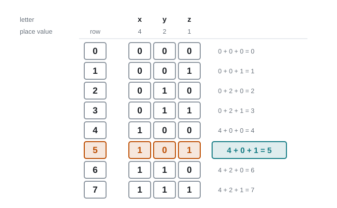
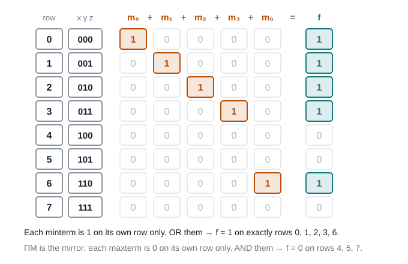
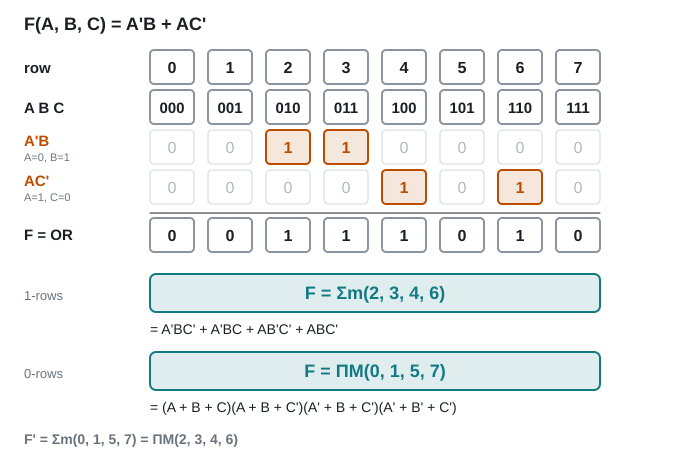
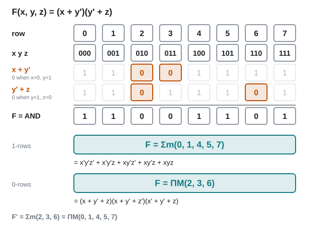

# 07 · SOP, POS, minterms and maxterms

Lecture 4 slides 14–21, Lecture 5 slides 2–9 · ●● · [**Quiz →**](https://albinjoby82-ops.github.io/DE_Lock-In/quiz.html?t=07)

**▶ Explainer videos** (tap to search YouTube):
- [minterms and maxterms](https://www.youtube.com/results?search_query=minterms+and+maxterms)
- [sum of products and product of sums](https://www.youtube.com/results?search_query=sum+of+products+and+product+of+sums)
- [canonical SOP and POS](https://www.youtube.com/results?search_query=canonical+SOP+and+POS)

Any truth table can be written straight down as an expression, two ways:
**rows where f = 1 → Σm** · **rows where f = 0 → ΠM**. Both correct, both long. K-maps (Topic 8) shrink them.

---

## 1. SOP and POS are circuit shapes

▶ Video: [sum of products and product of sums](https://www.youtube.com/results?search_query=sum+of+products+and+product+of+sums)

| Form | Looks like | Circuit |
|---|---|---|
| **SOP** (sum of products) | A'C' + BC + B'C' | AND gates → one OR |
| **POS** (product of sums) | (A' + B' + C)(B + C') | OR gates → one AND |

 

> **Apply:** is (a + b)c + d SOP, POS or neither?

Answer

**Neither** as written. Expand → ac + bc + d, which **is** SOP.

---

## 2. Minterm (m) and maxterm (M) for one row

▶ Video: [minterms and maxterms](https://www.youtube.com/results?search_query=minterms+and+maxterms)

**First: how the rows are numbered.** The rows count up in binary, 000 → 111. Read xyz as one binary number (x = 4, y = 2, z = 1). The row number is that number, and it's also the minterm/maxterm number.

Row 5 = 101 because 4 + 0 + 1 = 5. So m₅ and M₅ both belong to the row x = 1, y = 0, z = 1.

- Writing the table fast: **z** flips every row, **y** every 2 rows, **x** every 4.
- n letters → 2ⁿ rows, numbered from **0**.

> **Apply:** which row is x = 1, y = 1, z = 0? And what are x, y, z on row 3?

Answer

110 → 4 + 2 + 0 = **row 6**. Row 3 = 2 + 1 → **011** (x = 0, y = 1, z = 1).

Now each row gets a minterm and a maxterm:

| | Uses | bit 0 → | bit 1 → | Is … on that row only |
|---|---|---|---|---|
| **minterm mᵢ** | AND of all letters | **x'** | x | **1** |
| **maxterm Mᵢ** | OR of all letters | x | **x'** | **0** |

Row 5 = 101 → **m₅ = xy'z** · **M₅ = x' + y + z'**

Orange = the letters that get a bar. Plug 101 back in: m₅ = 1 and M₅ = 0, on that row only.

Minterm and maxterm are complements: mᵢ' = Mᵢ.

> **Apply:** f(x, y, z). Write m₃ and M₃.

Answer

3 = 011 → m₃ = **x'yz** · M₃ = **x + y' + z'**

---

## 3. Σm and ΠM

▶ Video: [canonical SOP and POS](https://www.youtube.com/results?search_query=canonical+SOP+and+POS)

**Σm** (sum of minterms) = OR together the minterms of every row where f = **1**.
**ΠM** (product of maxterms) = AND together the maxterms of every row where f = **0**.

**Why it works:** each minterm is 1 on its own row only. OR them and you get 1 on exactly the rows you picked, and 0 everywhere else. That's f.

ΠM is the mirror image: each maxterm is 0 on its own row only, so ANDing them gives 0 on exactly the rows you picked.

So for f = 1 on rows 0, 1, 2, 3, 6:

**f = Σm(0, 1, 2, 3, 6)** = x'y'z' + x'y'z + x'yz' + x'yz + xyz'

**f = ΠM(4, 5, 7)** = (x' + y + z)(x' + y + z')(x' + y' + z')

Same table, read two ways: the 1-rows (grey) give Σm, the 0-rows (orange) give ΠM.

**Rule to switch:** swap Σm ↔ ΠM and take the **missing** numbers.

| | Same function | Complement f' |
|---|---|---|
| Σm | (0, 1, 2, 3, 6) | (4, 5, 7) |
| ΠM | (4, 5, 7) | (0, 1, 2, 3, 6) |

> **Apply:** f(x, y, z) = Σm(1, 3, 5). Write f as ΠM, and f' as Σm.

Answer

Missing: 0, 2, 4, 6, 7. f = **ΠM(0, 2, 4, 6, 7)** · f' = **Σm(0, 2, 4, 6, 7)**

> **Apply:** f(A, B, C) = A + B'C. Write f as Σm.

Answer

A = 1 → rows 4–7. B'C → rows 1 and 5. f = **Σm(1, 4, 5, 6, 7)**.

### How it gets asked

Σ(…) with no m still means Σm, and Π(…) means ΠM. "Canonical SOP" = Σm, "canonical POS" = ΠM.

| They give you | They ask | Do this |
|---|---|---|
| an expression, e.g. A'B + AC' | "write as a sum of minterms and a product of maxterms" | find the rows each term covers (below) → 1-rows = Σm, 0-rows = ΠM |
| F = Σ(2, 5, 6) | "write F as a product of maxterms" | swap to Π, take the **missing** numbers |
| F = Σ(…) | "express F' as a sum of minterms" | F' = Σ(the **missing** numbers) |
| F = Π(2, 4, 5, 7) | "express F' as a sum of minterms" | F' = Σ(**same** numbers): F's 0-rows are F''s 1-rows |
| shorthand | "write it out" | each number → binary → letters (section 2) |

### Worked exam question 1 (SOP expression)

> **F(A, B, C) = A'B + AC'.** Express F as a sum of minterms and as a product of maxterms. Also give F'.

1. **A'B** is 1 when A = 0 and B = 1. C is missing, so it can be anything → 010, 011 → rows **2, 3**.
2. **AC'** is 1 when A = 1 and C = 0. B can be anything → 100, 110 → rows **4, 6**.
3. F is the OR, so F = 1 on rows 2, 3, 4, 6 → **F = Σm(2, 3, 4, 6)**.
4. The missing rows 0, 1, 5, 7 → **F = ΠM(0, 1, 5, 7)**.
5. F' is 1 where F is 0 → **F' = Σm(0, 1, 5, 7)**.
6. Write them out in letters if asked (section 2 rules).

**Check:** the Σm list and the ΠM list should cover all 8 rows, each one once (4 + 4 = 8 ✓).

A term with **1 letter missing covers 2 rows**. With 2 letters missing it covers 4 rows.

### Worked exam question 2 (POS expression)

> **F(x, y, z) = (x + y')(y' + z).** Express F as a sum of minterms and as a product of maxterms.

For a product, find where each bracket is **0**. An OR is 0 only when every letter in it is 0.

1. **(x + y')** = 0 when x = 0 and y = 1 → 010, 011 → rows **2, 3**.
2. **(y' + z)** = 0 when y = 1 and z = 0 → 010, 110 → rows **2, 6**.
3. F is the AND, so F = 0 if either bracket is 0 → rows 2, 3, 6 → **F = ΠM(2, 3, 6)**.
4. Missing rows → **F = Σm(0, 1, 4, 5, 7)**.

Row 2 shows up twice. List it once.

> **Apply (exam style):** F(x, y, z) = xy + x'z'. Write F as Σm and ΠM, and give F'.

Answer

xy: x = 1, y = 1 → 110, 111 → rows 6, 7. x'z': x = 0, z = 0 → 000, 010 → rows 0, 2.
**F = Σm(0, 2, 6, 7)** · **F = ΠM(1, 3, 4, 5)** · **F' = Σm(1, 3, 4, 5)**

> **Apply (exam style):** F(x, y, z) = Π(2, 4, 5, 7). Write F' as a sum of minterms.

Answer

F's 0-rows are 2, 4, 5, 7, and those are exactly F''s 1-rows. **F' = Σm(2, 4, 5, 7)**. Same numbers, because you don't take the missing ones here.

---

## Exam drill (slide exercise)

**Convert Σm(0, 1, 2, 3, 6) to ΠM and write it out in letters.**

Answer

**ΠM(4, 5, 7)** = (x' + y + z)(x' + y + z')(x' + y' + z')

**Traps**
- Minterm: 0 → barred. Maxterm: 0 → **plain**. They're opposite.
- Σm list + ΠM list = every row, once.
- Number the rows from **0**.

---

## Test yourself

**▶ [Topic 07 quiz](https://albinjoby82-ops.github.io/DE_Lock-In/quiz.html?t=07)** (answers checked as you go, **New numbers** for fresh practice)  
[Mixed quiz: topics 06 + 07](https://albinjoby82-ops.github.io/DE_Lock-In/quiz.html?mix=06,07&n=15)  
**▶ [Book questions for this topic](https://albinjoby82-ops.github.io/DE_Lock-In/book.html?t=07)** (Mano 2.10, 2.16, 2.17, 2.19–2.22: 21 questions, every one worked)  
[Mock mid-term](https://albinjoby82-ops.github.io/DE_Lock-In/#book-questions)  
[All quizzes](https://albinjoby82-ops.github.io/DE_Lock-In/)

Next: [08 · Karnaugh maps ⭐](08-karnaugh-maps.md)
