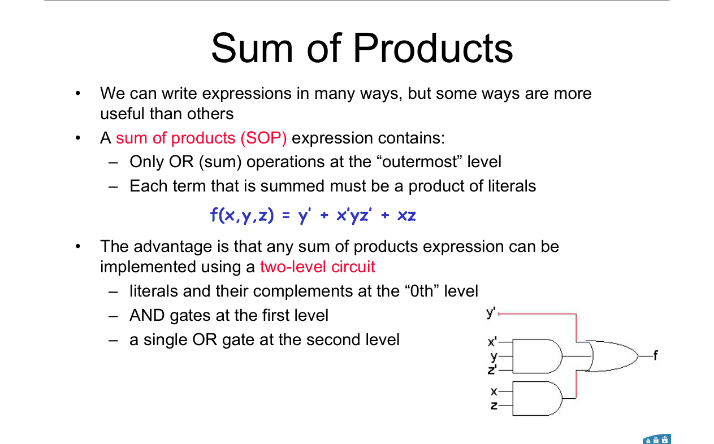
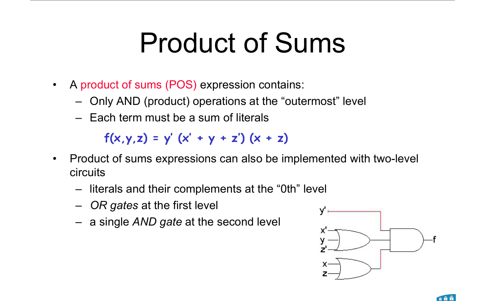
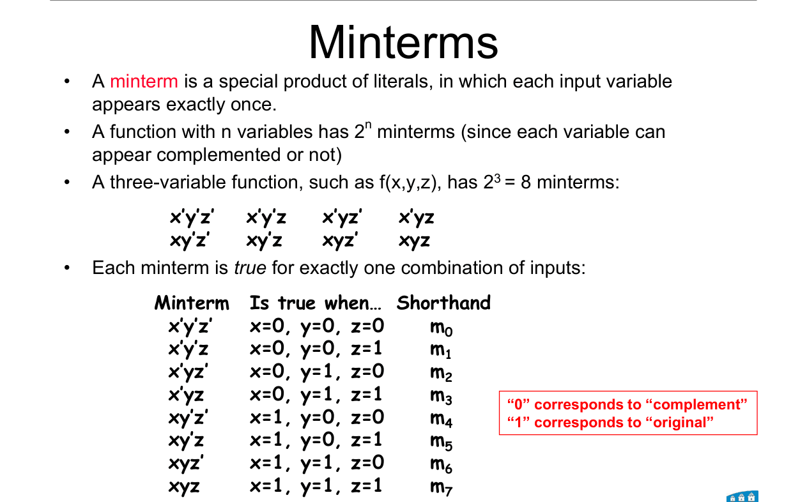
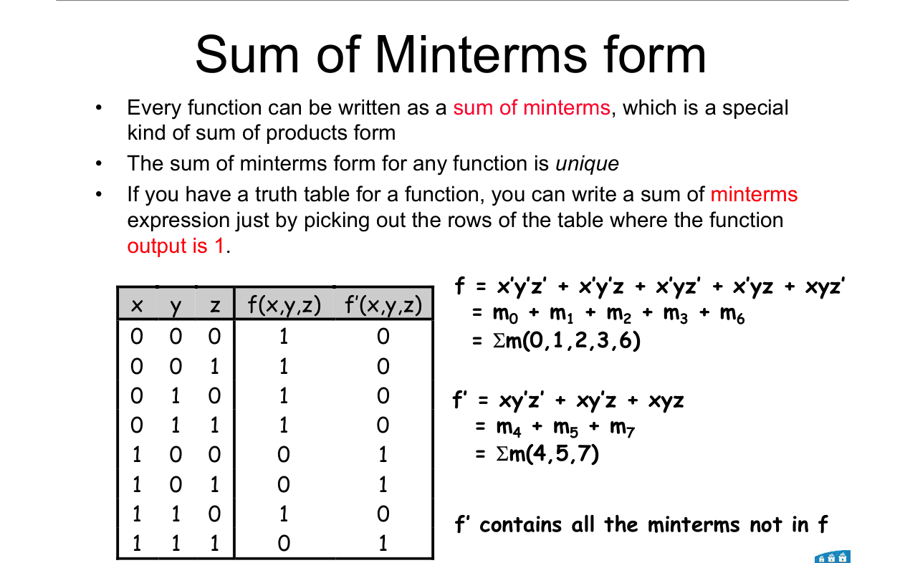
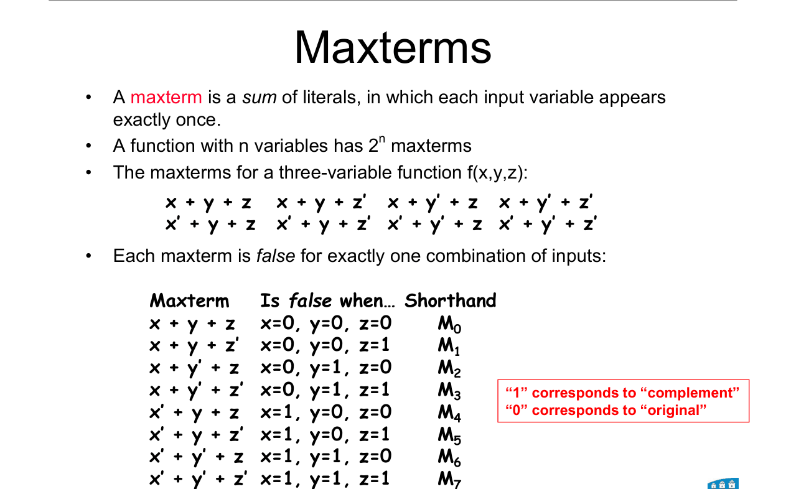
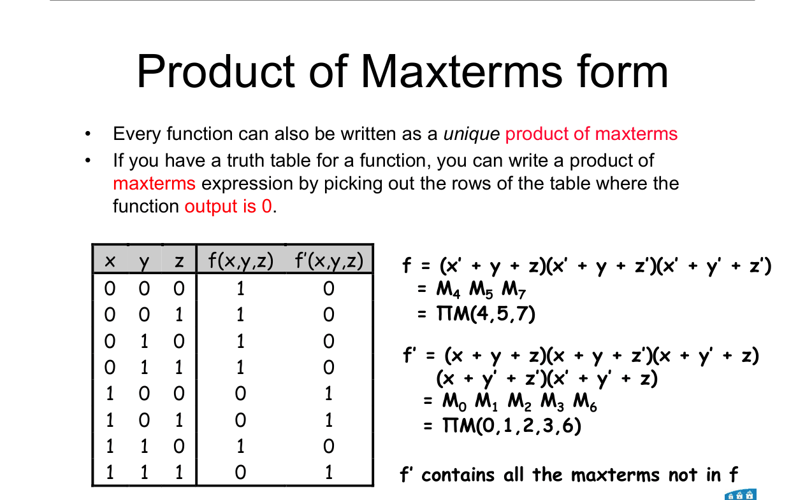
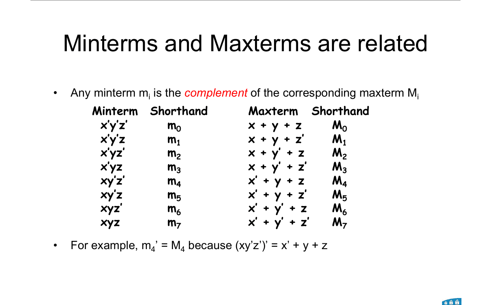
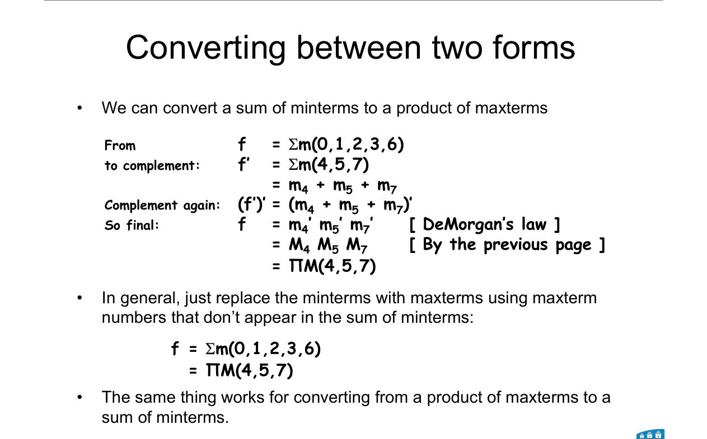

# Topic 7 — SOP, POS, minterms and maxterms

Slide exercises: convert Σm(0,1,2,3,6) to ΠM

Slides: Lecture 4, pages 14 to 21, and Lecture 5, pages 2 to 9

---

## The big idea

Any truth table can be turned straight into an expression.

There are two standard ways:
1. Pick out the rows where f = **1** → **sum of minterms** (Σm).
2. Pick out the rows where f = **0** → **product of maxterms** (ΠM).

Both are always correct. They're just not short yet.

Topic 8 (K-maps) shrinks them.

---

**How to use these notes:**
When you see 🧠, stop.
Answer it on paper first.
Then click to check.

---

## 1. Sum of products (SOP)

An **OR of AND terms**.

Example: f = y' + x'yz' + xz

 

**As a circuit:** a row of AND gates, all feeding **one OR gate**.

This is a **two-level** circuit: AND then OR.

---

## 2. Product of sums (POS)

An **AND of OR terms**.

Example: f = y'(x' + y + z')(x + z)

 

**As a circuit:** a row of OR gates, all feeding **one AND gate**.

Also two-level: OR then AND.

 

### 🧠 Check
Is (a + b)c + d SOP, POS, or neither?

Answer

**Neither.** The outermost operation is OR, but (a + b)c is not a plain product of letters.

Expanded, ac + bc + d **is** SOP.

---

## 3. Minterms

A **minterm** is an AND of **every** variable, each one plain or barred.

It is **1 on exactly one row** of the truth table.

---

### 📐 Rule 1: writing a minterm

**For the row's bits:**
- bit **0** → **barred** letter (x')
- bit **1** → **plain** letter (x)

**AND them together.**

**Name:** mᵢ, where i is the row number in decimal.

**Why it works:**
x' is 1 only when x = 0. So the AND is 1 only on that exact row.

**Example:** row 5 = 101 → **m₅ = x y' z**

---

| Row | x y z | Minterm |
|---|---|---|
| 0 | 0 0 0 | m₀ = x'y'z' |
| 1 | 0 0 1 | m₁ = x'y'z |
| 2 | 0 1 0 | m₂ = x'yz' |
| 3 | 0 1 1 | m₃ = x'yz |
| 4 | 1 0 0 | m₄ = xy'z' |
| 5 | 1 0 1 | m₅ = xy'z |
| 6 | 1 1 0 | m₆ = xyz' |
| 7 | 1 1 1 | m₇ = xyz |

---

## 4. Sum of minterms (Σm)

**How to read this diagram:**

The truth table has f = 1 on rows 0, 1, 2, 3, 6.

So f is the OR of those five minterms.

 

$$f = m_0 + m_1 + m_2 + m_3 + m_6 = \Sigma m(0, 1, 2, 3, 6)$$

$$= x'y'z' + x'y'z + x'yz' + x'yz + xyz'$$

 

**Every function has exactly one Σm form.** It's unique.

**f'** has all the other minterms: f' = Σm(4, 5, 7).

 

### 🧠 Check
A function is 1 on rows 1 and 6 only. Write it as Σm and in letters.

Answer

f = Σm(1, 6) = **x'y'z + xyz'**

---

## 5. Maxterms

A **maxterm** is an OR of **every** variable, each one plain or barred.

It is **0 on exactly one row**.

---

### 📐 Rule 2: writing a maxterm

**The opposite of the minterm rule:**
- bit **0** → **plain** letter (x)
- bit **1** → **barred** letter (x')

**OR them together.**

**Name:** Mᵢ (capital M).

**Why it works:**
An OR is 0 only when every part is 0. Plain x is 0 when x = 0. Barred x' is 0 when x = 1. So it's 0 only on that row.

**Example:** row 5 = 101 → **M₅ = x' + y + z'**

---

| Row | x y z | Maxterm |
|---|---|---|
| 0 | 0 0 0 | M₀ = x + y + z |
| 1 | 0 0 1 | M₁ = x + y + z' |
| 2 | 0 1 0 | M₂ = x + y' + z |
| 3 | 0 1 1 | M₃ = x + y' + z' |
| 4 | 1 0 0 | M₄ = x' + y + z |
| 5 | 1 0 1 | M₅ = x' + y + z' |
| 6 | 1 1 0 | M₆ = x' + y' + z |
| 7 | 1 1 1 | M₇ = x' + y' + z' |

 

### 🧠 Check
Write M₃ for f(x, y, z).

Answer

3 = 011 → x plain, y barred, z barred.

M₃ = **x + y' + z'**

---

## 6. Product of maxterms (ΠM)

Pick the rows where **f = 0**. AND their maxterms.

 

Same function as §4. f = 0 on rows 4, 5, 7:

$$f = M_4\,M_5\,M_7 = \Pi M(4, 5, 7)$$

$$= (x' + y + z)(x' + y + z')(x' + y' + z')$$

---

## 7. Converting between Σm and ΠM

Each minterm is the **complement** of its maxterm:

$$m_i' = M_i$$

Example: m₄' = (xy'z')' = x' + y + z = M₄ (by DeMorgan).

---

### 📐 Rule 3: switching Σm ↔ ΠM

**Swap the symbol (Σm ↔ ΠM).**

**List the numbers that are missing.**

$$\Sigma m(0, 1, 2, 3, 6) = \Pi M(4, 5, 7)$$

**Why it works:**

f' = Σm(missing rows). Complement both sides and use DeMorgan. Each m becomes an M, and the + becomes a product.

**Also:**
f' = Σm(4, 5, 7) = ΠM(0, 1, 2, 3, 6). The complement just swaps which list goes where.

**Use it when:**
You have one form and are asked for the other. No truth table needed.

---

 

### 🧠 Check
For f(x, y, z) = Σm(1, 3, 5), write f as ΠM.

Answer

All rows: 0 to 7. Missing: 0, 2, 4, 6, 7.

f = **ΠM(0, 2, 4, 6, 7)**

---

## 8. Table → expression has many answers

The truth table in §2 of Topic 6 can be written as:

- x'z' + z
- x' + z
- x'z' + x'z + xz

All three are correct. **Which is best?** The one with the fewest terms and letters.

Finding it by algebra is hard to do reliably.

That's the problem **K-maps** solve (Topic 8).

---

## Method: any minterm / maxterm question

1. **Write the truth table** if you don't have one. Number the rows 0, 1, 2, …
2. **Σm:** list the rows where f = 1. Each becomes a minterm (0 → barred).
3. **ΠM:** list the rows where f = 0. Each becomes a maxterm (0 → plain).
4. **Convert** between them by swapping Σ ↔ Π and taking the missing numbers.
5. **Check the row count:** Σm list + ΠM list = all 2ⁿ rows, no overlap.

---

Next: [End-of-topic test](../questions/07-minterms-maxterms.md)
