# Topic 8 — Karnaugh maps (SOP and POS)

Slide exercises: Lecture 5, slides 23 to 27

Slides: Lecture 5, pages 10 to 27

⭐ **The most important topic for the mid-term.**

---

## The big idea

Simplifying with algebra (Topic 6) needs luck and experience.

A **Karnaugh map** (K-map) does it by **drawing**.

 

You put the truth table into a grid.

You circle blocks of 1s.

Each block becomes one short term.

 

**Goal:** the **fewest terms**, then the **fewest letters**.

That gives the cheapest two-level circuit.

---

**How to use these notes:**
When you see 🧠, stop.
Answer it on paper first.
Then click to check.

---

## 1. Why we need it

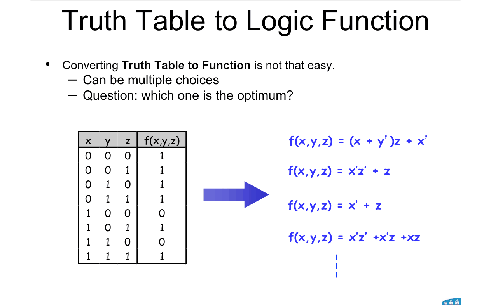

The same truth table can be written many ways (Topic 7 §8).

The K-map finds the shortest way **systematically**.

---

## 2. Two-variable map

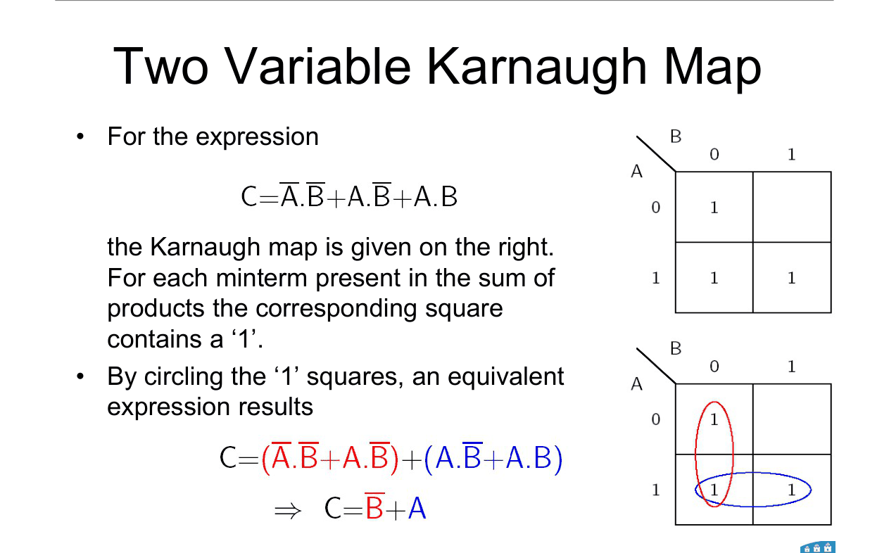

**How to read this diagram:**

A goes down the side (rows 0, 1). B goes across the top (columns 0, 1).

Each cell is one row of the truth table.

A **1** goes in each cell where the function is 1.

 

**Slide example:** C = A'B' + AB' + AB

| A \ B | 0 | 1 |
|---|---|---|
| **0** | 1 | 0 |
| **1** | 1 | 1 |

 

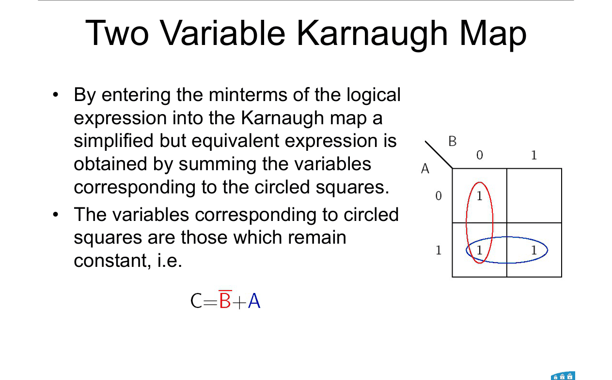

**Red group** (left column): B = 0 the whole way. A changes. → **B'**

**Blue group** (bottom row): A = 1 the whole way. B changes. → **A**

**C = B' + A**

 

**The key idea:**
Inside a group, any letter that **changes** cancels out. Only the letters that **stay the same** are kept.

---

## 3. Three-variable map

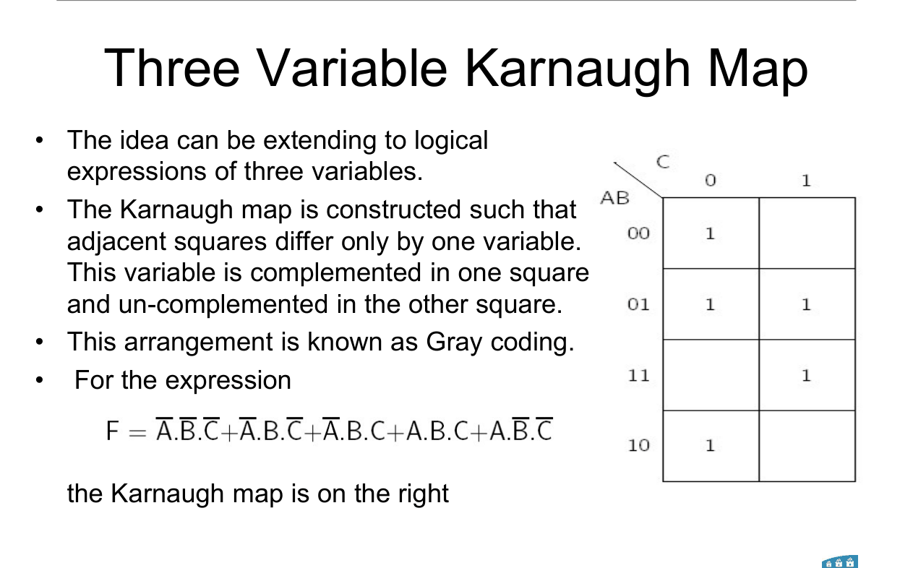

**AB goes down the side. C goes across the top.**

**⚠️ The rows go 00, 01, 11, 10.** Not 00, 01, 10, 11.

This is **Gray order** (Topic 5). Each row differs from the next by **one bit**.

That's what makes neighbouring cells combine.

 

**Cell numbers** (the minterm in each cell). **Learn this.**

| AB \ C | 0 | 1 |
|---|---|---|
| **00** | 0 | 1 |
| **01** | 2 | 3 |
| **11** | 6 | 7 |
| **10** | 4 | 5 |

 

**The map wraps around.** The top row (00) and bottom row (10) are neighbours too. They differ only in A.

 

### 🧠 Check
In the 3-variable map, which cell holds m₆? Which cells are next to it?

Answer

m₆ = 110 → row AB = 11, column C = 0.

Neighbours: m₇ (same row, C = 1), m₂ (row 01, above), m₄ (row 10, below).

---

## 4. Four-variable map

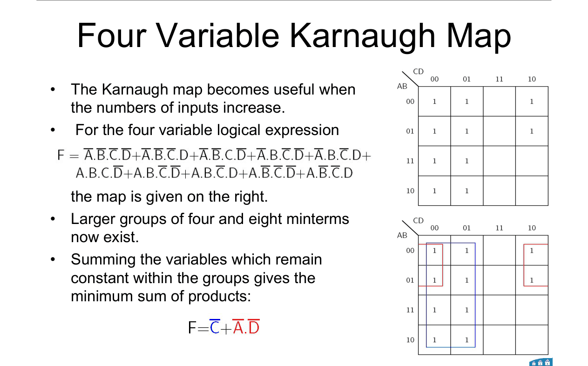

**AB down the side. CD across the top. Both in Gray order.**

**Cell numbers. Learn this.**

| AB \ CD | 00 | 01 | 11 | 10 |
|---|---|---|---|---|
| **00** | 0 | 1 | 3 | 2 |
| **01** | 4 | 5 | 7 | 6 |
| **11** | 12 | 13 | 15 | 14 |
| **10** | 8 | 9 | 11 | 10 |

 

**Tip to remember it:**
Columns go 0, 1, **3, 2**. Rows add 0, 4, **12, 8**.

So cell = (row number) + (column number).

 

**Wrapping:**
- Left edge and right edge are neighbours.
- Top edge and bottom edge are neighbours.
- **The four corners** (0, 2, 8, 10) form one group.

 

**⚠️ Most common mistake:** swapping the 11 and 10 positions.

 

### 🧠 Check
Without looking: which cell is m₁₁ in the 4-variable map?

Answer

11 = 1011 → AB = 10 (bottom row), CD = 11 (third column).

---

## 5. The grouping rules ⭐

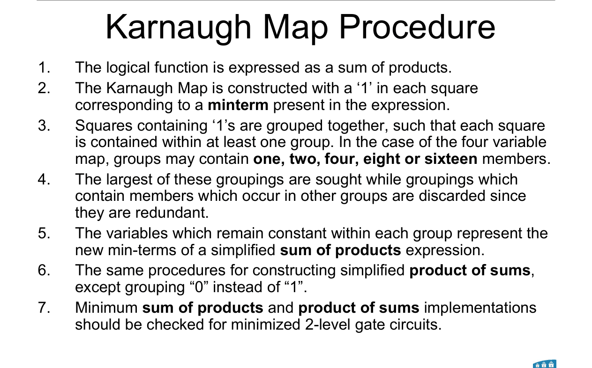

---

### 📐 Rule 1: how to group

1. Groups hold **1, 2, 4, 8 or 16** cells. Never 3, 5, 6 …
2. Groups must be **rectangles**. They can wrap around the edges.
3. Make every group **as big as possible**.
4. Every 1 must be in **at least one** group. **Overlapping is fine.**
5. Use **as few groups as possible**. Drop any group whose cells are all covered by other groups.

---

### 📐 Rule 2: reading a group (SOP)

For each letter, look across the whole group:

| The letter is… | Write |
|---|---|
| always **1** | the letter plain (A) |
| always **0** | the letter barred (A') |
| **changes** | leave it out |

**AND** the kept letters to make one term.

**OR** all the terms together.

**Size check:** a group of 2ᵏ cells **removes k letters**.

| Group size | 4-variable map: letters left |
|---|---|
| 1 | 4 |
| 2 | 3 |
| 4 | 2 |
| 8 | 1 |
| 16 | 0 (F = 1) |

**Why it works:**
Two neighbouring cells differ in exactly one letter. So xy + xy' = x(y + y') = x. That letter cancels. A bigger group repeats this.

**Use it when:**
Any "minimise" or "simplify using a K-map" question.

---

## 6. Worked example: three variables

**Slide example:**

F = A'B'C' + A'BC' + A'BC + ABC + AB'C'

= Σm(0, 2, 3, 7, 4)

 

| AB \ C | 0 | 1 |
|---|---|---|
| **00** | 1 | 0 |
| **01** | 1 | 1 |
| **11** | 0 | 1 |
| **10** | 1 | 0 |

 

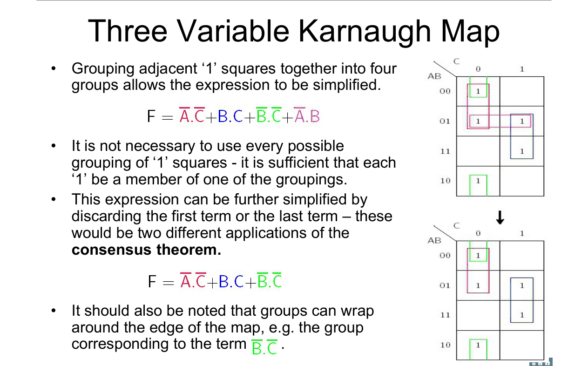

**How to read this diagram:**

Top map: four groups of 2. Bottom map: one redundant group removed.

 

| Group | Cells | Stays the same | Term |
|---|---|---|---|
| red | 0, 2 | A = 0, C = 0 | **A'C'** |
| blue | 3, 7 | B = 1, C = 1 | **BC** |
| green (wraps top to bottom) | 0, 4 | B = 0, C = 0 | **B'C'** |
| purple | 2, 3 | A = 0, B = 1 | A'B ← redundant |

The purple group's cells are already covered. So drop it.

(That's the **consensus theorem** from Topic 6.)

**F = A'C' + BC + B'C'**

 

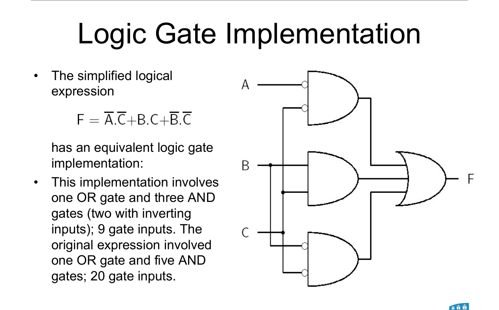

**Cost:** 20 gate inputs before → **9 gate inputs** after.

 

### 🧠 Check
Why is the green group allowed, when its cells are at the top and bottom of the map?

Answer

The map wraps around. Rows 00 and 10 differ only in A, so they are neighbours.

---

## 7. Worked example: four variables

**How to read this diagram:**

Top map: the 1s. Bottom map: the groups.

The 1s fill the whole left half (CD = 00 and 01), plus cells 2 and 6.

 

| Group | Size | Stays the same | Term |
|---|---|---|---|
| left half (columns 00, 01) | 8 | C = 0 | **C'** |
| cells 0, 2, 4, 6 (wraps left to right) | 4 | A = 0, D = 0 | **A'D'** |

**F = C' + A'D'**

 

### 🧠 Check
A group of 8 in a 4-variable map leaves how many letters?

Answer

8 = 2³, so 3 letters cancel. **1 letter** is left.

---

## 8. POS: group the 0s instead

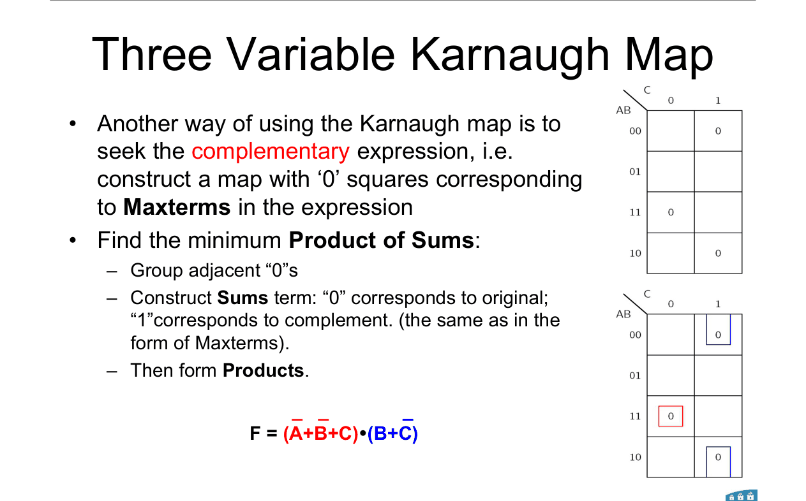

**How to read this diagram:**

The map now shows the **0s** of the same function as §6.

Group the 0s, the same way you grouped the 1s.

---

### 📐 Rule 3: reading a group of 0s (POS)

This uses the **maxterm rule** (Topic 7):

| The letter is… | Write |
|---|---|
| always **0** | the letter **plain** (A) |
| always **1** | the letter **barred** (A') |
| **changes** | leave it out |

**OR** the kept letters to make one sum term.

**AND** all the sum terms together.

**Why it works:**
Grouping the 0s gives the SOP of **F'**. Then DeMorgan flips every letter and swaps AND ↔ OR.

**Use it when:**
You're asked for the minimum POS, or to check which form is cheaper.

---

**Worked example (same function as §6):**

The 0s are at cells 1, 5, 6.

| Group | Cells | Stays the same | Sum term |
|---|---|---|---|
| red | 6 | A = 1, B = 1, C = 0 | **(A' + B' + C)** |
| blue (wraps) | 1, 5 | B = 0, C = 1 | **(B + C')** |

**F = (A' + B' + C)(B + C')**

 

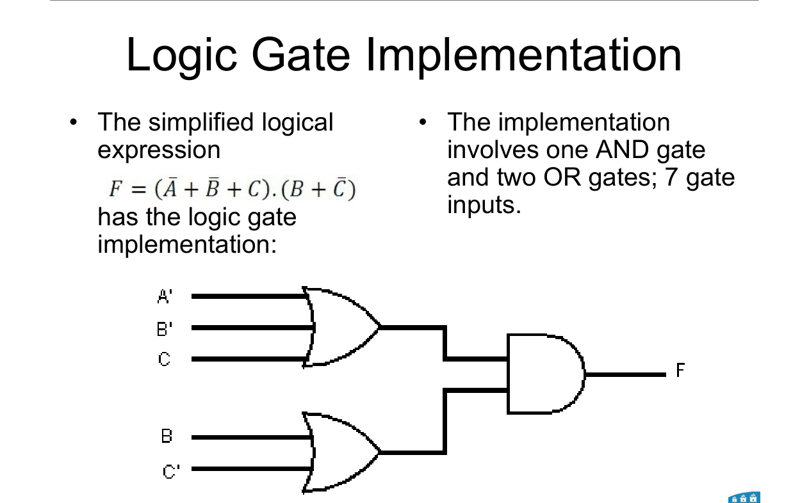

Only **7 gate inputs**. Cheaper than the SOP (9).

 

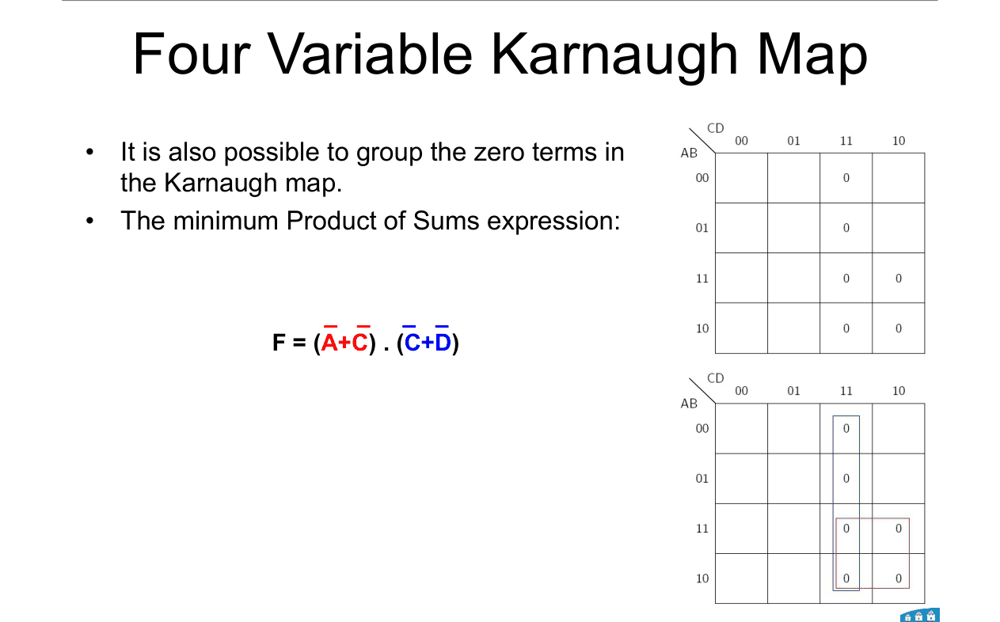

**Four-variable POS (same function as §7):**

The 0s fill column CD = 11, plus cells 10 and 14.

F = **(A' + C')(C' + D')**

 

### 🧠 Check
A group of 0s has A = 1 all the way through. Does A appear plain or barred in the sum term?

Answer

**Barred (A').** For 0s, 1 → barred. It's the maxterm rule.

---

## 9. Filling the map straight from an expression

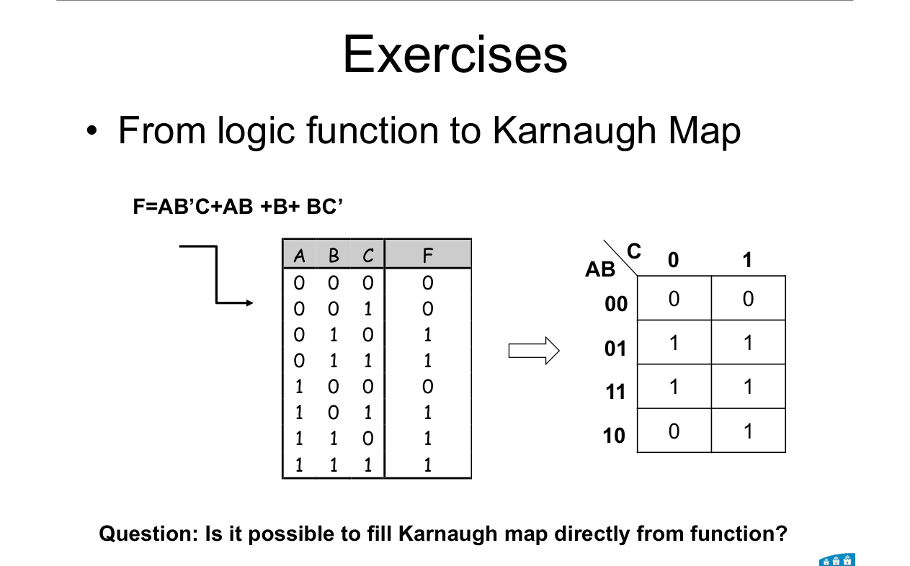

The slide asks: can you fill the map without a truth table?

**Yes.** Each product term marks every cell where its letters hold.

 

**Example: F = AB'C + AB + B + BC'** (3 variables)

| Term | Marks these cells |
|---|---|
| B | the whole B = 1 half: rows 01 and 11 → cells 2, 3, 6, 7 |
| AB | row 11 → cells 6, 7 |
| AB'C | cell 5 |
| BC' | cells 2, 6 |

Result: 1s at 2, 3, 5, 6, 7.

 

**For a POS expression:** each sum term marks **0s** where it is false.

Example: (B + C') is 0 when B = 0 and C = 1.

---

## 10. Pick the cheaper of SOP and POS

**Last step of the procedure:**
Find **both** the minimum SOP and the minimum POS.

**Pick the one with fewer terms, then fewer letters.**

Sometimes POS wins (like §8). Sometimes SOP wins.

---

## Method: any K-map question

1. **Draw the right map.** AB down the side. C or CD across. Gray order: **00, 01, 11, 10**.
2. **Fill it.** From Σm, a truth table, or straight from the expression (§9).
3. **SOP:** circle the 1s. Biggest rectangles of 1, 2, 4, 8 or 16. Wrap edges and corners.
4. **Cover every 1.** Overlap is fine. Drop redundant groups.
5. **Read each group:** keep only letters that don't change. 1 → plain, 0 → barred.
6. **POS:** circle the 0s. Read with the flipped rule: 0 → plain, 1 → barred.
7. **Compare** SOP and POS. Pick the cheaper.
8. **Check** one or two cells by plugging them into your answer.

---

Next: [End-of-topic test](../questions/08-karnaugh-maps.md)
