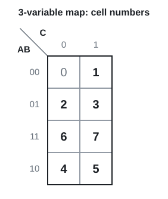
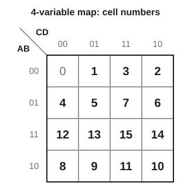
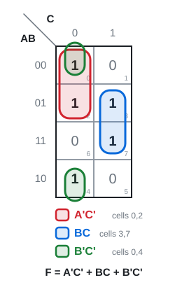
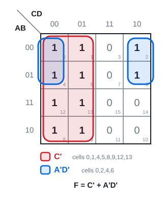
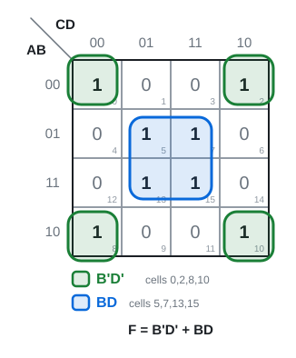
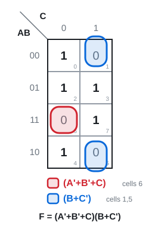
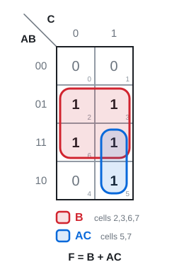

# 08 · Karnaugh maps ⭐

Lecture 5, slides 10–27 · ●●● the biggest mid-term topic · [**Quiz →**](https://albinjoby82-ops.github.io/DE_Lock-In/quiz.html?t=08)

**▶ Explainer videos** (tap to search YouTube):
- [Karnaugh map explained](https://www.youtube.com/results?search_query=Karnaugh+map+explained)
- [K-map 4 variable simplification](https://www.youtube.com/results?search_query=K-map+4+variable+simplification)
- [K-map product of sums grouping zeros](https://www.youtube.com/results?search_query=K-map+product+of+sums+grouping+zeros)

Put the truth table in a grid, circle blocks of 1s, read one short term per block. **Fewest blocks, biggest blocks** = cheapest circuit.

---

## 1. The grid: Gray order and cell numbers

▶ Video: [Karnaugh map explained](https://www.youtube.com/results?search_query=Karnaugh+map+explained)

**Rule:** AB down the side, C or CD across the top. Both go **00, 01, 11, 10**. Learn where each minterm sits.

 

Columns go 0, 1, **3, 2**. Rows add 0, 4, **12, 8**. Cell = row + column.

The map **wraps**: left edge touches right edge, top touches bottom, and the **4 corners** are one block.

> **Apply:** where is m₁₁? Which cells are next to m₆ in a 3-variable map?

Answer

m₁₁ = 1011 → row AB = 10 (bottom), column CD = 11 (third).
m₆ = 110 → row 11, column 0. Neighbours: **m₇, m₂, m₄**.

---

## 2. Grouping rules

1. Blocks of **1, 2, 4, 8 or 16** cells. Never 3 or 6.
2. **Rectangles** only. They may wrap round the edges.
3. Make every block **as big as possible**.
4. Every 1 in **at least one** block. Overlap is fine.
5. **Fewest** blocks. Drop any block whose cells are all covered by others.

---

## 3. Reading a block (SOP)

**Rule:** look along the block. A letter that **changes** cancels. A letter that stays **1** → plain. Stays **0** → barred. AND what's left.

A block of 2ᵏ cells removes **k** letters (4-variable map: 2 → 3 letters left, 4 → 2, 8 → 1).

Σm(0, 2, 3, 4, 7): **F = A'C' + BC + B'C'**. The green block wraps top to bottom. A'B (cells 2, 3) would be redundant, so it's left out.

> **Apply:** Σm(1, 3, 4, 6). Draw it, give the minimum SOP.

Answer

Cells 1, 3: A = 0, C = 1 → A'C. Cells 4, 6: A = 1, C = 0 → AC'. **F = A'C + AC'** (= A ⊕ C).

---

## 4. Four variables

▶ Video: [K-map 4 variable simplification](https://www.youtube.com/results?search_query=K-map+4+variable+simplification)

Left half (8 cells) → **C'**. Cells 0, 2, 4, 6 wrap left to right → **A'D'**. **F = C' + A'D'**.

> **Apply:** Σm(0, 2, 5, 7, 8, 10, 13, 15). Minimum SOP?

Answer

The 4 corners → **B'D'**. The centre square → **BD**. **F = B'D' + BD**.

---

## 5. POS: group the 0s

▶ Video: [K-map product of sums grouping zeros](https://www.youtube.com/results?search_query=K-map+product+of+sums+grouping+zeros)

**Rule:** circle the **0s** the same way. Read with the maxterm rule: stays **0** → **plain**, stays **1** → **barred**. OR the letters, AND the brackets.

7 gate inputs instead of 9. **Always find both and pick the cheaper.**

> **Apply:** a block of 0s has A = 1 and B = 0 all the way through. What sum term?

Answer

A = 1 → A'. B = 0 → B. **(A' + B)**.

---

## 6. Filling straight from an expression

**Rule:** each product term puts 1s on every cell where its letters hold. Each sum term (POS) puts **0s** where all its letters are false.

F = AB'C + AB + B + BC': **B** fills rows 01 and 11, **AB'C** adds cell 5. The rest are already there.

> **Apply:** where does the sum term (B + C') put its 0s in a 3-variable map?

Answer

It's 0 when B = 0 and C = 1 → cells **1 and 5**.

---

## Exam drill (slides 23–27)

**1.** F = AB'C + AB + B + BC'. Minimum SOP and POS.
**2.** F = (A + B + C)(B + C')(C' + D)(A + B' + C + D). Minimum SOP and POS.
**3.** F = (A + C')D + BC + ACD'. Minimum SOP and POS. Which is cheaper?

Answers

1. SOP **B + AC**. POS **(A + B)(B + C)**.
2. 1s at 5, 7, 8, 9, 12, 13, 15. SOP **AC' + BD**. POS **(A + B)(A + D)(B + C')(C' + D)**. SOP is cheaper.
3. 1s at 1, 5, 6, 7, 9, 10, 11, 13, 14, 15. SOP **C'D + BC + AC** (6 letters). POS **(C + D)(A + B + C')** (5 letters). **POS is cheaper.**

**Traps**
- Rows go 00, 01, **11, 10**. Swapping the last two is the most common mistake.
- Groups of 6 are not allowed, even as a rectangle.
- Use the wrap: edges and the four corners.
- For 0s: 0 → plain.

---

## Test yourself

**▶ [Topic 08 quiz](https://albinjoby82-ops.github.io/DE_Lock-In/quiz.html?t=08)** (answers checked as you go, **New numbers** for fresh practice)  
[Mixed quiz: topics 07 + 08](https://albinjoby82-ops.github.io/DE_Lock-In/quiz.html?mix=07,08&n=15)  
**▶ [Book questions for this topic](https://albinjoby82-ops.github.io/DE_Lock-In/book.html?t=08)** (Mano 3.1–3.14, 3.26: 63 questions, every one worked)  
[Mock mid-term](https://albinjoby82-ops.github.io/DE_Lock-In/#book-questions)  
[All quizzes](https://albinjoby82-ops.github.io/DE_Lock-In/)

Next: [09 · Don't cares, NAND-NAND and NOR-NOR](09-dont-cares-nand-nor.md)
