# Topic 9 — Don't cares, NAND-NAND and NOR-NOR

Slide exercises: Lecture 6, slides 14 and 15

Slides: Lecture 6, all

---

## The big idea

Two upgrades to K-maps:

1. **Don't cares:** some inputs never happen. We can pick their output to make bigger groups.
2. **NAND and NOR only:** real chips prefer these gates. We can build any SOP from just NANDs, and any POS from just NORs.

---

**How to use these notes:**
When you see 🧠, stop.
Answer it on paper first.
Then click to check.

---

## 1. Don't care terms

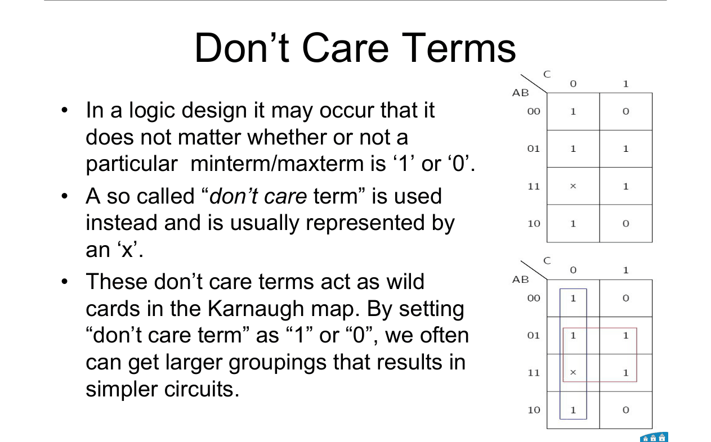

Sometimes an input combination **never happens**.

Or it happens, but **we don't care** what the output is.

We mark that cell with an **x**. It's a wild card.

---

### 📐 Rule 1: using don't cares

**Treat an x as a 1** if it lets you make a **bigger** group.

**Treat an x as a 0** if it doesn't help. Then just leave it out.

You **never** have to cover an x.

**Why it works:**
The output on that row doesn't matter. So pick whichever value gives the simpler circuit.

**Use it when:**
The question gives d(…) or marks cells with x.

**Watch out:**
Don't add a group just to cover an x. Only the 1s must be covered.

---

## 2. Worked example (slide 4)

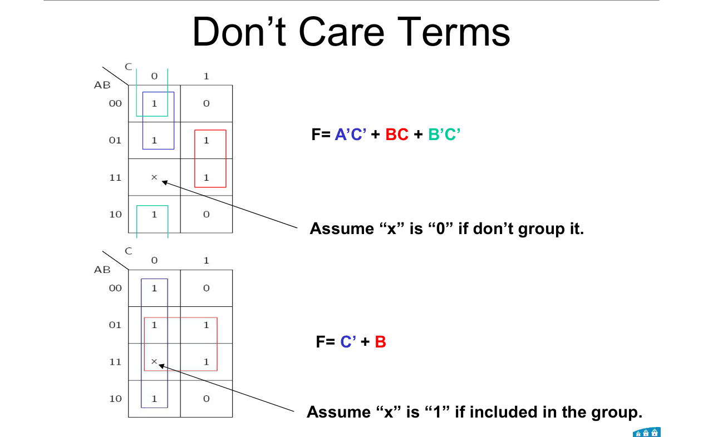

**How to read this diagram:**

Same map both times. The x is at cell 6 (row 11, column 0).

Top: x left as 0. Bottom: x used as 1.

 

| AB \ C | 0 | 1 |
|---|---|---|
| **00** | 1 | 0 |
| **01** | 1 | 1 |
| **11** | **x** | 1 |
| **10** | 1 | 0 |

 

**x as 0** (top map): three groups of 2.

F = A'C' + BC + B'C'

 

**x as 1** (bottom map): two groups of 4.

Whole column C = 0 (cells 0, 2, 6, 4): → **C'**

Rows 01 and 11 (cells 2, 3, 6, 7): → **B**

**F = C' + B**

Much simpler.

 

### 🧠 Check
Why is F = C' + B allowed, even though it outputs 1 on cell 6?

Answer

Cell 6 is a don't care. Its output doesn't matter, so 1 is fine.

---

## 3. NAND and NOR gates

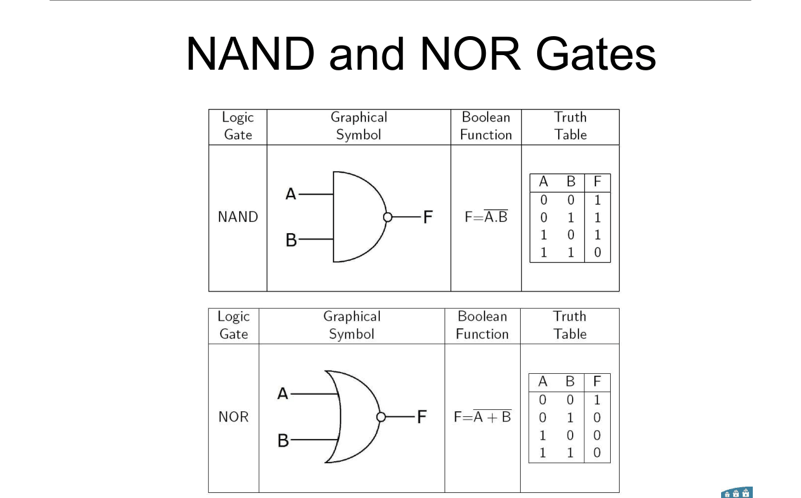

| Gate | Output | Truth |
|---|---|---|
| **NAND** | (AB)' | 0 only when **both** inputs are 1 |
| **NOR** | (A + B)' | 1 only when **both** inputs are 0 |

The **bubble** on the output means "NOT".

---

## 4. Why NAND and NOR?

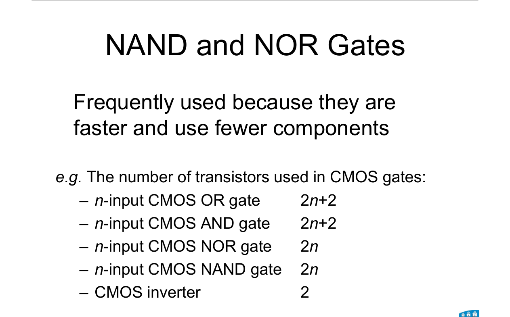

They are **faster** and use **fewer transistors**.

---

### 📐 Rule 2: CMOS transistor counts

| Gate (n inputs) | Transistors |
|---|---|
| NAND | **2n** |
| NOR | **2n** |
| AND | **2n + 2** |
| OR | **2n + 2** |
| NOT (inverter) | **2** |

| Symbol | Means |
|---|---|
| n | number of inputs to the gate |

**Why AND and OR cost 2 more:**
In CMOS, an AND is built as a NAND followed by an inverter. The inverter adds 2.

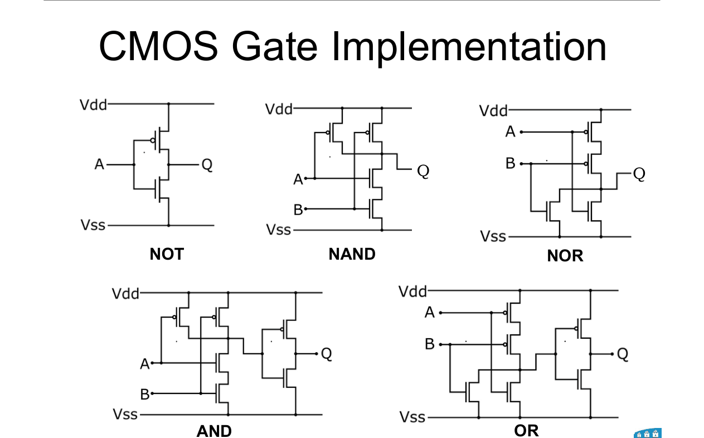

**Use it when:**
"How many transistors…" questions, or explaining why NAND/NOR are preferred.

---

 

### 🧠 Check
How many transistors in a 3-input NAND? A 3-input AND?

Answer

NAND: 2 × 3 = **6**

AND: 2 × 3 + 2 = **8**

---

## 5. Why NAND-NAND works

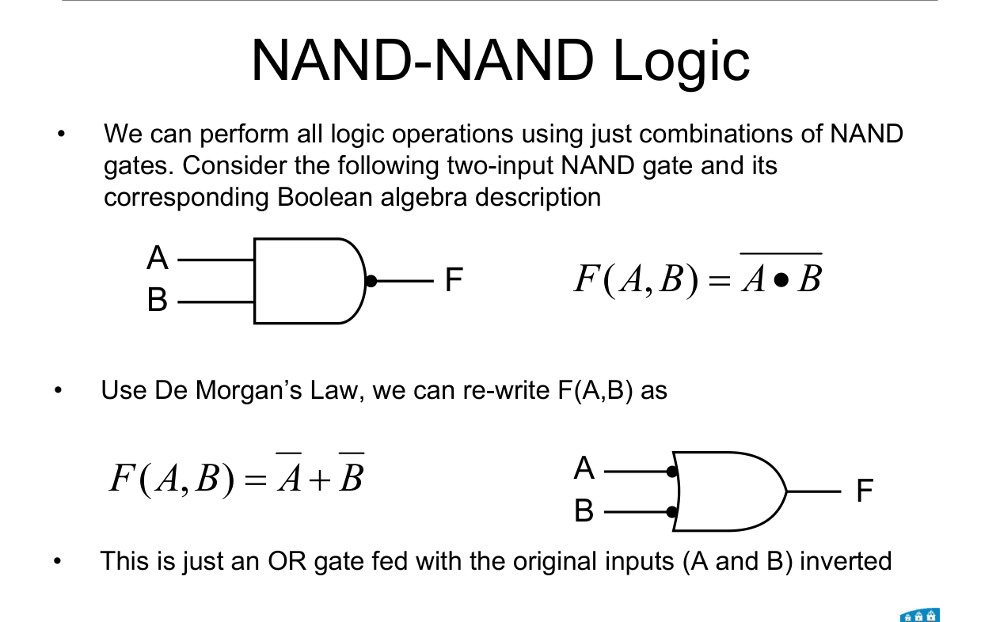

By DeMorgan:

$$(AB)' = A' + B'$$

So a NAND gate is the same as **an OR gate with inverted inputs**.

 

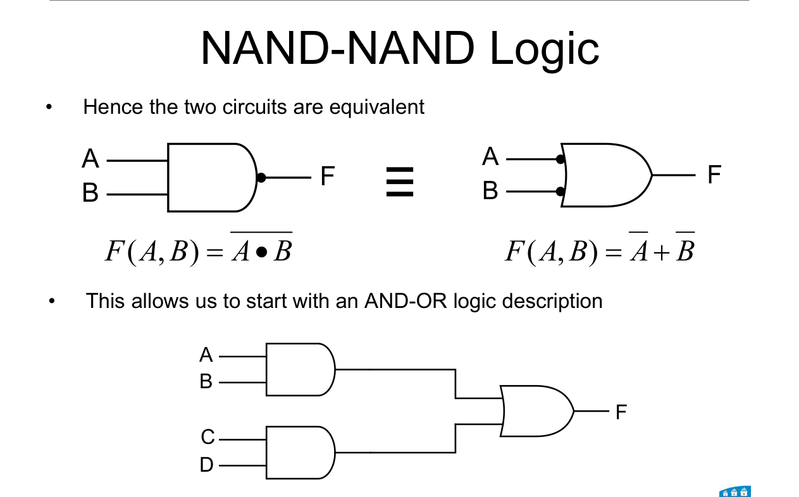

**How to read this diagram:**

Left: a NAND. Right: an OR with bubbles on its inputs.

They're the same gate, drawn two ways.

 

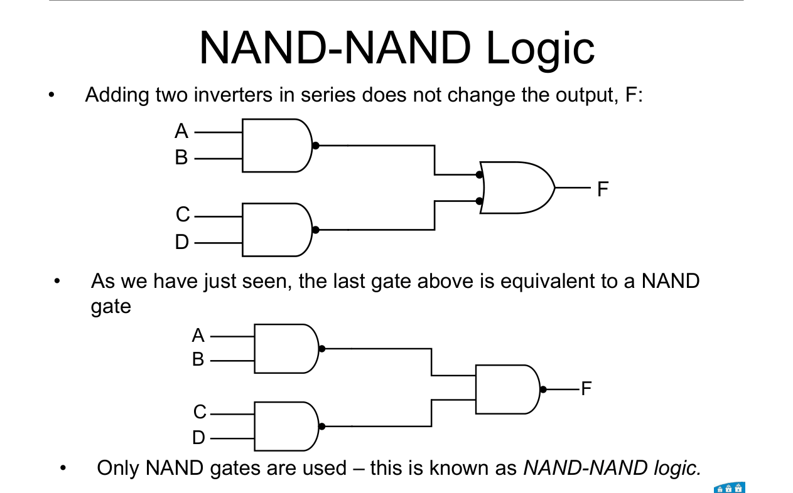

**How to read this diagram:**

Top: a normal AND-OR circuit.

Middle: two bubbles added on each middle wire. Two NOTs cancel, so nothing changes.

Bottom: each AND + its bubble = a NAND. The OR with bubbled inputs = a NAND.

**All NANDs.** This is **NAND-NAND logic**.

---

## 6. Single letters into the output gate

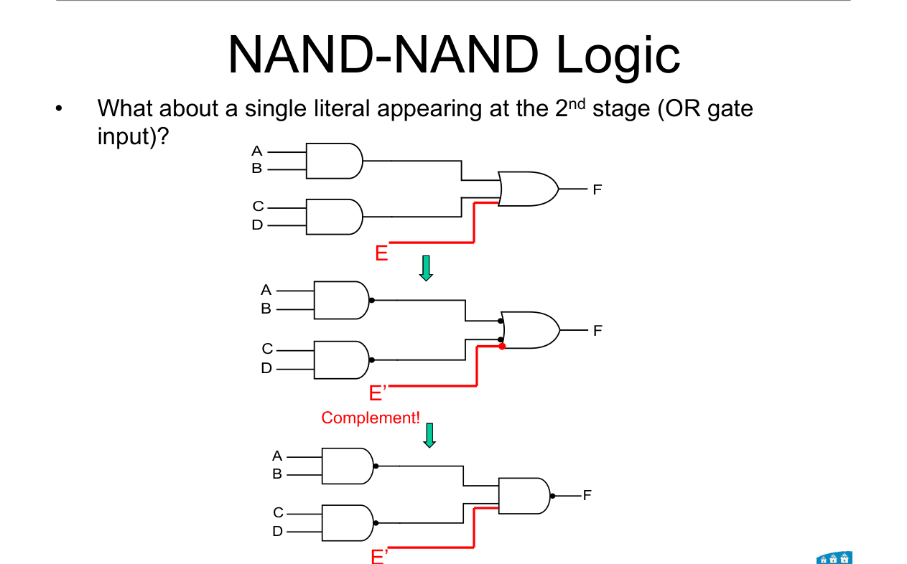

**What if a single letter, E, goes straight into the OR?**

It has no first-level gate, so it doesn't get the extra bubble.

But the output NAND still inverts it.

**So you must feed in E' instead.**

---

## 7. The NAND-NAND procedure ⭐

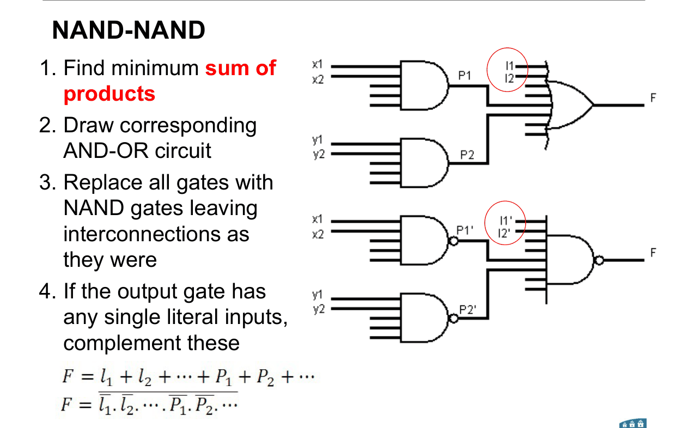

---

### 📐 Rule 3: NAND-NAND

**Step 1.** Find the **minimum SOP** (K-map).

**Step 2.** Draw the AND-OR circuit.

**Step 3.** Replace **every** gate with a **NAND**. Keep the wiring.

**Step 4.** Any **single letter** going straight into the output gate: **complement it**.

**Why it works:** §5 and §6.

**Use it when:**
"Implement with two-level NAND" or "NAND gates only".

---

## 8. The NOR-NOR procedure

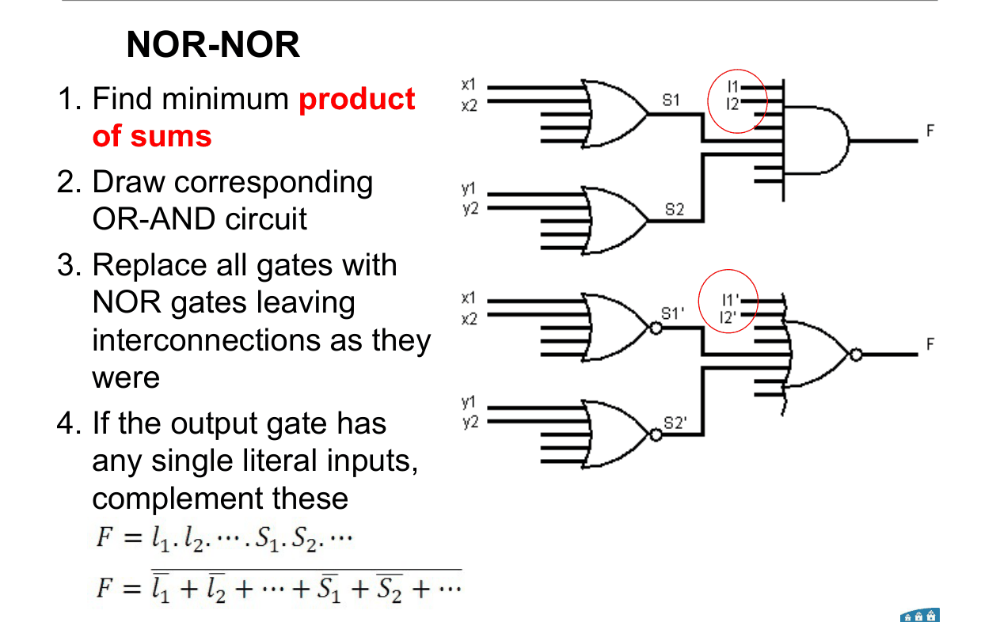

---

### 📐 Rule 4: NOR-NOR

**Step 1.** Find the **minimum POS** (K-map, grouping 0s).

**Step 2.** Draw the OR-AND circuit.

**Step 3.** Replace **every** gate with a **NOR**. Keep the wiring.

**Step 4.** Any **single letter** going straight into the output gate: **complement it**.

**Why it works:**
Same idea, flipped. By DeMorgan, (A + B)' = A'B'. So a NOR is an AND with inverted inputs.

**Use it when:**
"Implement with two-level NOR" or "NOR gates only".

---

 

### 🧠 Check
You have F = AB + C. Build it with NANDs.

Answer

Gate 1: NAND(A, B) = (AB)'

C is a single letter at the output, so complement it: C'.

Output: NAND(gate 1, C') = ((AB)' · C')'

Check by DeMorgan: = AB + C ✓

---

## 9. Worked example: NAND-NAND (slide 14)

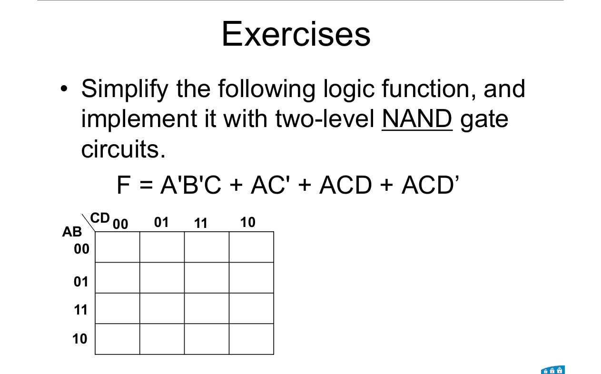

**Simplify F = A'B'C + AC' + ACD + ACD' and build it with two-level NANDs.**

 

**Step 1. Minimise.**

Algebra: ACD + ACD' = AC. Then AC + AC' = A.

So F = A + A'B'C = **A + B'C** (shortcut x + x'y = x + y).

 

Or by K-map: the 1s are cells 2, 3 and 8 to 15.

| AB \ CD | 00 | 01 | 11 | 10 |
|---|---|---|---|---|
| **00** | 0 | 0 | 1 | 1 |
| **01** | 0 | 0 | 0 | 0 |
| **11** | 1 | 1 | 1 | 1 |
| **10** | 1 | 1 | 1 | 1 |

Rows 11 and 10 (group of 8): **A**

Cells 3, 2, 11, 10 (wraps top to bottom): B = 0, C = 1 → **B'C**

 

**Steps 2 to 4. Build.**

Gate 1: NAND(B', C) = (B'C)'

A is a single letter at the output gate → feed in **A'**.

Output: NAND(A', gate 1)

 

**Check:** (A' · (B'C)')' = A + B'C ✓

---

## 10. Worked example: NOR-NOR (slide 15)

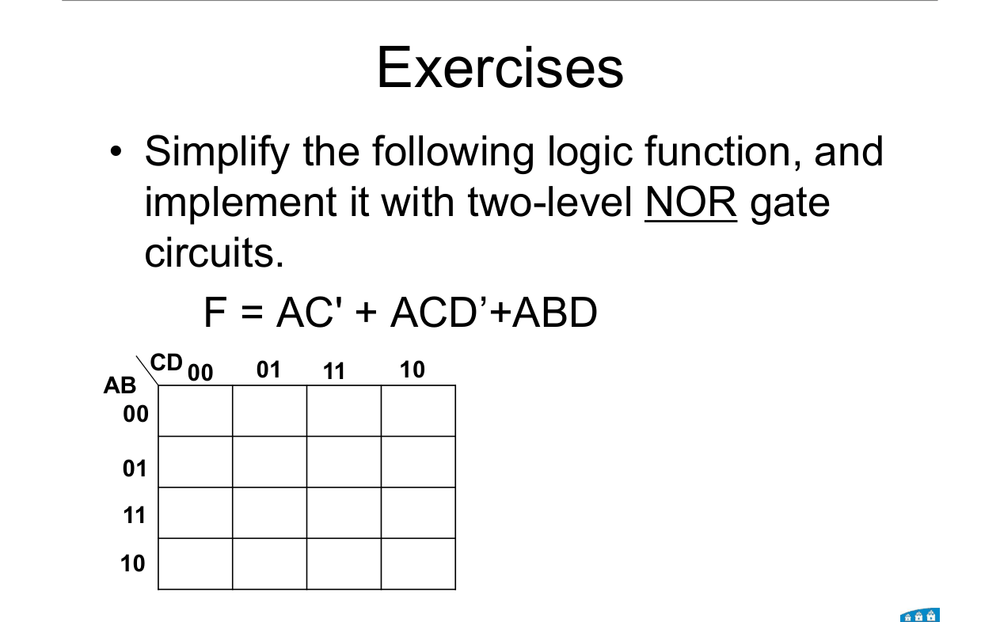

**Simplify F = AC' + ACD' + ABD and build it with two-level NORs.**

 

**Step 1. Minimise the POS.**

The 1s are cells 8, 9, 10, 12, 13, 14, 15. That's every A = 1 cell except 11.

| AB \ CD | 00 | 01 | 11 | 10 |
|---|---|---|---|---|
| **00** | 0 | 0 | 0 | 0 |
| **01** | 0 | 0 | 0 | 0 |
| **11** | 1 | 1 | 1 | 1 |
| **10** | 1 | 1 | **0** | 1 |

Group the 0s:

Rows 00 and 01 (cells 0 to 7): A = 0 → **(A)**

Cells 3 and 11 (column CD = 11, wraps top to bottom): B = 0, C = 1, D = 1 → **(B + C' + D')**

**F = A(B + C' + D')**

(The SOP would be AB + AC' + AD'. Longer.)

 

**Steps 2 to 4. Build.**

Gate 1: NOR(B, C', D') = (B + C' + D')'

A is a single letter at the output gate → feed in **A'**.

Output: NOR(A', gate 1)

 

**Check:** (A' + (B + C' + D')')' = A · (B + C' + D') ✓

---

## Method: "implement with NAND / NOR only"

1. **NAND?** Get the minimum **SOP**. **NOR?** Get the minimum **POS**.
2. **Use don't cares** if there are any. x = 1 only if it grows a group.
3. **Draw** the two-level circuit (AND-OR or OR-AND).
4. **Swap every gate** for NAND (or NOR).
5. **Complement single letters** going straight into the output gate.
6. **Check** with DeMorgan.

---

Next: [End-of-topic test](../questions/09-dont-cares-nand-nor.md)
