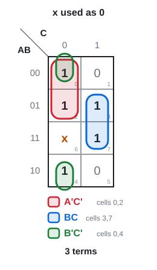
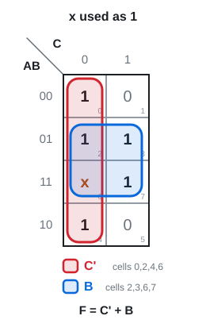
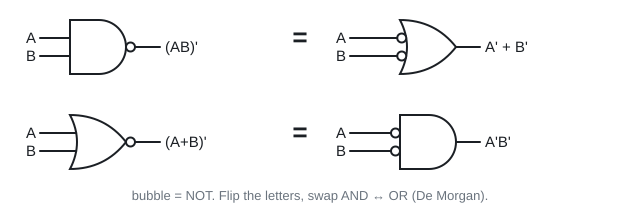
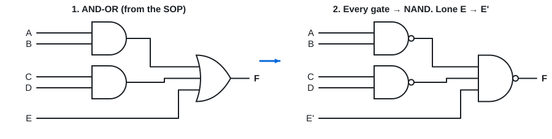
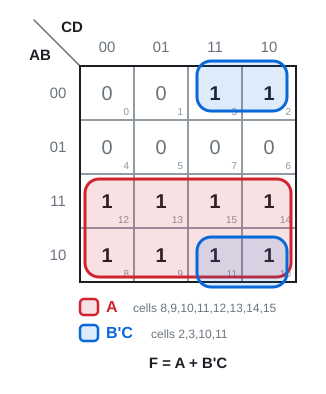
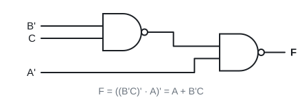
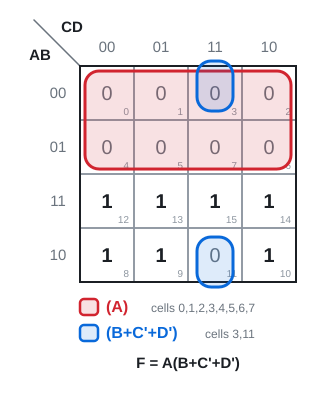
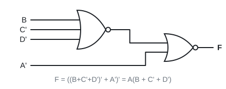

# 09 · Don't cares, NAND-NAND and NOR-NOR

Lecture 6, all · ●●● · [**Quiz →**](https://albinjoby82-ops.github.io/DE_Lock-In/quiz.html?t=09)

Two upgrades: **don't cares** make bigger K-map blocks, and **NAND / NOR only** circuits are what real chips prefer.

---

## 1. Don't cares (x)

An input that never happens, or whose output doesn't matter, gets an **x**.

**Rule:** treat x as **1** if it makes a block bigger. Otherwise treat it as 0 and ignore it. You **never** have to cover an x.

 

Σm(0, 2, 3, 4, 7) + d(6): **F = C' + B** instead of three terms.

> **Apply:** F(A, B, C) = Σm(1, 3) + d(5, 7). Minimum SOP?

Answer

Use both x's: column C = 1 is a block of 4 → **F = C**.

---

## 2. Why NAND and NOR?

CMOS transistor counts (n inputs):

| NAND | NOR | AND | OR | NOT |
|---|---|---|---|---|
| **2n** | **2n** | 2n + 2 | 2n + 2 | 2 |

AND = NAND + inverter, so it costs 2 more. NAND and NOR are smaller **and** faster.

> **Apply:** transistors in a 3-input NAND? A 3-input AND?

Answer

NAND 2 × 3 = **6**. AND 6 + 2 = **8**.

---

## 3. The trick: De Morgan turns gates inside out

A NAND **is** an OR with inverted inputs. So in an AND-OR circuit, add two bubbles on each middle wire (they cancel). Every gate becomes a NAND.

---

## 4. NAND-NAND recipe (from SOP)

1. Minimum **SOP** (K-map, use don't cares).
2. Draw AND → OR.
3. Swap **every** gate for **NAND**. Same wires.
4. A **single letter** going straight into the output gate: **complement it**.

Why step 4: a lone letter has no first-level gate, so it misses its bubble. The output NAND would flip it.

## 5. NOR-NOR recipe (from POS)

Same four steps, but start from the minimum **POS** (group the 0s), draw OR → AND, swap every gate for **NOR**, complement lone letters.

> **Apply:** build F = AB + C from NANDs only.

Answer

Gate 1 = NAND(A, B). C is a lone letter → feed **C'**. Output = NAND(gate 1, C').
Check: ((AB)' · C')' = AB + C ✓

---

## Exam drill (slides 14 and 15)

**1.** Simplify F = A'B'C + AC' + ACD + ACD' and build it with two-level NANDs.

Answer

**F = A + B'C** → NAND(B', C), then NAND(**A'**, gate 1).

**2.** Simplify F = AC' + ACD' + ABD and build it with two-level NORs.

Answer

Group the 0s:

**F = A(B + C' + D')** → NOR(B, C', D'), then NOR(**A'**, gate 1).

**Traps**
- NAND ← SOP. NOR ← POS. Don't mix them up.
- Complement the **lone letters** at the output gate.
- An x never has to be covered.
