# Topic 10 — Adders, carry lookahead, subtractors, multipliers

Slide exercises: none set, but every circuit here is a likely exam question

Slides: Lecture 7/8, all

---

## The big idea

Now we use Topics 6 to 9 to **design real circuits**.

The first one: a circuit that **adds**.

Everything else in a computer's maths unit (subtract, multiply) is built from adders.

 

**Four equations carry this topic:**

Half adder: S = X ⊕ Y, C = XY

Full adder: S = X ⊕ Y ⊕ Z, C = XY + XZ + YZ

---

**How to use these notes:**
When you see 🧠, stop.
Answer it on paper first.
Then click to check.

---

## 1. Combinational logic and the design procedure

A **combinational circuit** takes n inputs and gives m outputs using gates.

The output depends **only on the inputs right now**. No memory.

---

### 📐 Rule 1: design procedure for any combinational circuit

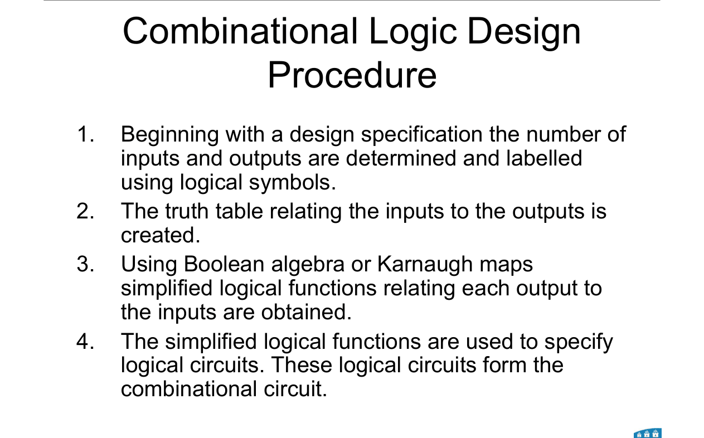

**Step 1.** From the spec, decide the **inputs and outputs**. Give them letters.

**Step 2.** Write the **truth table**.

**Step 3.** **Simplify** each output (algebra or K-map).

**Step 4.** **Draw** the circuit.

**Use it when:**
Any "design a circuit that…" question.

---

## 2. XOR

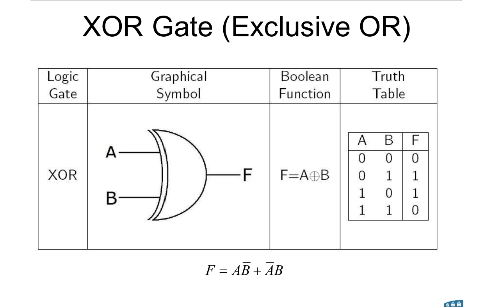

**XOR (exclusive OR)** is 1 when the inputs are **different**.

$$A \oplus B = A'B + AB'$$

| A | B | A ⊕ B |
|---|---|---|
| 0 | 0 | 0 |
| 0 | 1 | 1 |
| 1 | 0 | 1 |
| 1 | 1 | 0 |

 

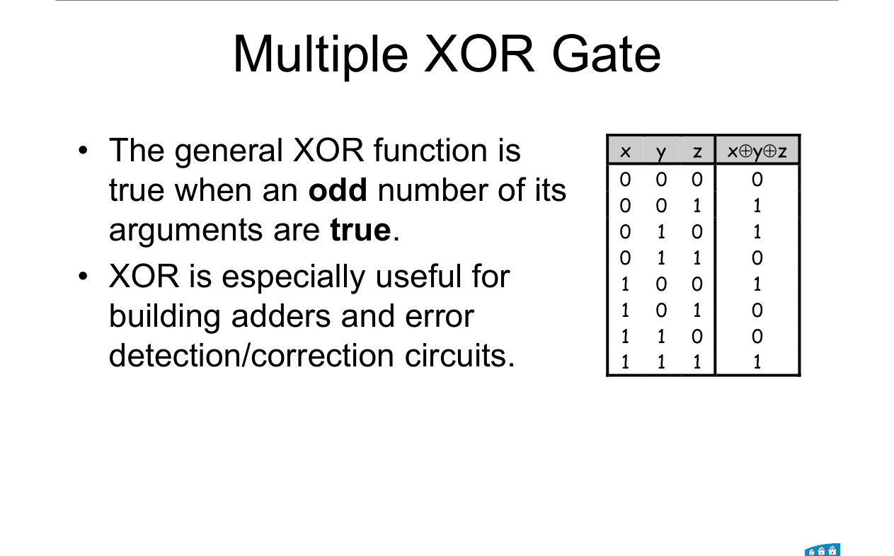

**With more inputs:** XOR is 1 when an **odd** number of inputs are 1.

That makes it perfect for adders and error checking (parity).

 

### 🧠 Check
What is 1 ⊕ 1 ⊕ 1?

Answer

Three 1s is an odd count, so **1**.

---

## 3. Half adder

Adds **two bits**: 0 + 0 = 0, 0 + 1 = 1, 1 + 0 = 1, 1 + 1 = 10.

Needs two outputs: **S** (sum) and **C** (carry).

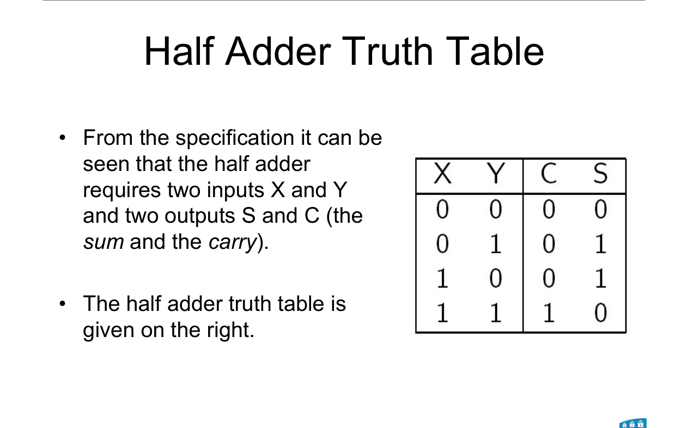

| X | Y | C | S |
|---|---|---|---|
| 0 | 0 | 0 | 0 |
| 0 | 1 | 0 | 1 |
| 1 | 0 | 0 | 1 |
| 1 | 1 | 1 | 0 |

 

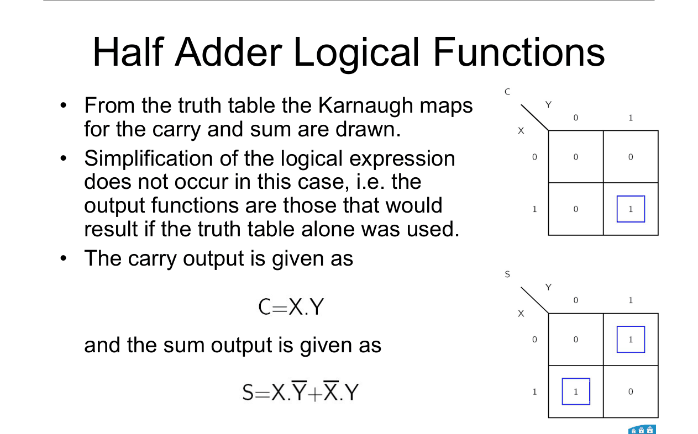

The K-maps don't simplify anything.

---

### 📐 Equation 1: half adder

$$S = X \oplus Y \qquad\qquad C = XY$$

| Symbol | Means |
|---|---|
| X, Y | the two bits being added |
| S | sum bit |
| C | carry bit |

**Why:** S = X'Y + XY', which is exactly XOR. C is 1 only for 1 + 1.

**Use it when:**
Adding two bits with no carry coming in. Also inside the full adder and carry lookahead.

---

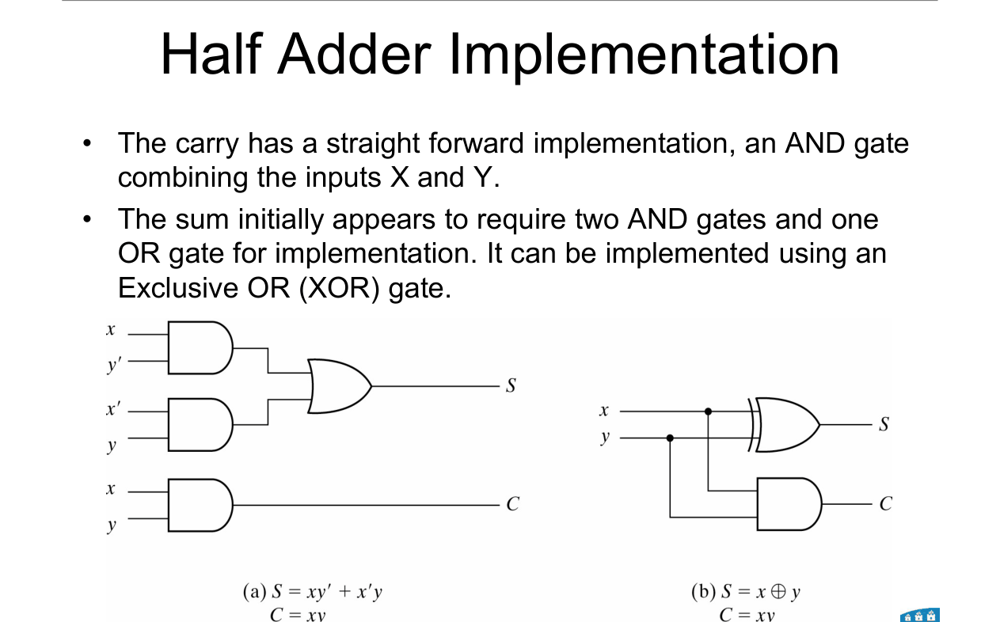

**How to read this diagram:**

(a) The sum with two ANDs and an OR. (b) The same sum with one XOR gate. The carry is one AND either way.

---

## 4. Full adder ⭐

Adds **three bits**: X, Y and a carry-in Z.

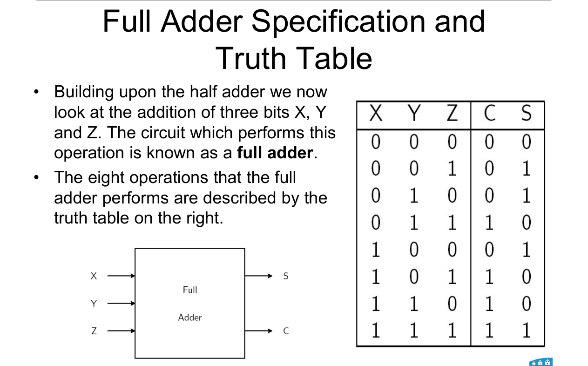

| X | Y | Z | C | S |
|---|---|---|---|---|
| 0 | 0 | 0 | 0 | 0 |
| 0 | 0 | 1 | 0 | 1 |
| 0 | 1 | 0 | 0 | 1 |
| 0 | 1 | 1 | 1 | 0 |
| 1 | 0 | 0 | 0 | 1 |
| 1 | 0 | 1 | 1 | 0 |
| 1 | 1 | 0 | 1 | 0 |
| 1 | 1 | 1 | 1 | 1 |

**Tip:** C = 1 when **two or more** inputs are 1. S = 1 when an **odd number** are 1.

 

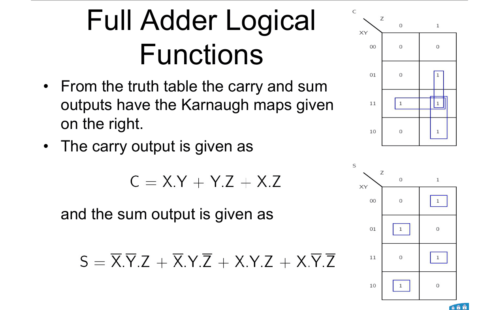

**How to read this diagram:**

Top map (carry): three groups of 2 → XY + YZ + XZ.

Bottom map (sum): a **checkerboard**. No two 1s touch, so nothing simplifies.

---

### 📐 Equation 2: full adder

$$S = X \oplus Y \oplus Z = \Sigma m(1, 2, 4, 7)$$

$$C = XY + XZ + YZ = \Sigma m(3, 5, 6, 7)$$

| Symbol | Means |
|---|---|
| X, Y | the two bits being added |
| Z | carry in from the bit to the right |
| S | sum bit |
| C | carry out to the bit on the left |

**Use it when:**
Adding one column of a multi-bit sum.

**Built directly:** the carry needs 3 ANDs + 1 OR. The sum needs 4 ANDs + 1 OR.

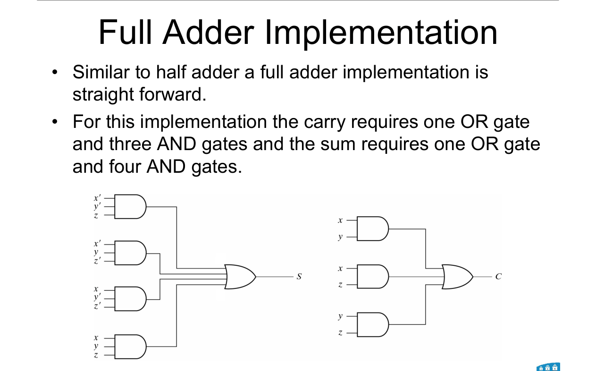

---

## 5. Full adder from two half adders

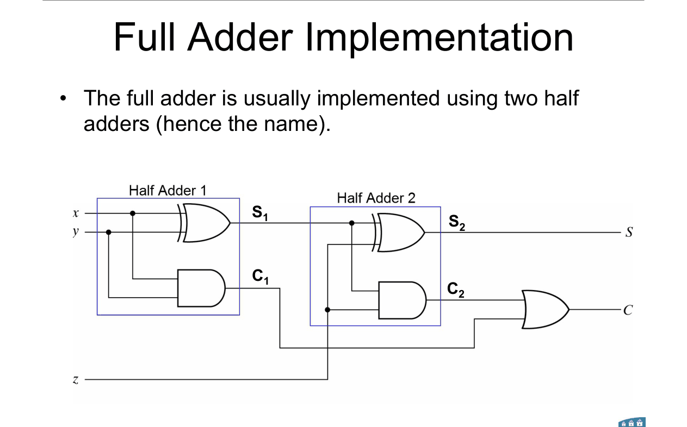

**How to read this diagram:**

Half adder 1 adds x and y → S₁ and C₁.

Half adder 2 adds S₁ and z → S₂ (the final sum) and C₂.

An OR combines the two carries.

 

$$S_1 = X \oplus Y \qquad C_1 = XY$$

$$S = S_1 \oplus Z \qquad C_2 = S_1 Z$$

$$C = C_1 + C_2 = XY + (X \oplus Y)Z$$

 

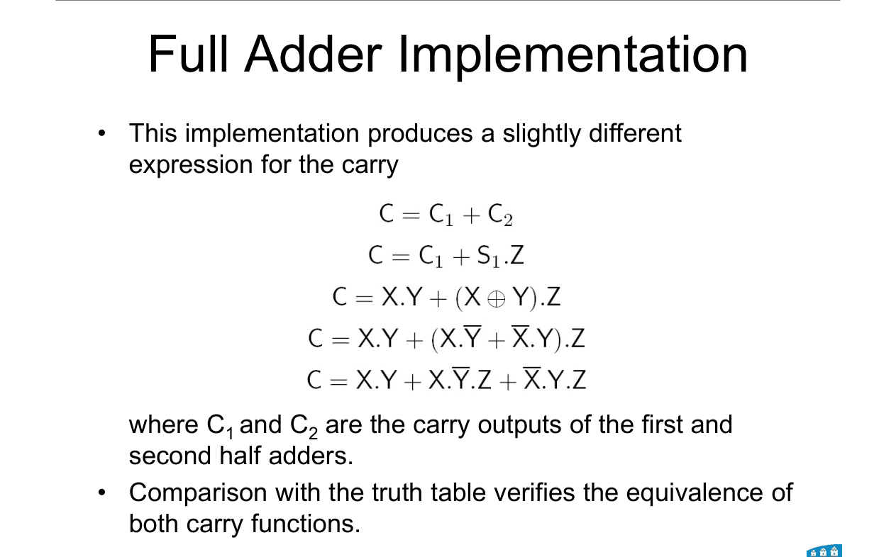

This carry **looks different** from XY + XZ + YZ, but it gives the **same truth table**.

 

### 🧠 Check
X = 1, Y = 0, Z = 1. Find S₁, C₁, S and C.

Answer

S₁ = 1 ⊕ 0 = 1. C₁ = 1 · 0 = 0.

S = 1 ⊕ 1 = **0**. C₂ = 1 · 1 = 1.

C = 0 + 1 = **1**.

(1 + 0 + 1 = 2 = 10 ✓)

---

## 6. Ripple carry adder

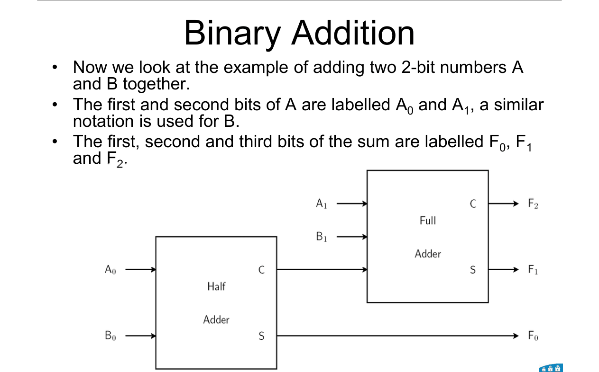

To add bigger numbers, chain full adders. **One per bit.**

Each carry-out feeds the next carry-in.

 

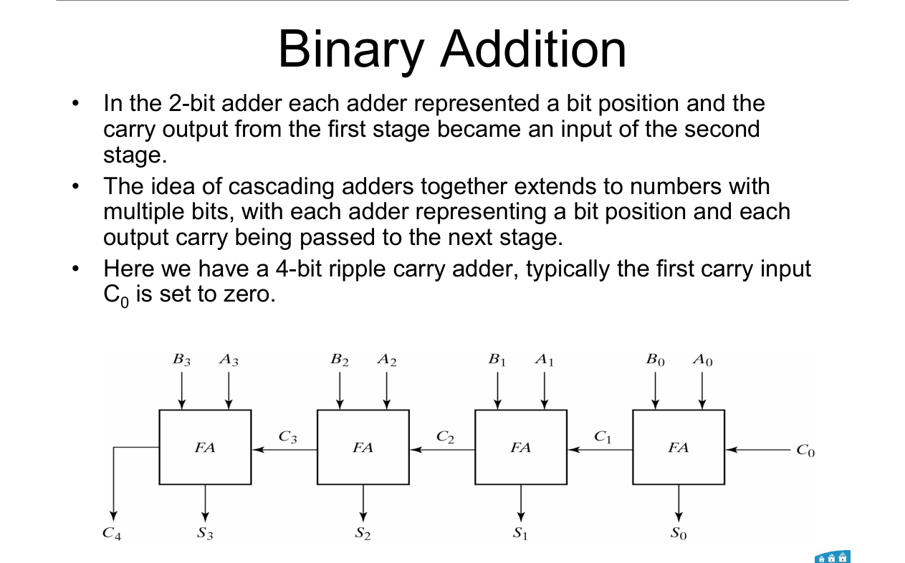

**How to read this diagram:**

Four full adders (FA) side by side. Bit 0 on the right.

The carry C₀ comes in on the right (usually 0). C₄ comes out on the left.

 

**The problem: speed.**

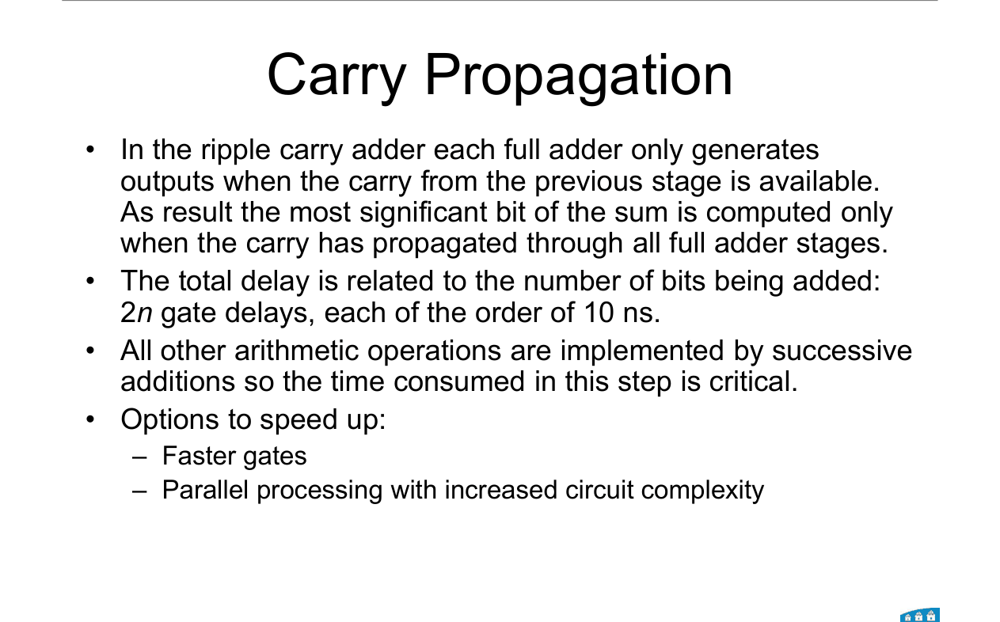

Each adder must **wait** for the carry from the one before.

The carry **ripples** through every stage.

**Delay ≈ 2n gate delays** for n bits. Each gate delay is about 10 ns.

 

**Why not just build a 4-bit adder straight from a truth table?**

It would have 9 inputs (4 + 4 + carry-in). That's 2⁹ = **512 rows**. Too big.

 

### 🧠 Check
Roughly how long does a 16-bit ripple carry adder take, at 10 ns per gate?

Answer

2n = 32 gate delays. 32 × 10 ns = **320 ns**.

---

## 7. Carry lookahead ⭐

Work out **every carry at once**, straight from the inputs. No waiting.

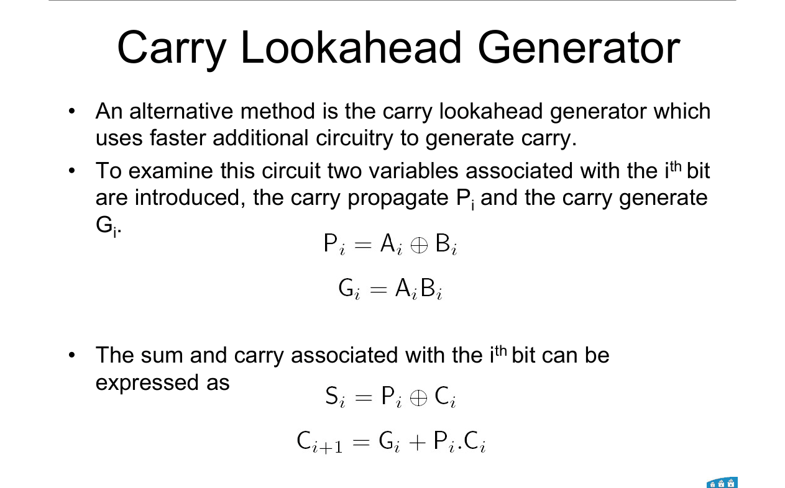

---

### 📐 Equation 3: propagate and generate

$$P_i = A_i \oplus B_i \qquad\qquad G_i = A_i B_i$$

$$S_i = P_i \oplus C_i \qquad\qquad C_{i+1} = G_i + P_i C_i$$

| Symbol | Means |
|---|---|
| Aᵢ, Bᵢ | bit i of the two numbers |
| Gᵢ | **generate**: this bit makes a carry by itself (1 + 1) |
| Pᵢ | **propagate**: this bit passes an incoming carry on (exactly one input is 1) |
| Cᵢ | carry into bit i. C₀ is the input carry. |

**What it means:**
A carry comes out of bit i if bit i **generates** one, **or** if it **propagates** the one coming in.

**Use it when:**
Writing out carry lookahead equations.

---

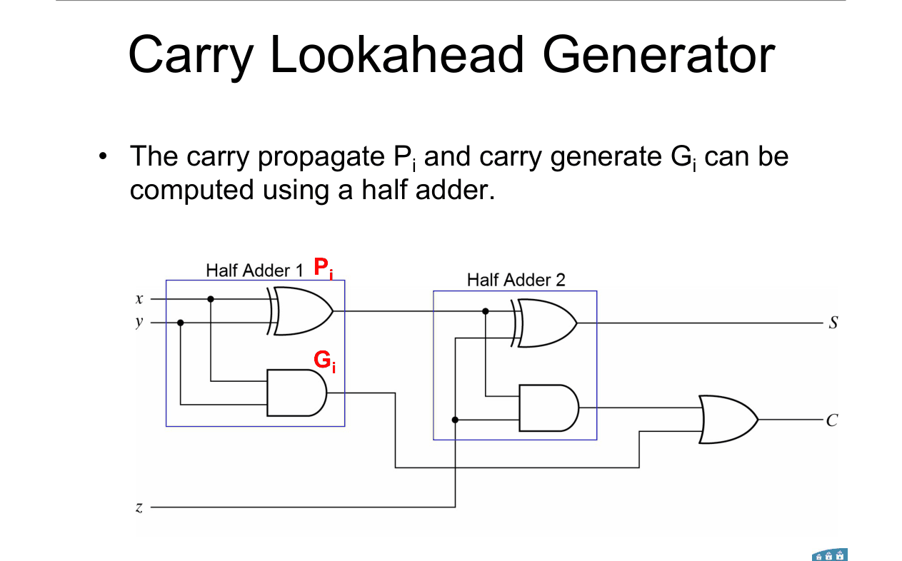

A half adder makes Pᵢ and Gᵢ: its sum is Pᵢ and its carry is Gᵢ.

 

**Expanding the carries** (keep substituting the previous one):

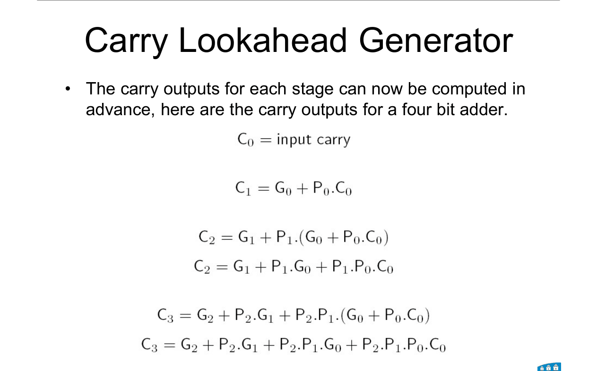

$$C_1 = G_0 + P_0 C_0$$

$$C_2 = G_1 + P_1 G_0 + P_1 P_0 C_0$$

$$C_3 = G_2 + P_2 G_1 + P_2 P_1 G_0 + P_2 P_1 P_0 C_0$$

$$C_4 = G_3 + P_3 G_2 + P_3 P_2 G_1 + P_3 P_2 P_1 G_0 + P_3 P_2 P_1 P_0 C_0$$

(The slides stop at C₃. C₄ follows the same pattern.)

**Pattern:** each term is "some bit generates, and every bit after it propagates".

 

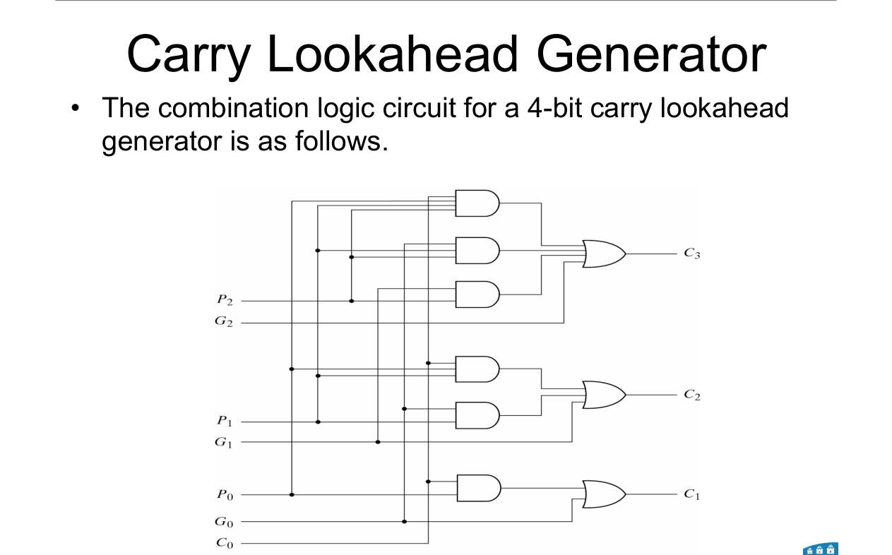

Every carry is now just **two levels** of gates (AND then OR). Fast.

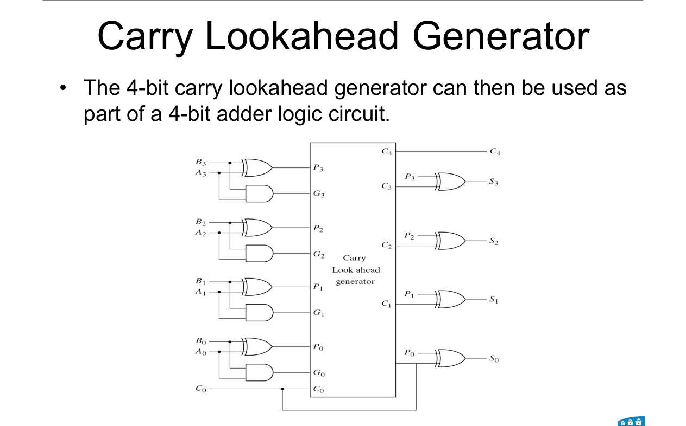

---

## 8. Carry lookahead: the catch

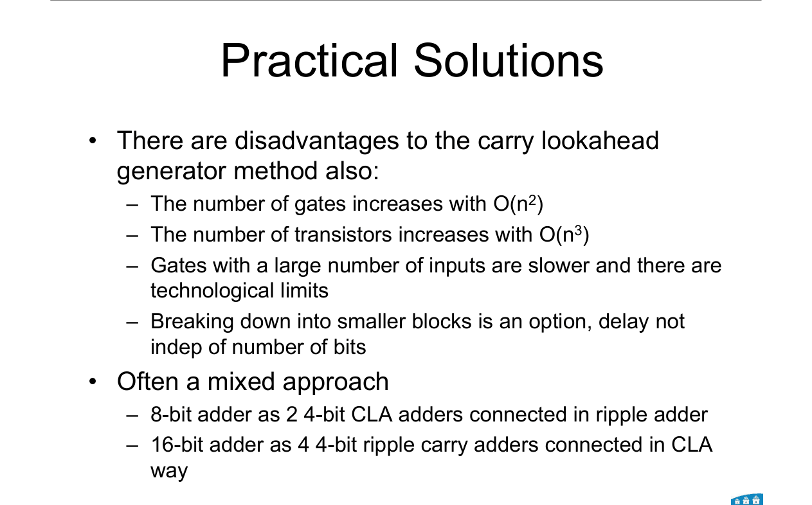

| Problem | Why |
|---|---|
| Gates grow as **O(n²)** | each carry has more terms |
| Transistors grow as **O(n³)** | and each term has more inputs |
| Wide gates are **slow** | and there are technology limits |

**Real designs mix the two:**
- 8-bit adder = two 4-bit CLA blocks, rippled together.
- 16-bit adder = four 4-bit ripple adders, linked by lookahead.

 

### 🧠 Check
Write C₂ in terms of P, G and C₀.

Answer

C₂ = G₁ + P₁C₁ = G₁ + P₁(G₀ + P₀C₀)

= **G₁ + P₁G₀ + P₁P₀C₀**

---

## 9. Subtraction

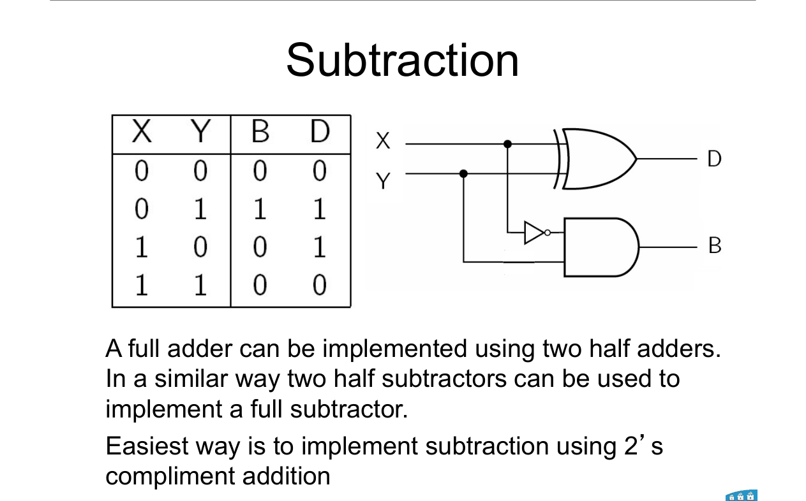

Half subtractor: X − Y. Outputs **D** (difference) and **B** (borrow).

| X | Y | B | D |
|---|---|---|---|
| 0 | 0 | 0 | 0 |
| 0 | 1 | 1 | 1 |
| 1 | 0 | 0 | 1 |
| 1 | 1 | 0 | 0 |

---

### 📐 Equation 4: subtraction

**Half subtractor:**

$$D = X \oplus Y \qquad\qquad B = X'Y$$

A borrow happens only for 0 − 1.

**Full subtractor** (two half subtractors + an OR):

$$D = X \oplus Y \oplus Z \qquad\qquad B = X'Y + X'Z + YZ$$

**The easy way (what real circuits do):** use 2's complement (Topic 4).

$$A - B = A + B' + 1$$

Invert every bit of B, and set the adder's carry-in to **1**.

**Use it when:**
Building a subtractor. The 2's complement way reuses the adder you already have.

---

 

### 🧠 Check
Why does setting the carry-in to 1 help with subtraction?

Answer

−B in 2's complement = flip B, then add 1.

The inverters do the flip. The carry-in of 1 does the "add 1". So the adder computes A + (−B).

---

## 10. Multiplication

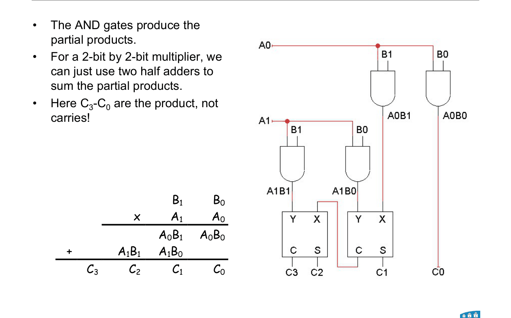

Multiplying two bits = **AND**. So each partial product bit is an AND gate.

 

**2 × 2 bits** (A₁A₀ × B₁B₀):

| Output | Equation |
|---|---|
| C₀ | A₀B₀ |
| C₁ | A₀B₁ ⊕ A₁B₀ (half adder sum). Its carry is K = A₀B₁ · A₁B₀ |
| C₂ | A₁B₁ ⊕ K (half adder sum) |
| C₃ | A₁B₁ · K (half adder carry) |

That's **4 ANDs and 2 half adders**.

**⚠️ C₃ to C₀ are the product bits, not carries.**

 

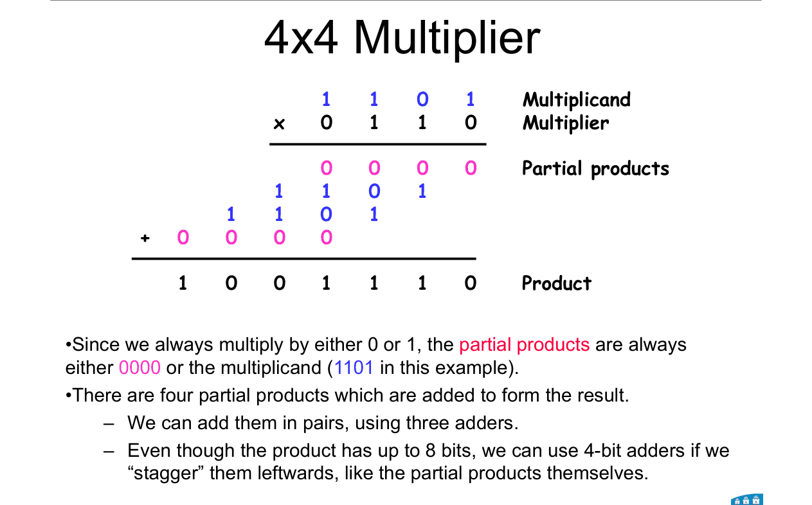

**4 × 4 bits:**

16 ANDs make **four partial products**. Each is either 0000 or the multiplicand.

Add them in pairs with **three 4-bit adders**, each shifted left one place.

Slide example: 1101 × 0110 = **1001110** (13 × 6 = 78)

---

## 11. Shifts

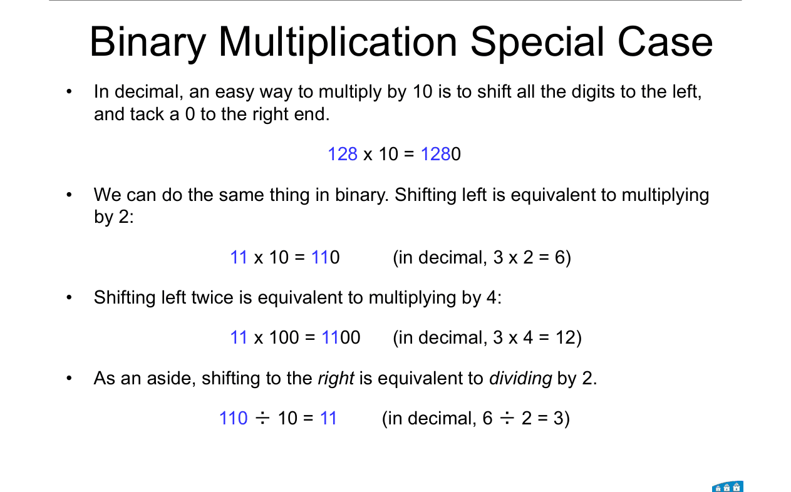

| Shift | Effect | Example |
|---|---|---|
| left 1 | × 2 | 11 → 110 (3 → 6) |
| left 2 | × 4 | 11 → 1100 (3 → 12) |
| right 1 | ÷ 2 | 110 → 11 (6 → 3) |

Just like adding a 0 in decimal multiplies by 10.

---

## Method: any adder question

1. **Half adder:** S = X ⊕ Y, C = XY.
2. **Full adder:** S = X ⊕ Y ⊕ Z, C = XY + XZ + YZ (or XY + (X ⊕ Y)Z from two half adders).
3. **n-bit ripple adder:** chain n full adders. Delay ≈ 2n gate delays.
4. **Carry lookahead:** Pᵢ = Aᵢ ⊕ Bᵢ, Gᵢ = AᵢBᵢ, Cᵢ₊₁ = Gᵢ + PᵢCᵢ. Expand.
5. **Subtract:** A + B' + 1.
6. **Design from scratch:** use the 4-step procedure (Rule 1).

---

Next: [End-of-topic test](../questions/10-adders.md)
