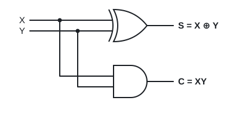
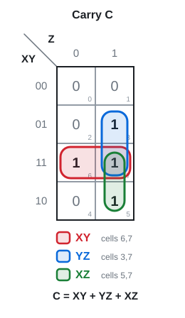
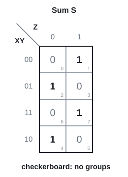
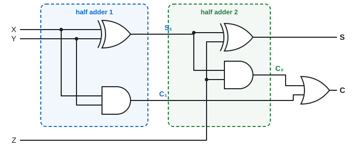
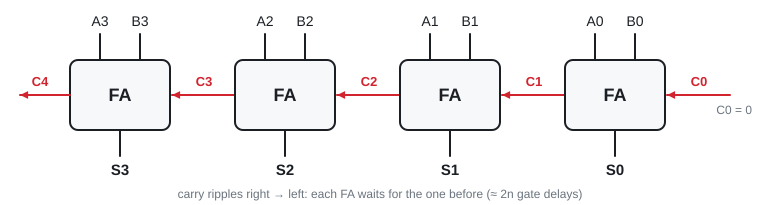
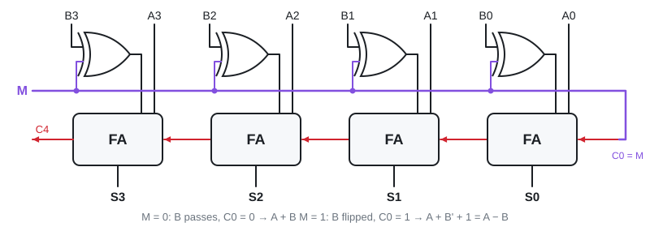
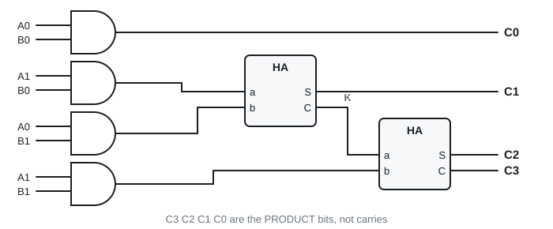

# 10 · Adders, subtractors, multipliers

Lectures 7 and 8 · ●● · [**Quiz →**](https://albinjoby82-ops.github.io/DE_Lock-In/quiz.html?t=10)

Topics 6 to 9 used to **design** real circuits. Design recipe for any "build a circuit that…" question:
**name inputs and outputs → truth table → simplify each output → draw.**

---

## 1. XOR

**A ⊕ B = A'B + AB'** = 1 when the inputs **differ**. With more inputs: 1 when an **odd** number of inputs are 1.

> **Apply:** 1 ⊕ 1 ⊕ 1 = ? 1 ⊕ 0 ⊕ 1 ⊕ 1 = ?

Answer

Three 1s (odd) → **1**. Three 1s again → **1**.

---

## 2. Half adder: two bits

| X | Y | C | S |
|---|---|---|---|
| 0 | 0 | 0 | 0 |
| 0 | 1 | 0 | 1 |
| 1 | 0 | 0 | 1 |
| 1 | 1 | 1 | 0 |

**S = X ⊕ Y · C = XY**

---

## 3. Full adder: two bits plus carry-in Z ⭐

**S = 1 when an odd number of inputs are 1. C = 1 when two or more are 1.**

**S = X ⊕ Y ⊕ Z = Σm(1, 2, 4, 7) · C = XY + XZ + YZ = Σm(3, 5, 6, 7)**

 

Built from **two half adders and an OR**: C = XY + (X ⊕ Y)Z. Looks different, same truth table.

> **Apply:** X = 1, Y = 0, Z = 1. Find S₁, C₁, C₂, S and C in the circuit above.

Answer

S₁ = 1 ⊕ 0 = 1, C₁ = 0. S = 1 ⊕ 1 = **0**, C₂ = 1·1 = 1. C = 0 + 1 = **1**. (1 + 0 + 1 = 10 ✓)

---

## 4. Ripple-carry adder

One full adder per bit. Each carry-out feeds the next carry-in.

**Problem: speed.** Delay ≈ **2n gate delays** (each about 10 ns). Building it straight from a truth table is no good either: a 4-bit adder has 9 inputs = 512 rows.

> **Apply:** delay of a 16-bit ripple adder at 10 ns per gate?

Answer

2 × 16 = 32 gate delays × 10 ns = **320 ns**.

---

## 5. Carry lookahead: every carry at once

**Pᵢ = Aᵢ ⊕ Bᵢ** (propagate: passes a carry on) · **Gᵢ = AᵢBᵢ** (generate: makes a carry itself)

**Cᵢ₊₁ = Gᵢ + PᵢCᵢ** · **Sᵢ = Pᵢ ⊕ Cᵢ**

Keep substituting:

C₁ = G₀ + P₀C₀
C₂ = G₁ + P₁G₀ + P₁P₀C₀
C₃ = G₂ + P₂G₁ + P₂P₁G₀ + P₂P₁P₀C₀

Pattern: "some bit generates, and every bit after it propagates". Every carry is just AND → OR (2 levels). The cost: gates grow **O(n²)**, transistors **O(n³)**, so real adders mix 4-bit lookahead blocks with ripple.

> **Apply:** A₁A₀ = 11, B₁B₀ = 01, C₀ = 0. Find G₀, P₀, G₁, P₁, C₂.

Answer

G₀ = 1·1 = 1, P₀ = 0. G₁ = 1·0 = 0, P₁ = 1. C₂ = G₁ + P₁G₀ + P₁P₀C₀ = 0 + 1 + 0 = **1**. (3 + 1 = 4 = 100 ✓)

---

## 6. Subtract with the same adder

**A − B = A + B' + 1.** Invert B with XOR gates, set carry-in = 1. One control line M does both:

Half subtractor (by hand): **D = X ⊕ Y, Borrow = X'Y**.

> **Apply:** why does C₀ = 1 matter when M = 1?

Answer

−B in 2's complement = flip B, **then add 1**. The XORs flip; the carry-in of 1 is the "+1".

---

## 7. Multiplier

Bit × bit = **AND**. 2 × 2: four ANDs make the partial products, two half adders add them.

4 × 4 uses 16 ANDs and three 4-bit adders. Shift left = × 2.

---

## Exam drill

Design a circuit with 3 inputs whose output is 1 when **at least two** inputs are 1. Truth table, minimum SOP, gates.

Answer

It's the full adder's carry: Σm(3, 5, 6, 7) → **F = XY + XZ + YZ**. Three 2-input ANDs into one 3-input OR.

**Traps:** C₃…C₀ of a multiplier are product bits, not carries · CLA P uses XOR, G uses AND · subtract = invert **and** carry-in 1.

---

## Test yourself

**▶ [Topic 10 quiz](https://albinjoby82-ops.github.io/DE_Lock-In/quiz.html?t=10)** (answers checked as you go, **New numbers** for fresh practice)  
[Mixed quiz: topics 09 + 10](https://albinjoby82-ops.github.io/DE_Lock-In/quiz.html?mix=09,10&n=15)  
[All quizzes](https://albinjoby82-ops.github.io/DE_Lock-In/)

Next: [11 · Decoders and encoders](11-decoders-encoders.md)
