# Topic 11 — Decoders and encoders

Slide exercises: full adder on a 3-to-8 decoder (active-high and active-low)

Slides: Lecture 9, all

---

## The big idea

A **decoder** turns a binary number into "switch on line number i".

An **encoder** does the opposite.

 

The big trick:

A decoder's outputs are exactly the **minterms** (Topic 7).

So **any function = a decoder + one OR gate.**

---

**How to use these notes:**
When you see 🧠, stop.
Answer it on paper first.
Then click to check.

---

## 1. What a decoder does

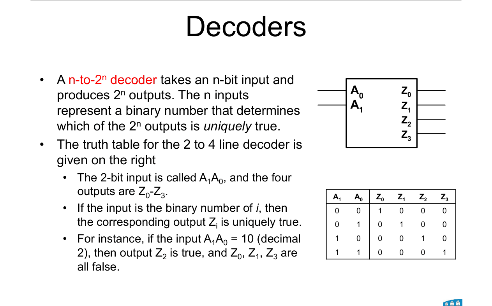

An **n-to-2ⁿ decoder** has n inputs and 2ⁿ outputs.

The inputs form a binary number, **i**.

**Only output i is 1.** All others are 0.

 

**2-to-4 decoder** (inputs A₁A₀):

| A₁ | A₀ | Z₀ | Z₁ | Z₂ | Z₃ |
|---|---|---|---|---|---|
| 0 | 0 | 1 | 0 | 0 | 0 |
| 0 | 1 | 0 | 1 | 0 | 0 |
| 1 | 0 | 0 | 0 | 1 | 0 |
| 1 | 1 | 0 | 0 | 0 | 1 |

Example: A₁A₀ = 10 (decimal 2) → **Z₂ = 1**, the rest are 0.

 

**Output equations:**

Z₀ = A₁'A₀' · Z₁ = A₁'A₀ · Z₂ = A₁A₀' · Z₃ = A₁A₀

 

### 🧠 Check
A 3-to-8 decoder gets input 101. Which output is 1?

Answer

101 = 5, so **output 5** (D₅). All others are 0.

---

## 2. 3-to-8 decoder

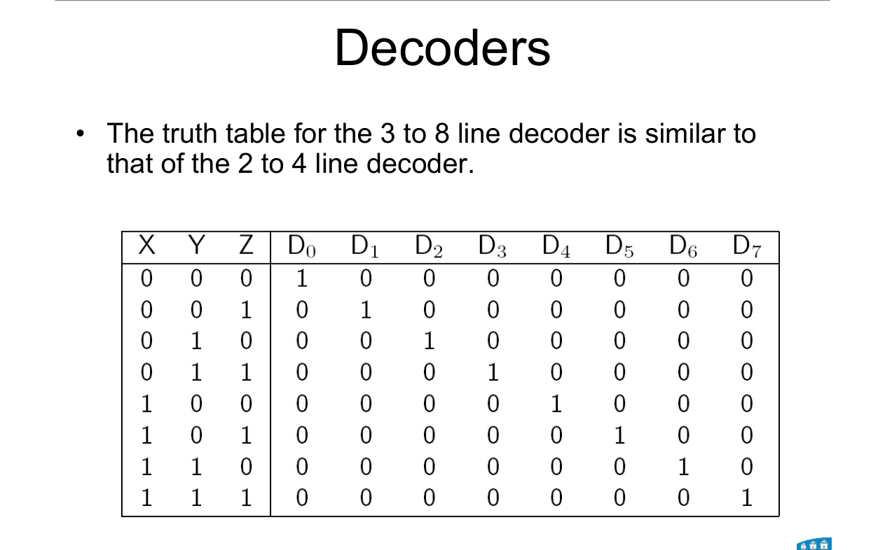

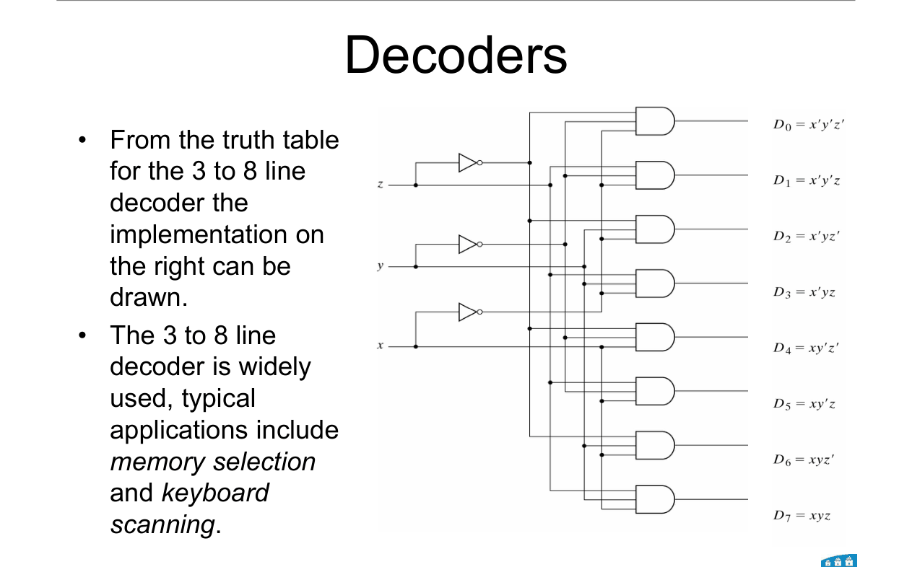

**How to read this diagram:**

Three inputs (x, y, z) and their inverted copies run down the middle.

Each of the 8 AND gates picks one combination. D₀ = x'y'z' … D₇ = xyz.

 

**Used for:** memory selection and keyboard scanning.

---

## 3. A decoder is a minterm generator

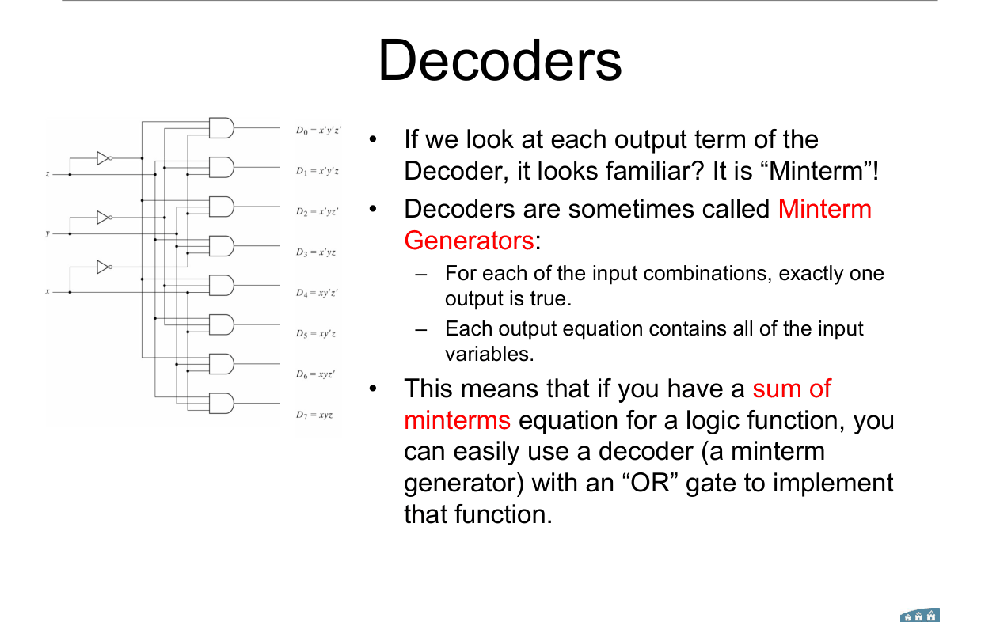

Look at the output equations: each one is a **minterm**.

- For any input, exactly one output is 1.
- Each output contains every input variable.

---

### 📐 Rule 1: any function from an active-high decoder

**Step 1.** Write the function as **Σm**.

**Step 2.** Feed the inputs into an n-to-2ⁿ decoder.

**Step 3.** **OR** together the outputs listed in Σm.

**Why it works:**
Each output is one minterm. OR-ing minterms gives the sum of minterms.

**Use it when:**
"Implement f with a decoder and gates."

---

## 4. Worked example: full adder on a decoder

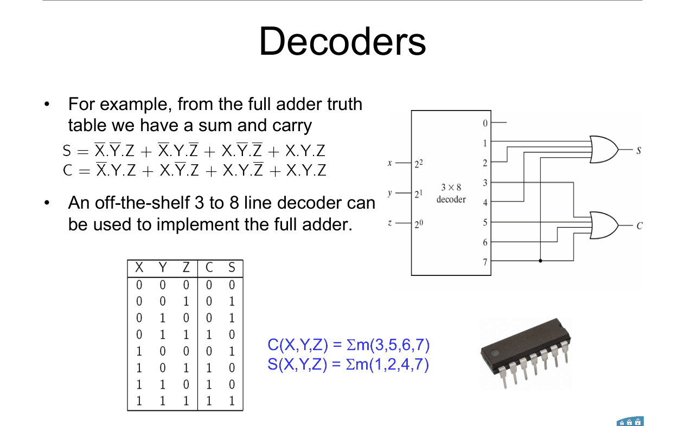

Full adder (Topic 10): C = Σm(3, 5, 6, 7), S = Σm(1, 2, 4, 7).

 

Wire X, Y, Z into a 3-to-8 decoder (X is the MSB).

**S** = OR of outputs **1, 2, 4, 7**

**C** = OR of outputs **3, 5, 6, 7**

Two OR gates. Done.

 

### 🧠 Check
f(x, y, z) = Σm(0, 6). How would you build it with a 3-to-8 decoder?

Answer

OR together outputs **0 and 6**. One 2-input OR gate.

---

## 5. Enable input

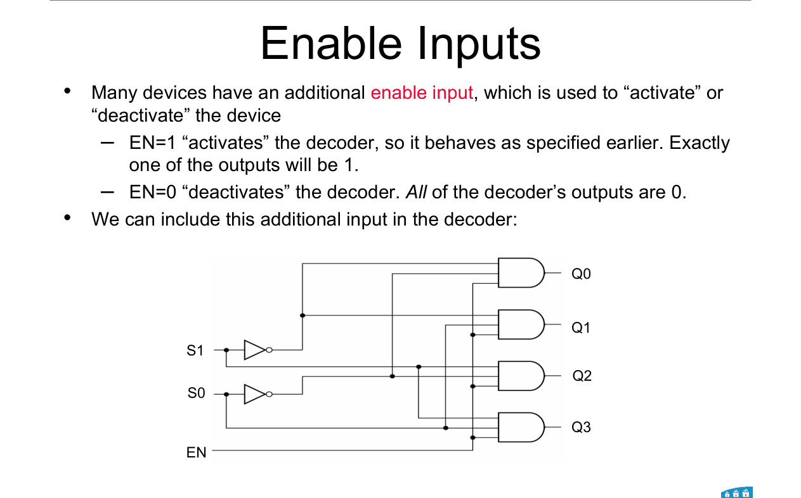

Many decoders have an **enable (EN)** input.

- **EN = 1:** works as normal. Exactly one output is 1.
- **EN = 0:** switched off. **All outputs are 0.**

 

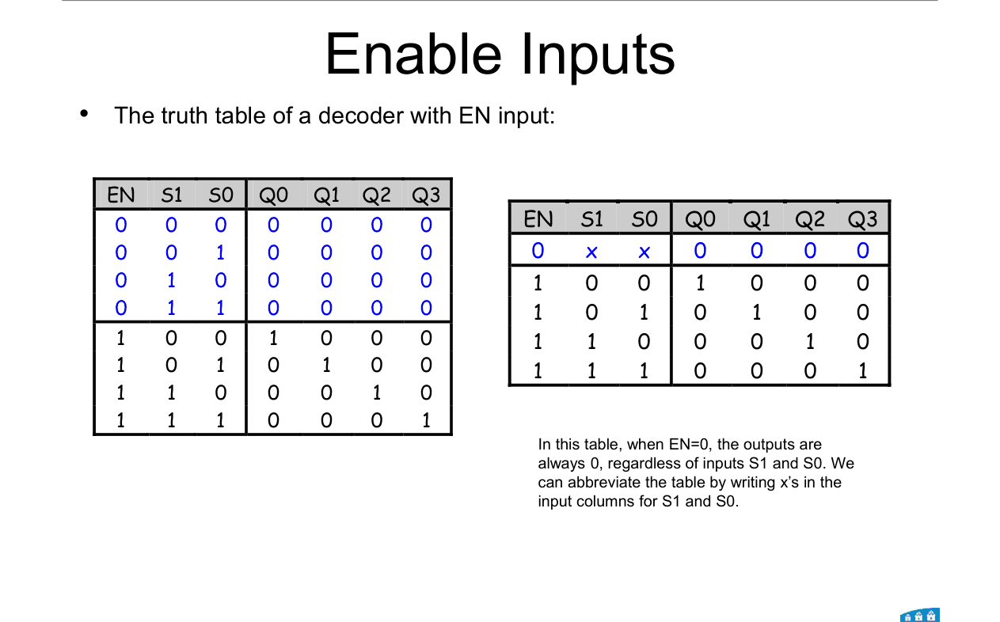

**How to read this diagram:**

Left: the full table with all 8 rows.

Right: the short version. When EN = 0, S₁ and S₀ don't matter, so they're written as **x**.

| EN | S₁ | S₀ | Q₀ | Q₁ | Q₂ | Q₃ |
|---|---|---|---|---|---|---|
| 0 | x | x | 0 | 0 | 0 | 0 |
| 1 | 0 | 0 | 1 | 0 | 0 | 0 |
| 1 | 0 | 1 | 0 | 1 | 0 | 0 |
| 1 | 1 | 0 | 0 | 0 | 1 | 0 |
| 1 | 1 | 1 | 0 | 0 | 0 | 1 |

---

## 6. Building a bigger decoder from smaller ones

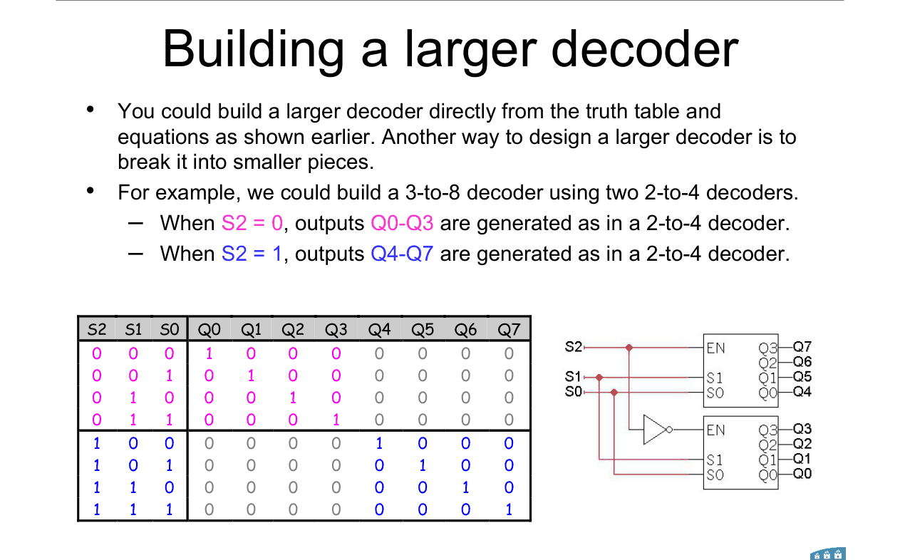

**Two 2-to-4 decoders make one 3-to-8.**

- S₁ and S₀ go to **both** decoders.
- **S₂'** drives the **first** decoder's EN → gives Q₀ to Q₃.
- **S₂** drives the **second** decoder's EN → gives Q₄ to Q₇.

So S₂ picks which half is switched on.

 

### 🧠 Check
Input S₂S₁S₀ = 110. Which decoder is on, and which of its outputs is 1?

Answer

S₂ = 1, so the **second** decoder is on.

S₁S₀ = 10 = 2, so its output 2 is 1. That's **Q₆** overall.

---

## 7. Active-low decoders

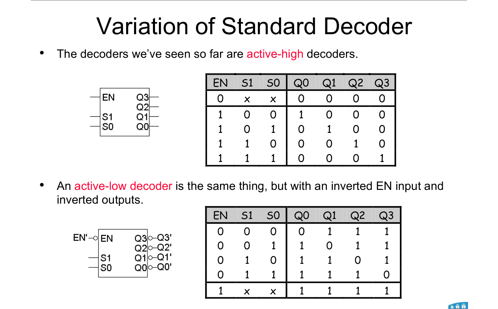

An **active-low** decoder is the same thing, with **everything inverted**:

- EN is inverted: it works when **EN = 0**.
- The outputs are inverted: the chosen output is **0**, all others are **1**.

 

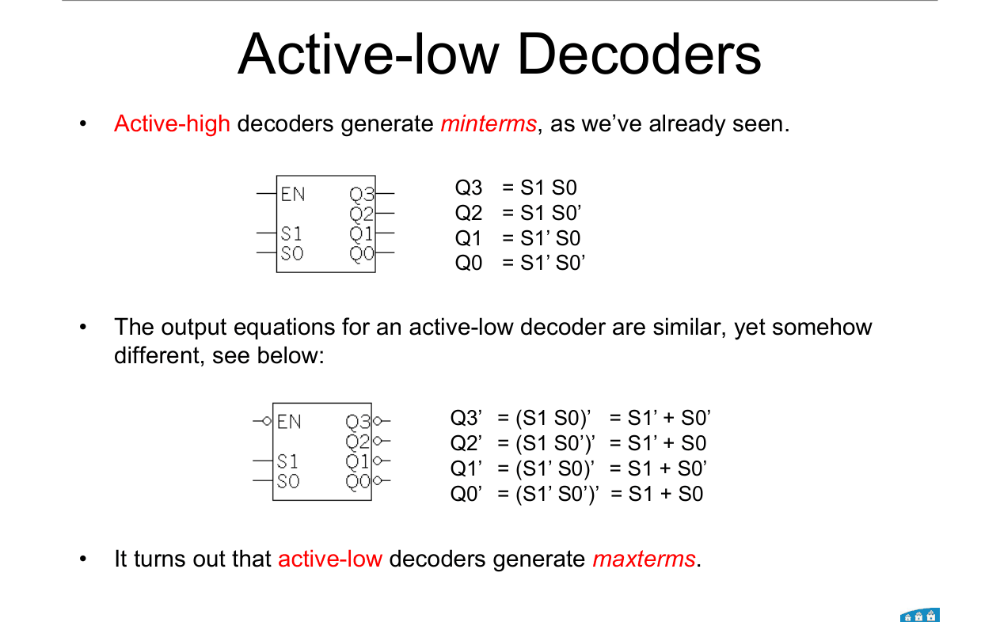

**Each output is now the complement of a minterm. That's a maxterm.**

Q₀ = (S₁'S₀')' = S₁ + S₀ = M₀

---

### 📐 Rule 2: any function from an active-low decoder

**Step 1.** Write the function as **ΠM** (the rows where f = 0).

**Step 2.** **AND** together the outputs listed in ΠM.

**Why it works:**
Each active-low output is a maxterm. AND-ing maxterms gives the product of maxterms.

**Remember:** you need an **AND** gate for a product of sums.

---

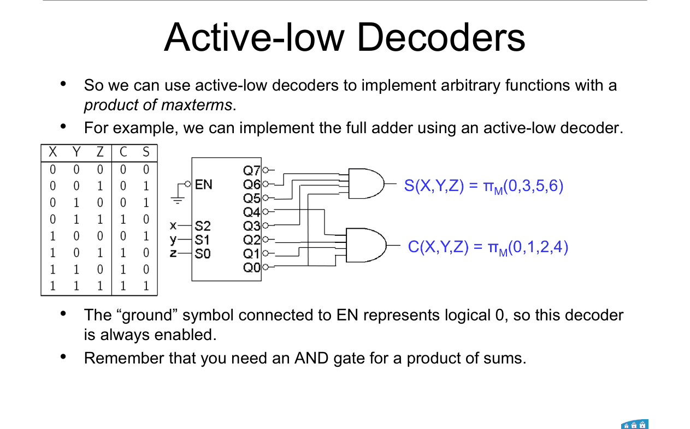

**Worked example: full adder on an active-low decoder.**

EN is tied to ground (logic 0), so it's always on.

C = ΠM(0, 1, 2, 4) → **AND outputs 0, 1, 2, 4**

S = ΠM(0, 3, 5, 6) → **AND outputs 0, 3, 5, 6**

 

### 🧠 Check
Why is the EN of the active-low decoder in this example connected to ground?

Answer

Ground is logic 0. An active-low EN switches the decoder **on** when it's 0. So the decoder is always enabled.

---

## 8. Encoders

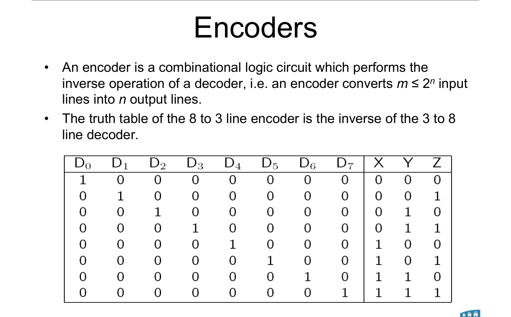

An **encoder** is the reverse of a decoder.

**m ≤ 2ⁿ input lines → n output lines.** The output is the number of the input that's on.

 

**8-to-3 encoder:**

$$X = D_4 + D_5 + D_6 + D_7$$

$$Y = D_2 + D_3 + D_6 + D_7$$

$$Z = D_1 + D_3 + D_5 + D_7$$

**How to get these:** X is the 4s bit, so it's 1 for inputs 4, 5, 6, 7. And so on.

 

**The problem:** it assumes **exactly one** input is 1.

- D₃ and D₅ both on → outputs 111 (= 7). **Wrong.**
- No inputs on → outputs 000. Looks the same as D₀.

 

### 🧠 Check
In the 8-to-3 encoder, only D₆ is on. What are X, Y, Z?

Answer

X = 1 (6 is in 4, 5, 6, 7). Y = 1 (6 is in 2, 3, 6, 7). Z = 0.

**110** = 6 ✓

---

## 9. Priority encoder

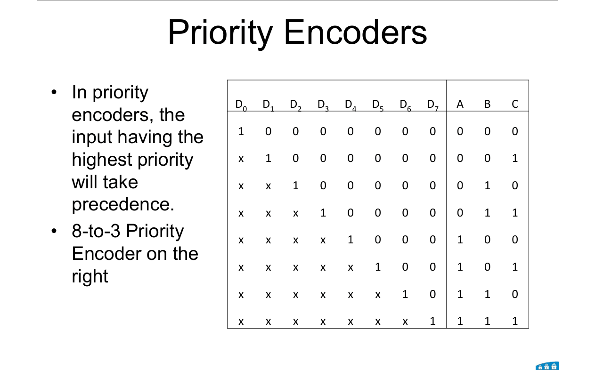

**When several inputs are 1, the highest-numbered one wins.**

Lower inputs become **don't cares** (x) in the table.

 

**How to read the table:**

Each row: the 1 shows the highest input that's on. Every input to its left (lower numbers) is x.

Output ABC = the number of that input.

 

**8-to-3 priority encoder equations** (not on the slides):

$$A = D_4 + D_5 + D_6 + D_7$$

$$B = D_7 + D_6 + D_5'D_4'(D_3 + D_2)$$

$$C = D_7 + D_6'D_5 + D_6'D_4'D_3 + D_6'D_4'D_2'D_1$$

 

### 🧠 Check
D₂, D₃ and D₅ are on. What does an 8-to-3 priority encoder output?

Answer

D₅ is the highest, so it wins. Output = 5 = **101**.

---

## Method: any decoder / encoder question

1. **Function on an active-high decoder:** write Σm. **OR** those outputs.
2. **Function on an active-low decoder:** write ΠM. **AND** those outputs.
3. **Enable:** active-high works when EN = 1. Active-low works when EN = 0.
4. **Bigger decoder:** top select bit drives the ENs (one plain, one inverted). Lower bits go to both.
5. **Encoder output bit k:** OR of every input whose number has bit k = 1.
6. **Priority encoder:** highest-numbered active input wins.

---

Next: [End-of-topic test](../questions/11-decoders-encoders.md)
