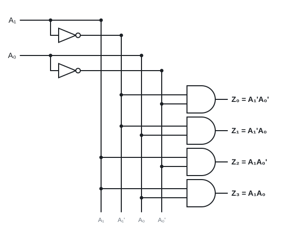
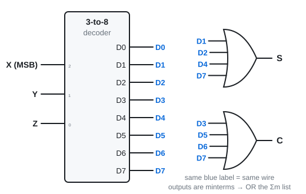
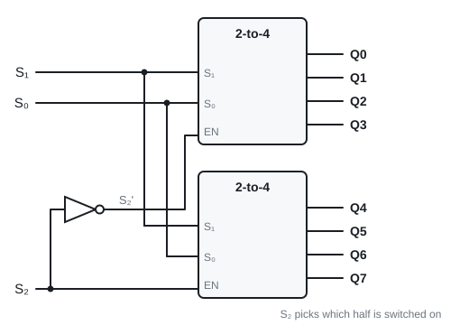
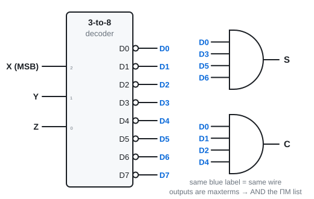
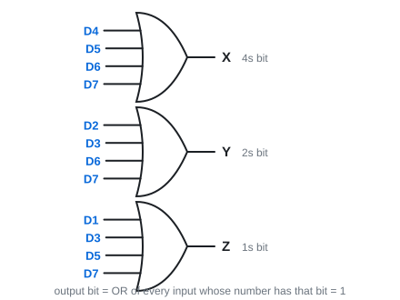

# 11 · Decoders and encoders

Lecture 9 · ●● · [**Quiz →**](https://albinjoby82-ops.github.io/DE_Lock-In/quiz.html?t=11)

A **decoder** turns a binary number i into "line i is on". Its outputs are exactly the **minterms**, so **any function = decoder + one gate**.

---

## 1. n-to-2ⁿ decoder

**Rule:** inputs form a number i → **only output i is 1**.

Each AND gate is one minterm: Z₂ = A₁A₀' is 1 only for input 10.

> **Apply:** a 3-to-8 decoder gets 101. Which output is 1?

Answer

101 = 5 → **D₅** only.

---

## 2. Any function: decoder + OR ⭐

**Rule (active-high):** write f as **Σm**, **OR** those outputs.

Full adder: S = Σm(1, 2, 4, 7), C = Σm(3, 5, 6, 7).

> **Apply:** f(x, y, z) = Σm(0, 6). Build it.

Answer

One 2-input OR of decoder outputs **D₀ and D₆**.

---

## 3. Enable and bigger decoders

**EN = 1:** works normally. **EN = 0:** every output is 0.

Two 2-to-4s make a 3-to-8: S₁S₀ go to both, **S₂** picks which one is enabled.

> **Apply:** S₂S₁S₀ = 110. Which decoder is on, and which Q is 1?

Answer

S₂ = 1 → the **bottom** decoder. S₁S₀ = 10 = its output 2 → **Q₆**.

---

## 4. Active-low decoders: AND the maxterms

Everything inverted: works when **EN = 0**, chosen output goes **0**, the rest stay 1. Each output is a **maxterm**.

**Rule (active-low):** write f as **ΠM** (rows where f = 0), **AND** those outputs.

EN is tied to ground (logic 0) so it is always on.

> **Apply:** f = Σm(1, 2, 4, 7) on an active-low 3-to-8. Which outputs, and which gate?

Answer

ΠM(0, 3, 5, 6) → **AND** of D₀, D₃, D₅, D₆.

---

## 5. Encoders: the reverse

**Rule:** output bit k = **OR** of every input whose number has bit k = 1.

Problem: it assumes exactly one input is on. D₃ and D₅ together give 111. Nothing on looks like D₀.

**Priority encoder:** the **highest-numbered** active input wins.

> **Apply:** D₂, D₃ and D₅ are on. Plain 8-to-3 encoder output? Priority encoder output?

Answer

Plain: X = D₅ = 1, Y = D₂ + D₃ = 1, Z = D₃ + D₅ = 1 → **111** (wrong).
Priority: D₅ wins → **101**.

---

## Exam drill (slide exercise)

**Build a full adder on a 3-to-8 decoder: active-high, then active-low.**

Answer

Active-high: **S = OR(D₁, D₂, D₄, D₇)**, **C = OR(D₃, D₅, D₆, D₇)**.
Active-low: **S = AND(D₀, D₃, D₅, D₆)**, **C = AND(D₀, D₁, D₂, D₄)**.

**Traps:** active-high → Σm and OR · active-low → ΠM and AND · X is the MSB of the decoder input.
