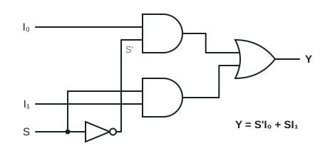
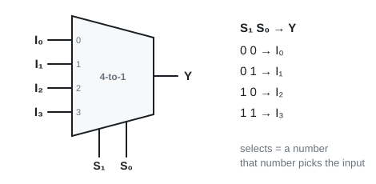
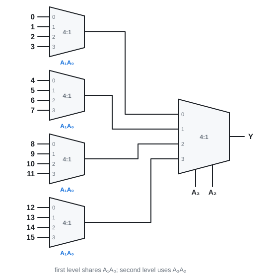
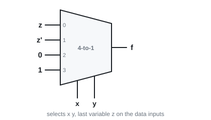
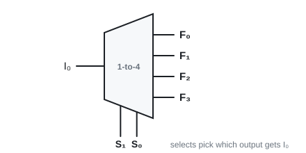
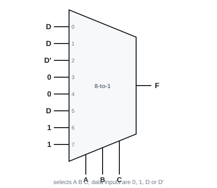

# 12 · Multiplexers and demultiplexers

Lecture 10 · ●● · [**Quiz →**](https://albinjoby82-ops.github.io/DE_Lock-In/quiz.html?t=12)

A **mux** is a switch: many inputs in, **one** out. The select lines form a number, and that number picks the input. A mux can build **any** function.

---

## 1. 2-to-1 and 4-to-1

**Y = S'I₀ + SI₁** → S = 0 passes I₀, S = 1 passes I₁.

⚠️ Slide 3 says S = 1 passes I₀. That's a typo: the next slide, the examples and the textbook all use select 0 → input 0.

Y = S₁'S₀'I₀ + S₁'S₀I₁ + S₁S₀'I₂ + S₁S₀I₃: each AND is a minterm of the selects.

> **Apply:** S₁S₀ = 10. Which input reaches Y?

Answer

10 = 2 → **I₂**.

---

## 2. Bigger muxes from smaller ones

First level shares the **low** select bits. The last mux uses the **high** bits.

> **Apply:** how many 2-to-1 muxes make a 4-to-1? Which select goes where?

Answer

**3.** Two on the first level share S₀, one on the second level uses S₁.

---

## 3. Any function, full size

n variables → 2ⁿ-to-1 mux. Variables on the selects. **Dᵢ = 1 if mᵢ is in f, else 0.**

---

## 4. Any function, one size smaller ⭐

**Rule:** first n − 1 variables on the selects. Pair the truth-table rows (only the **last** variable v changes in a pair). Each data input is one of four things:

| f when v = 0 | f when v = 1 | Dᵢ |
|---|---|---|
| 0 | 0 | **0** |
| 0 | 1 | **v** |
| 1 | 0 | **v'** |
| 1 | 1 | **1** |

**Slide 7: f(x, y, z) = Σm(1, 2, 6, 7) on a 4-to-1**

| xy | z = 0 | z = 1 | D |
|---|---|---|---|
| 00 | 0 (m₀) | 1 (m₁) | **z** |
| 01 | 1 (m₂) | 0 (m₃) | **z'** |
| 10 | 0 (m₄) | 0 (m₅) | **0** |
| 11 | 1 (m₆) | 1 (m₇) | **1** |

> **Apply:** f(x, y, z) = Σm(0, 3, 4, 5) on a 4-to-1 (selects x, y). D₀ to D₃?

Answer

00: m₀ = 1, m₁ = 0 → **z'** · 01: m₂ = 0, m₃ = 1 → **z** · 10: m₄ = 1, m₅ = 1 → **1** · 11: 0, 0 → **0**

---

## 5. Demultiplexer

One input goes to **one of 2ⁿ outputs**. A demux = a decoder whose outputs are each ANDed with the input.

Mux at one end + demux at the other = many users sharing **one wire** (same select signals at both ends).

> **Apply:** 1-to-4 demux, S₁S₀ = 11, I₀ = 1. F₀ to F₃?

Answer

Only **F₃ = 1**. The rest are 0.

---

## Exam drill (slide 8)

**F(A, B, C, D) = Σm(1, 3, 4, 11, 12, 13, 14, 15) on an 8-to-1 mux.**

Answer

Selects ABC, data in terms of D. Pairs (0,1)→D, (2,3)→D, (4,5)→D', (6,7)→0, (8,9)→0, (10,11)→D, (12,13)→1, (14,15)→1.

**Traps:** n variables need only n − 1 selects · always pair on the **last** variable · select 0 → input 0.

---

## Test yourself

**▶ [Topic 12 quiz](https://albinjoby82-ops.github.io/DE_Lock-In/quiz.html?t=12)** (answers checked as you go, **New numbers** for fresh practice)  
[Mixed quiz: topics 11 + 12](https://albinjoby82-ops.github.io/DE_Lock-In/quiz.html?mix=11,12&n=15)  
[All quizzes](https://albinjoby82-ops.github.io/DE_Lock-In/)

That's the last topic. Do the [cheat sheet](../cheat-sheet.md) the night before.
