# Topic 12 — Multiplexers and demultiplexers

Slide exercises: f = Σm(1, 2, 6, 7) on a 4-to-1 mux. F = Σm(1, 3, 4, 11, 12, 13, 14, 15) on an 8-to-1 mux.

Slides: Lecture 10, all

---

## The big idea

A **multiplexer (mux)** is a switch.

Many inputs come in. **One** goes out.

The **select lines** choose which one.

 

The big trick:

A mux can build **any** function. And it only needs n − 1 select lines for n variables.

---

**How to use these notes:**
When you see 🧠, stop.
Answer it on paper first.
Then click to check.

---

## 1. What a mux does

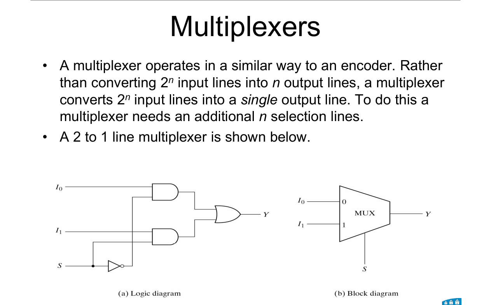

A **2ⁿ-to-1 mux** has 2ⁿ data inputs, n select lines and 1 output.

It's also called a **data selector**.

**How to read this diagram:**

(a) The gates inside: two ANDs and an OR. S chooses which AND is switched on.

(b) The block symbol: a trapezoid. Inputs on the wide side, output on the narrow side.

---

## 2. The 2-to-1 mux

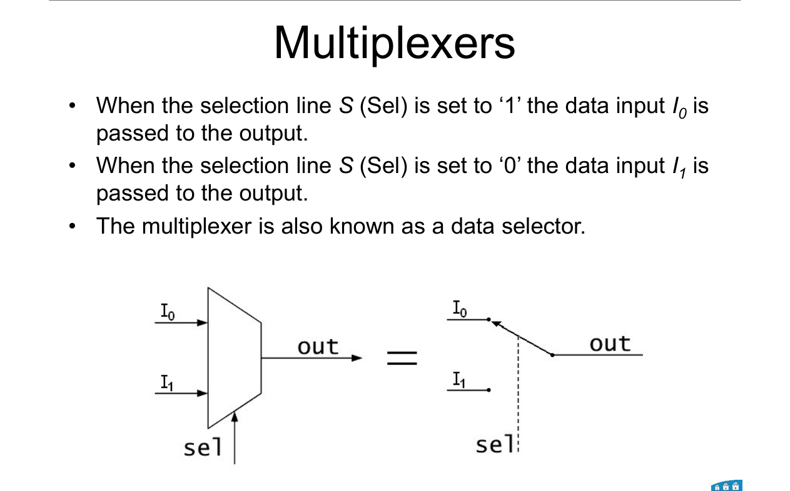

---

### 📐 Equation 1: 2-to-1 mux

$$Y = S'\,I_0 + S\,I_1$$

| Symbol | Means |
|---|---|
| S | select line |
| I₀, I₁ | data inputs |
| Y | output |

**What it means:**
S = 0 → Y = I₀. S = 1 → Y = I₁.

**⚠️ Slide 3 says the opposite** (S = 1 passes I₀). That's a typo.
The 4-to-1 table on the next slide, the function examples and the textbook all use **select 0 → input 0**.
If an exam question gives its own convention, follow that.

---

## 3. The 4-to-1 mux

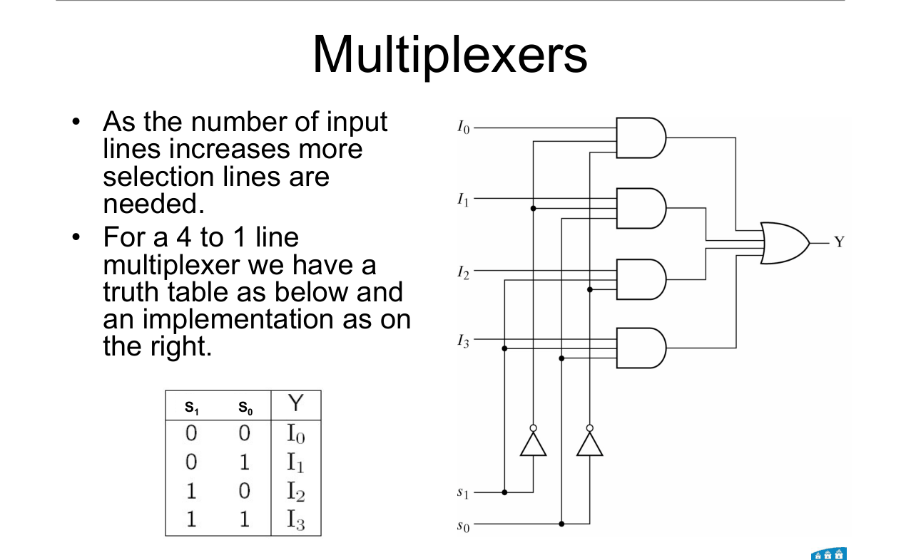

| S₁ | S₀ | Y |
|---|---|---|
| 0 | 0 | I₀ |
| 0 | 1 | I₁ |
| 1 | 0 | I₂ |
| 1 | 1 | I₃ |

$$Y = S_1'S_0'\,I_0 + S_1'S_0\,I_1 + S_1S_0'\,I_2 + S_1S_0\,I_3$$

**Pattern:** the select lines form a number. That number picks the input.

Each AND gate is a **minterm of the selects**, ANDed with one data input.

 

### 🧠 Check
A 4-to-1 mux has S₁S₀ = 10. Which input reaches the output?

Answer

10 = 2, so **I₂**.

---

## 4. Bigger muxes from smaller ones

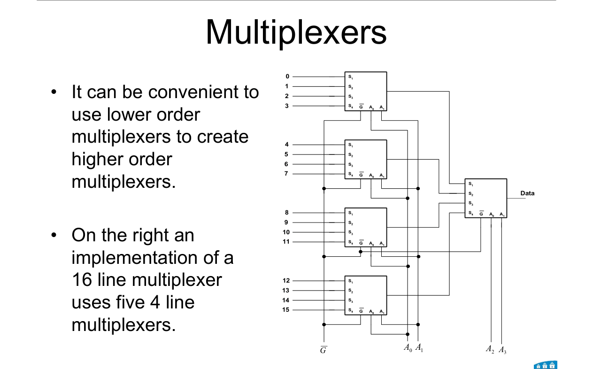

**How to read this diagram:**

Four 4-to-1 muxes on the left. One 4-to-1 mux on the right.

 

**A 16-to-1 mux from five 4-to-1 muxes:**

- **First level:** four muxes take data 0–3, 4–7, 8–11 and 12–15. They all share the **low** select bits A₁A₀.
- **Second level:** the fifth mux uses the **high** select bits A₃A₂ to pick which first-level output goes through.

 

### 🧠 Check
How many 2-to-1 muxes do you need to build a 4-to-1 mux?

Answer

**3.** Two on the first level (sharing S₀), one on the second level (using S₁).

---

## 5. Any function on a mux: method 1 (full size)

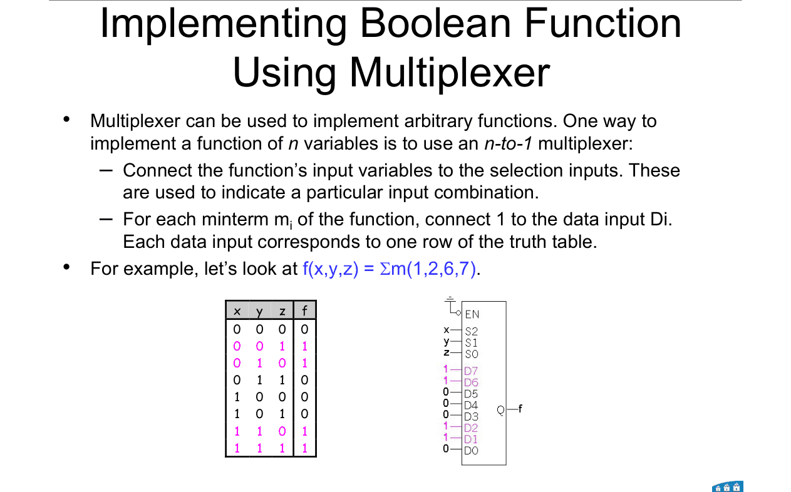

---

### 📐 Rule 1: n variables on a 2ⁿ-to-1 mux

**Step 1.** Wire the n variables to the **select lines**.

**Step 2.** For each data input Dᵢ: tie it to **1** if mᵢ is in the function, else **0**.

**Why it works:**
The selects pick one row of the truth table. The data input on that row *is* the answer.

**Example:** f(x, y, z) = Σm(1, 2, 6, 7) on an 8-to-1 mux:

D₁ = D₂ = D₆ = D₇ = 1. All other Ds = 0.

---

## 6. Any function on a mux: method 2 (one size smaller) ⭐

**You can use a mux with only n − 1 select lines.**

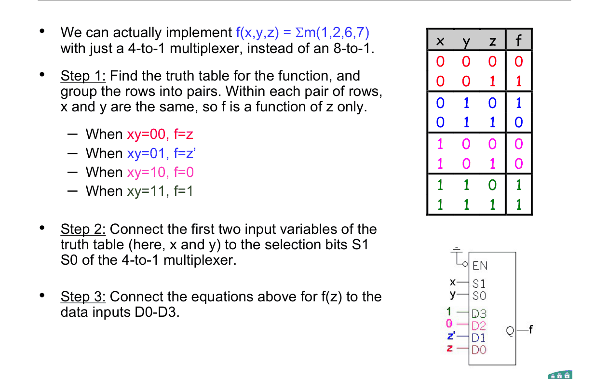

---

### 📐 Rule 2: n variables on a 2ⁿ⁻¹-to-1 mux

**Step 1.** Wire the **first n − 1 variables** to the select lines.

**Step 2.** Pair up the truth table rows. Inside each pair, only the **last variable, v**, changes.

**Step 3.** Look at each pair's two outputs. Set its data input from this table:

| f when v = 0 | f when v = 1 | Data input |
|---|---|---|
| 0 | 0 | **0** |
| 0 | 1 | **v** |
| 1 | 0 | **v'** |
| 1 | 1 | **1** |

**Why it works:**
Within a pair, the first n − 1 variables are fixed, so f depends only on v. And a function of one variable can only be 0, 1, v or v'.

**Use it when:**
"Implement f with a 4-to-1 mux" for a 3-variable f, or an 8-to-1 for a 4-variable f.

---

**Worked example (slide 7): f(x, y, z) = Σm(1, 2, 6, 7) on a 4-to-1 mux**

S₁ = x, S₀ = y. The last variable is z.

| x y | f when z = 0 | f when z = 1 | Data input |
|---|---|---|---|
| 00 | 0 (row 0) | 1 (row 1) | D₀ = **z** |
| 01 | 1 (row 2) | 0 (row 3) | D₁ = **z'** |
| 10 | 0 (row 4) | 0 (row 5) | D₂ = **0** |
| 11 | 1 (row 6) | 1 (row 7) | D₃ = **1** |

 

### 🧠 Check
In a pair, f = 1 when v = 0 and f = 0 when v = 1. What goes on that data input?

Answer

**v'**. It's 1 exactly when v = 0.

---

## 7. Worked example: 4 variables on an 8-to-1 mux (slide 8)

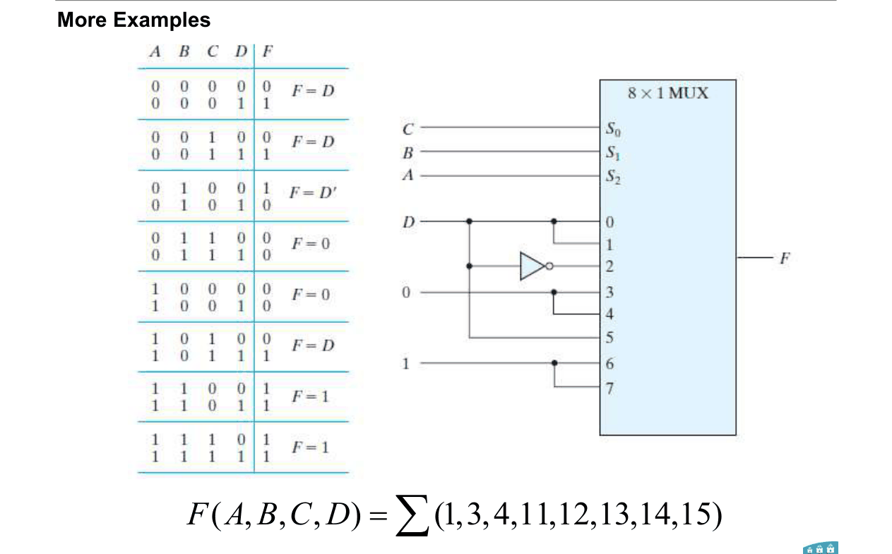

**F(A, B, C, D) = Σm(1, 3, 4, 11, 12, 13, 14, 15)**

S₂S₁S₀ = ABC. The last variable is D.

| ABC | Rows | F (D = 0, D = 1) | Data input |
|---|---|---|---|
| 000 | 0, 1 | 0, 1 | D₀ = **D** |
| 001 | 2, 3 | 0, 1 | D₁ = **D** |
| 010 | 4, 5 | 1, 0 | D₂ = **D'** |
| 011 | 6, 7 | 0, 0 | D₃ = **0** |
| 100 | 8, 9 | 0, 0 | D₄ = **0** |
| 101 | 10, 11 | 0, 1 | D₅ = **D** |
| 110 | 12, 13 | 1, 1 | D₆ = **1** |
| 111 | 14, 15 | 1, 1 | D₇ = **1** |

 

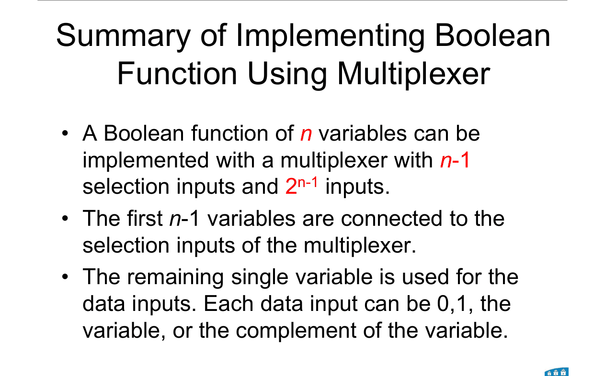

**Summary:** an n-variable function fits on a mux with **n − 1 select lines** and **2ⁿ⁻¹ data inputs**. Each data input is 0, 1, v or v'.

---

## 8. Demultiplexers

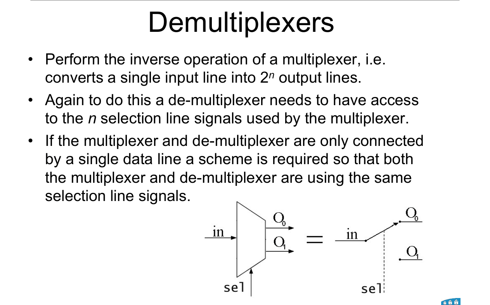

A **demultiplexer (demux)** is the reverse of a mux.

**One** input goes out to **one of 2ⁿ** outputs. The select lines choose which.

 

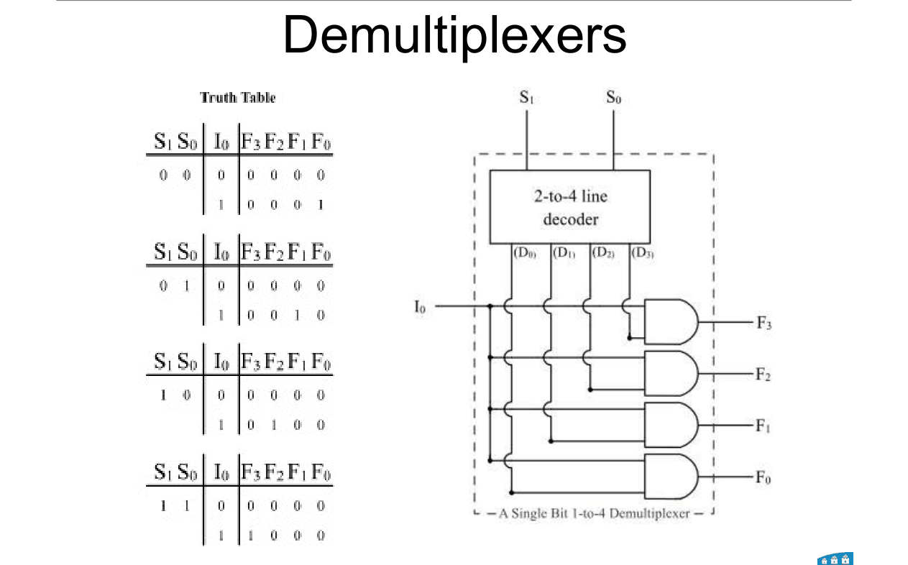

**How to read this diagram:**

A 2-to-4 decoder turns the selects into "which line". Each decoder output is ANDed with the input I₀.

So **a demux = a decoder whose outputs are each ANDed with the input.**

 

**1-to-4 demux:**

$$F_0 = S_1'S_0'\,I_0 \qquad F_1 = S_1'S_0\,I_0 \qquad F_2 = S_1S_0'\,I_0 \qquad F_3 = S_1S_0\,I_0$$

 

### 🧠 Check
In a 1-to-4 demux, S₁S₀ = 11 and I₀ = 1. What are F₀ to F₃?

Answer

Only F₃ gets the input. **F₀ = F₁ = F₂ = 0, F₃ = 1.**

---

## 9. Why mux + demux? Sharing one channel

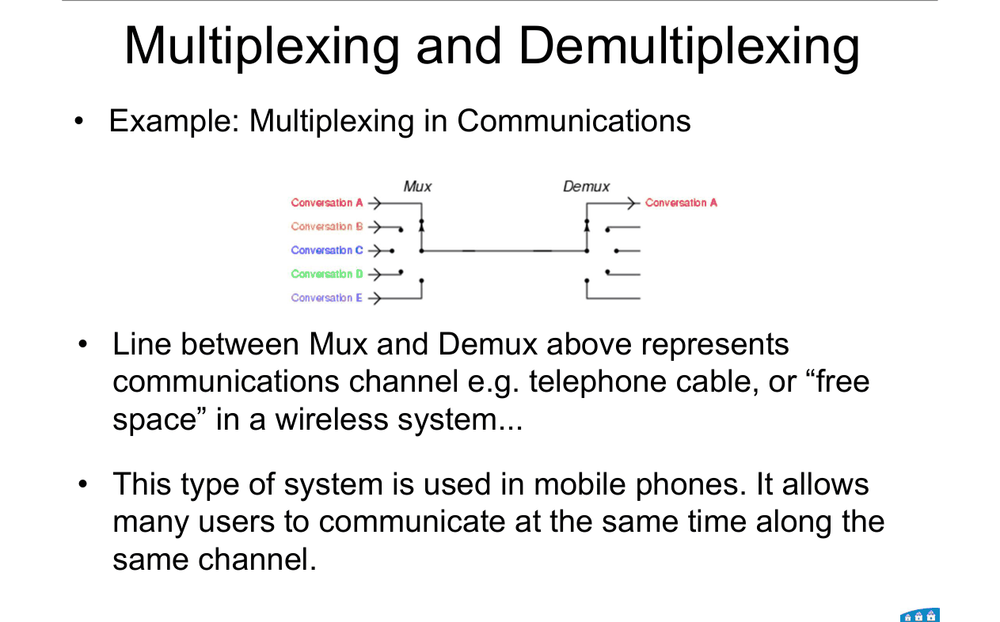

A mux at one end and a demux at the other can **share one wire** between many users.

The wire could be a telephone cable or **free space** (wireless).

**Both ends must use the same select signals.** Otherwise the data goes to the wrong place.

This is how mobile phones let many people talk on one channel.

---

## Method: "implement f with a multiplexer"

1. **How big is the mux?** n variables → 2ⁿ⁻¹-to-1 (method 2) or 2ⁿ-to-1 (method 1).
2. **Write the truth table** in binary order.
3. **Method 1:** selects = all variables. Dᵢ = f on row i (0 or 1).
4. **Method 2:** selects = first n − 1 variables. Pair the rows. Each pair → 0, 1, v or v'.
5. **Check one row** by following it through the mux.

---

Next: [End-of-topic test](../questions/12-multiplexers.md)
