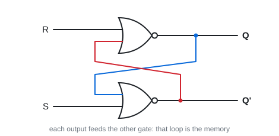
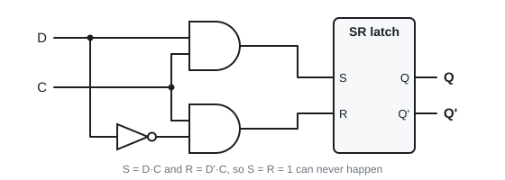
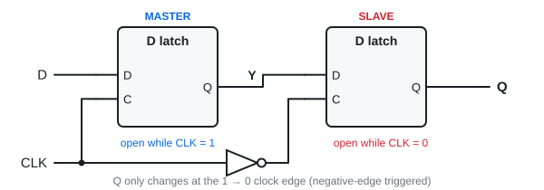
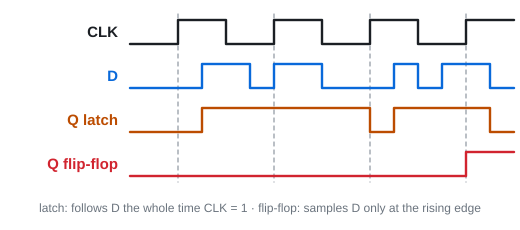
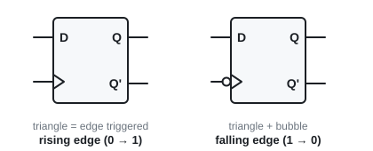
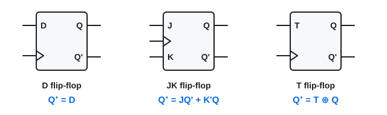

# 13 · Latches and flip-flops

Lectures 11–12 · ●●● · everything in Topics 14 to 17 is built from this

**▶ Explainer videos** (tap to search YouTube):
- [SR latch explained](https://www.youtube.com/results?search_query=SR+latch+explained)
- [latch vs flip-flop edge triggered](https://www.youtube.com/results?search_query=latch+vs+flip-flop+edge+triggered)
- [JK flip-flop characteristic table](https://www.youtube.com/results?search_query=JK+flip-flop+characteristic+table)

**The one idea:** a combinational circuit only knows its inputs **now**. Feed an output back into the input and the circuit can **remember**. That is sequential logic.

| | Output depends on | Has memory? |
|---|---|---|
| Combinational (Topics 6–12) | inputs now | no |
| Sequential (Topics 13–17) | inputs now **and** the stored state | yes |

---

## 1. SR latch: the 1-bit memory

Two NOR gates, each output fed into the other gate.

**Q⁺ = (R + Q')'** and **Q'⁺ = (S + Q)'** (Q⁺ means "Q next").

| S | R | Q next | Name |
|---|---|---|---|
| 0 | 0 | Q (no change) | **hold** ← this is the memory |
| 1 | 0 | 1 | **set** |
| 0 | 1 | 0 | **reset** |
| 1 | 1 | Q = Q' = 0 | **not allowed** |

**Why 11 is banned:** both outputs go to 0, so Q and Q' are no longer opposites. If S and R then drop to 0 together, the latch oscillates and you cannot say where it lands.

**NAND version:** same latch, inputs **active-low** (S'R' latch). 11 = hold, 01 = set, 10 = reset, **00 = not allowed**.

> **Apply:** NOR latch holds Q = 1. Inputs go SR = 00, then 01, then 00. What is Q after each?

Answer

00 → **1** (hold). 01 → **0** (reset). 00 → **0** (hold the new value).

Same inputs (00) gave two different outputs. That is what "sequential" means.

---

## 2. Adding a clock: the gated latch

Add an enable input **C**. C = 1 → latch listens. C = 0 → S and R are ignored, latch holds.

**D latch:** tie R to S through an inverter, call the input D. Now S = R = 1 can never happen.

| C | D | Q next |
|---|---|---|
| 0 | x | Q (hold) |
| 1 | 0 | 0 |
| 1 | 1 | 1 |

**In words: while C = 1, Q copies D. When C drops, Q freezes.**

**Problem:** a latch is **level triggered**. For the whole time C = 1 it is open, so Q can change many times in one clock pulse. Hard to design with.

---

## 3. Flip-flop = changes only on a clock edge ⭐

**Fix:** two latches in a row, on opposite clock levels (master–slave).

1. CLK = 1: master open, slave shut. D gets into the master (Y), but Q cannot move.
2. CLK falls to 0: master shuts (freezes Y), slave opens and passes Y to Q.

So Q changes **only at the falling edge**: a negative-edge-triggered flip-flop. (Master–slave D uses 8 gates. A cheaper positive-edge design uses 3 SR latches.)

> **Apply:** one sentence: what is the difference between a latch and a flip-flop?

Answer

A latch is **level** triggered (open the whole time the clock is 1). A flip-flop is **edge** triggered (samples only at the clock transition).

---

## 4. The three flip-flops you must know cold ⭐

**Characteristic tables** (what Q becomes at the next clock edge):

| D | Q⁺ | | J | K | Q⁺ | meaning | | T | Q⁺ |
|---|---|---|---|---|---|---|---|---|---|
| 0 | 0 | | 0 | 0 | Q | hold | | 0 | Q (hold) |
| 1 | 1 | | 0 | 1 | 0 | reset | | 1 | Q' (toggle) |
| | | | 1 | 0 | 1 | set | | | |
| | | | 1 | 1 | Q' | **toggle** | | | |

**Characteristic equations** (same thing as algebra):

**D: Q⁺ = D**

**JK: Q⁺ = JQ' + K'Q**

**T: Q⁺ = T ⊕ Q = TQ' + T'Q**

**How to remember JK:** it is an SR flip-flop (J = set, K = reset) where the banned 11 input now means **toggle**. And a T flip-flop is a JK with J and K tied together.

> **Apply:** Q = 1. What is Q⁺ for (a) JK = 01 (b) JK = 11 (c) T = 1 (d) D = 1?

Answer

(a) **0** reset · (b) **0** toggle · (c) **0** toggle · (d) **1**.

> **Apply:** use the JK equation to check row JK = 10 with Q = 0.

Answer

Q⁺ = JQ' + K'Q = 1·1 + 1·0 = **1**. Set. ✓

---

## 5. Excitation tables: the tables read backwards

Characteristic table: "I have these inputs, what happens?" (used for **analysis**, Topic 14).
Excitation table: "I want Q to go from this to that, what inputs do I need?" (used for **design**, Topic 15).

| Q | Q⁺ | J | K | D | T |
|---|---|---|---|---|---|
| 0 | 0 | 0 | x | 0 | 0 |
| 0 | 1 | 1 | x | 1 | 1 |
| 1 | 0 | x | 1 | 0 | 1 |
| 1 | 1 | x | 0 | 1 | 0 |

**JK trick:** Q = 0 → only **J** matters (J = Q⁺, K = x). Q = 1 → only **K** matters (K = opposite of Q⁺, J = x).
**D** = Q⁺. **T** = 1 when Q changes.

> **Apply:** why does 0 → 1 need JK = 1x?

Answer

Two ways to get from 0 to 1: **set** (JK = 10) or **toggle** (JK = 11). J is 1 in both, K can be either → 1x.

---

## 6. Asynchronous reset

At power-up a flip-flop's state is unknown. A **reset** (clear) input forces Q = 0 **straight away, without waiting for the clock**. That is what "asynchronous" means here.

---

## Exam drill

**A negative-edge JK flip-flop starts at Q = 0. At eight clock edges in a row the inputs JK are: 10, 00, 11, 01, 11, 11, 00, 10. Give Q after each edge.**

Answer

| Edge | JK | Action | Q |
|---|---|---|---|
| 1 | 10 | set | 1 |
| 2 | 00 | hold | 1 |
| 3 | 11 | toggle | 0 |
| 4 | 01 | reset | 0 |
| 5 | 11 | toggle | 1 |
| 6 | 11 | toggle | 0 |
| 7 | 00 | hold | 0 |
| 8 | 10 | set | 1 |

Q = **1, 1, 0, 0, 1, 0, 0, 1**

**Make a T flip-flop out of a D flip-flop.**

Answer

Want Q⁺ = T ⊕ Q. A D flip-flop gives Q⁺ = D. So wire **D = T ⊕ Q**: one XOR gate fed by T and the flip-flop's own Q.

**Traps:** latch = level, flip-flop = edge · NOR latch bans 11, NAND latch bans 00 · JK 11 toggles, it is not illegal · bubble on the clock = falling edge.

---

Next: [14 · Analysing a sequential circuit](14-sequential-analysis.md) · [Final exam practice](../final-exam-practice.md)
