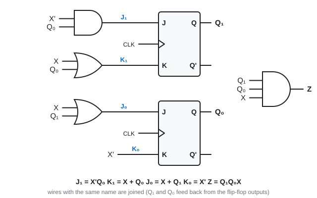
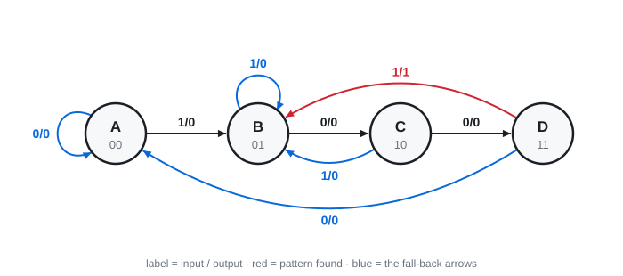

# 14 · Analysing a sequential circuit

Lecture 13 · ●●● · "here is a circuit, find its state table and state diagram"

**▶ Explainer videos** (tap to search YouTube):
- [analysis of clocked sequential circuits state table](https://www.youtube.com/results?search_query=analysis+of+clocked+sequential+circuits+state+table)
- [state diagram from state table](https://www.youtube.com/results?search_query=state+diagram+from+state+table)

**Analysis** goes: circuit → equations → **state table** → **state diagram**. Always the same three steps.

**Words:**
- **State** = what the flip-flops hold right now (Q₁Q₀).
- **Next state** = what they hold after the next clock edge.
- **Input** X comes from outside. **Output** Z goes outside.

---

## 1. The method ⭐

1. **Read the equations off the circuit.** One for each flip-flop input, one for each output.
2. **Make the table.** List every present state and input. Work out the flip-flop inputs for each row.
3. **Find the next state** from each row using the characteristic table (Topic 13 §4).

Then draw the diagram from the table.

---

## 2. Worked example (Lecture 13 slides 8–18)

**Step 1: equations**

J₁ = X'Q₀ · K₁ = X + Q₀ · J₀ = X + Q₁ · K₀ = X' · **Z = Q₁Q₀X**

**Step 2 and 3: the table.** Rows = present state Q₁Q₀ with X. 2 flip-flops + 1 input = 2³ = 8 rows.

| Q₁ Q₀ | X | J₁ K₁ | J₀ K₀ | Q₁⁺ Q₀⁺ | Z |
|---|---|---|---|---|---|
| 0 0 | 0 | 0 0 | 0 1 | **0 0** | 0 |
| 0 0 | 1 | 0 1 | 1 0 | **0 1** | 0 |
| 0 1 | 0 | 1 1 | 0 1 | **1 0** | 0 |
| 0 1 | 1 | 0 1 | 1 0 | **0 1** | 0 |
| 1 0 | 0 | 0 0 | 1 1 | **1 1** | 0 |
| 1 0 | 1 | 0 1 | 1 0 | **0 1** | 0 |
| 1 1 | 0 | 1 1 | 1 1 | **0 0** | 0 |
| 1 1 | 1 | 0 1 | 1 0 | **0 1** | 1 |

**How one row is done (row 0 1, X = 0):**
- J₁ = X'Q₀ = 1·1 = 1, K₁ = X + Q₀ = 1 → JK = 11 → **toggle** Q₁: 0 → 1
- J₀ = X + Q₁ = 0, K₀ = X' = 1 → JK = 01 → **reset** Q₀: 1 → 0
- Next state **10**. Z = Q₁Q₀X = 0.

**The diagram.** One circle per state. One arrow per table row, labelled **input / output**.

(This circuit turns out to be a 1001 detector. Topic 15 designs it from scratch.)

> **Apply:** the circuit is in state 10 and X = 0 arrives. Using the equations only, find the next state.

Answer

J₁ = X'Q₀ = 1·0 = 0, K₁ = 0 + 0 = 0 → hold → Q₁ stays 1.
J₀ = 0 + 1 = 1, K₀ = X' = 1 → toggle → Q₀: 0 → 1.
Next state **11**. ✓ (matches the table)

---

## 3. Always check the size

- n flip-flops → **2ⁿ circles**.
- m inputs → **2ᵐ arrows leaving every circle**.

Here: 2 flip-flops → 4 circles. 1 input → 2 arrows out of each. If a circle has only one arrow leaving, you missed a row.

---

## 4. With D flip-flops it is even shorter

Q⁺ = D, so the D equations **are** the next-state equations (the slides call these **state equations**).

**Slide 4 example:** A⁺ = Ax + Bx · B⁺ = A'x · y = (A + B)x'

| A B | x | A⁺ B⁺ | y |
|---|---|---|---|
| 0 0 | 0 | 0 0 | 0 |
| 0 0 | 1 | 0 1 | 0 |
| 0 1 | 0 | 0 0 | 1 |
| 0 1 | 1 | 1 1 | 0 |
| 1 0 | 0 | 0 0 | 1 |
| 1 0 | 1 | 1 0 | 0 |
| 1 1 | 0 | 0 0 | 1 |
| 1 1 | 1 | 1 0 | 0 |

> **Apply:** with T flip-flops and T = Bx on flip-flop A, write the state equation for A.

Answer

Q⁺ = T ⊕ Q, so **A⁺ = (Bx) ⊕ A**. A toggles only when B = 1 and x = 1.

---

## Exam drill

**A circuit has two JK flip-flops A and B and one input x. JA = B, KA = Bx', JB = x', KB = A ⊕ x. Find the state table and describe the state diagram.**

Answer

| A B | x | JA KA | JB KB | A⁺ B⁺ |
|---|---|---|---|---|
| 0 0 | 0 | 0 0 | 1 0 | 0 1 |
| 0 0 | 1 | 0 0 | 0 1 | 0 0 |
| 0 1 | 0 | 1 1 | 1 0 | 1 1 |
| 0 1 | 1 | 1 0 | 0 1 | 1 0 |
| 1 0 | 0 | 0 0 | 1 1 | 1 1 |
| 1 0 | 1 | 0 0 | 0 0 | 1 0 |
| 1 1 | 0 | 1 1 | 1 1 | 0 0 |
| 1 1 | 1 | 1 0 | 0 0 | 1 1 |

Diagram: 4 circles. Arrows (labelled with x only, there is no output):
00 —0→ 01, 00 —1→ 00 · 01 —0→ 11, 01 —1→ 10 · 10 —0→ 11, 10 —1→ 10 · 11 —0→ 00, 11 —1→ 11.

**Two T flip-flops: TA = Bx, TB = x, output y = AB. What does the circuit do?**

Answer

A⁺ = A ⊕ Bx, B⁺ = B ⊕ x.

x = 0: nothing toggles, state holds. x = 1: 00 → 01 → 10 → 11 → 00.

It is a **2-bit counter that counts only when x = 1**. y = 1 in state 11. y depends on the state only → **Moore**.

**Traps:** use the **present** state to work out flip-flop inputs, never the next state · JK 11 = toggle · every circle needs 2ᵐ arrows out · output Z is worked out from the present state and input, in the same row.

---

Next: [15 · Designing a sequential circuit](15-sequential-design.md) · [Final exam practice](../final-exam-practice.md)
