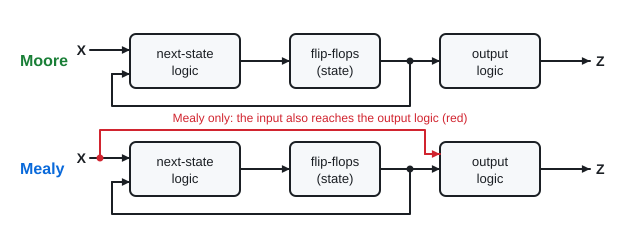
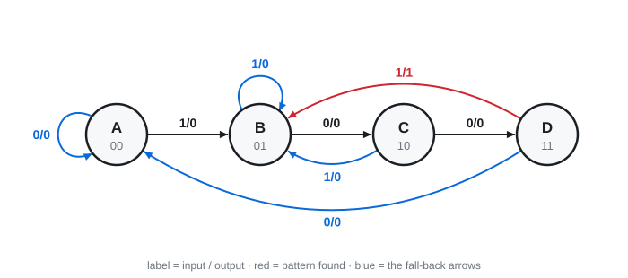
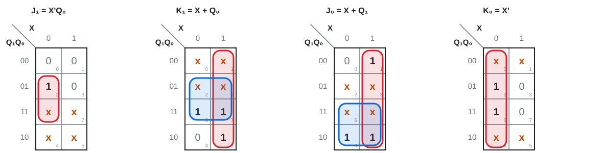
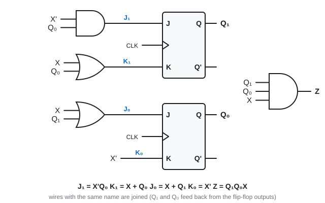
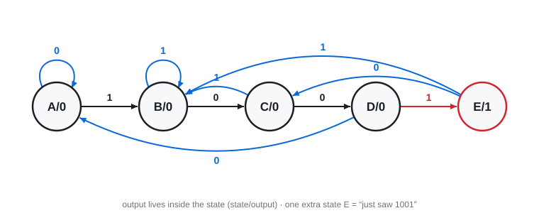
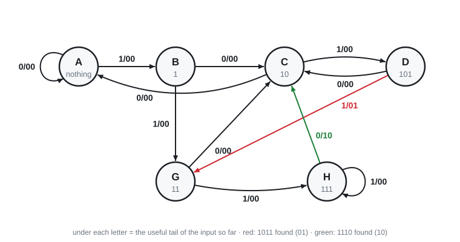

# 15 · Designing a sequential circuit (sequence detectors) ⭐

Lectures 14–16 · ●●● biggest sequential topic · "design a circuit that detects 1001"

**▶ Explainer videos** (tap to search YouTube):
- [sequence detector Mealy state diagram overlapping](https://www.youtube.com/results?search_query=sequence+detector+Mealy+state+diagram+overlapping)
- [Moore vs Mealy machine](https://www.youtube.com/results?search_query=Moore+vs+Mealy+machine)
- [sequential circuit design JK flip-flop excitation table](https://www.youtube.com/results?search_query=sequential+circuit+design+JK+flip-flop+excitation+table)

**Design** is analysis backwards: words → state diagram → state table → flip-flop inputs → K-maps → circuit.
A circuit designed this way is a **finite state machine (FSM)**.

---

## 1. Moore and Mealy

| | Output depends on | Output drawn | Notes |
|---|---|---|---|
| **Moore** | state only | **inside the circle** (state/output) | synchronous output, often needs **one more state** |
| **Mealy** | state **and** input | **on the arrow** (input/output) | reacts at once, output can change between clock edges |

> **Apply:** an arrow is labelled 1/0. Moore or Mealy? What do the two numbers mean?

Answer

**Mealy.** Input 1 causes this move, and the output during it is 0.

---

## 2. The five steps

1. **State diagram** (then state table) from the words. Hardest step.
2. **Give each state a binary code.** n states need at least log₂ n flip-flops (round up).
3. **Flip-flop inputs for every row**, using the **excitation table**.
4. **K-map** each flip-flop input and each output.
5. **Draw the circuit.**

---

## 3. Step 1: drawing the state diagram for a pattern ⭐

**Rule: each state remembers how much of the pattern you have so far.**

Detect **1001** (one input bit X per clock, Z = 1 when the last four bits were 1001):

| State | Means "so far I have…" |
|---|---|
| A | nothing useful |
| B | 1 |
| C | 10 |
| D | 100 |

**Draw it in two passes.**

**Pass 1, the happy path:** A —1→ B —0→ C —0→ D, and from D a 1 completes the pattern, so output 1.

**Pass 2, every other arrow.** For each one ask: **"what is the longest ending of my input that is still the start of the pattern?"**

| In state | Input | Bits so far end in | Longest useful ending | Go to |
|---|---|---|---|---|
| A | 0 | …0 | nothing | A |
| B (1) | 1 | …11 | 1 | B |
| C (10) | 1 | …101 | 1 | B |
| D (100) | 0 | …1000 | nothing | A |
| D (100) | 1 | …100**1** found! | 1 (it can start the next one) | B, output 1 |

That last row is **overlap**: in 1001001 the middle 1 ends one pattern and starts the next.

**State table** (one row per arrow):

| Present | X | Next | Z |
|---|---|---|---|
| A | 0 | A | 0 |
| A | 1 | B | 0 |
| B | 0 | C | 0 |
| B | 1 | B | 0 |
| C | 0 | D | 0 |
| C | 1 | B | 0 |
| D | 0 | A | 0 |
| D | 1 | B | 1 |

> **Apply:** detecting **101**. You are in the state "have 10" and a 1 arrives. Output? Next state (overlap allowed)?

Answer

Output **1** (101 complete). The final 1 can start a new 101, so go to **"have 1"**.

> **Apply:** detecting **110**. You are in "have 11" and another 1 arrives. Where do you go?

Answer

Bits end in 111. Longest useful ending is **11**. **Stay in "have 11".** (Going back to "have 1" is the classic mistake.)

---

## 4. Step 2: codes

A = 00, B = 01, C = 10, D = 11 → two flip-flops Q₁Q₀.

| Q₁ Q₀ | X | Q₁⁺ Q₀⁺ | Z |
|---|---|---|---|
| 0 0 | 0 | 0 0 | 0 |
| 0 0 | 1 | 0 1 | 0 |
| 0 1 | 0 | 1 0 | 0 |
| 0 1 | 1 | 0 1 | 0 |
| 1 0 | 0 | 1 1 | 0 |
| 1 0 | 1 | 0 1 | 0 |
| 1 1 | 0 | 0 0 | 0 |
| 1 1 | 1 | 0 1 | 1 |

---

## 5. Step 3: excitation table → flip-flop inputs ⭐

| Q → Q⁺ | J K | D | T |
|---|---|---|---|
| 0 → 0 | 0 x | 0 | 0 |
| 0 → 1 | 1 x | 1 | 1 |
| 1 → 0 | x 1 | 0 | 1 |
| 1 → 1 | x 0 | 1 | 0 |

For **each flip-flop on its own**, look at its present bit and its next bit, and copy the JK pair.

| Q₁ Q₀ | X | Q₁⁺ Q₀⁺ | J₁ K₁ | J₀ K₀ | Z |
|---|---|---|---|---|---|
| 0 0 | 0 | 0 0 | 0 x | 0 x | 0 |
| 0 0 | 1 | 0 1 | 0 x | 1 x | 0 |
| 0 1 | 0 | 1 0 | 1 x | x 1 | 0 |
| 0 1 | 1 | 0 1 | 0 x | x 0 | 0 |
| 1 0 | 0 | 1 1 | x 0 | 1 x | 0 |
| 1 0 | 1 | 0 1 | x 1 | 1 x | 0 |
| 1 1 | 0 | 0 0 | x 1 | x 1 | 0 |
| 1 1 | 1 | 0 1 | x 1 | x 0 | 1 |

**One row done slowly (0 1, X = 0 → 1 0):**
- Q₁ goes 0 → 1 → J₁K₁ = **1 x**
- Q₀ goes 1 → 0 → J₀K₀ = **x 1**

---

## 6. Step 4: K-maps

Variables are Q₁, Q₀ and X. The x's are don't cares, so use them to make groups bigger (Topic 9).

**J₁ = X'Q₀ · K₁ = X + Q₀ · J₀ = X + Q₁ · K₀ = X' · Z = Q₁Q₀X**

Z has a single 1 (row 111), so it is just that minterm.

## 7. Step 5: circuit

---

## 8. Same design with D flip-flops

**D = next state.** No excitation step: the Q₁⁺ and Q₀⁺ columns **are** D₁ and D₀. K-map those columns directly.

**D₁ = Q₁Q₀'X' + Q₁'Q₀X' · D₀ = X + Q₁Q₀' · Z = Q₁Q₀X**

| | JK | D |
|---|---|---|
| Work | excitation table needed | none, D = Q⁺ |
| Equations | simpler (lots of don't cares) | usually bigger |
| Used in practice | less | **more** (one input, less hardware) |

> **Apply:** why are the JK equations simpler?

Answer

Half of every J and K column is **x**. Don't cares let K-map groups grow.

---

## 9. The Moore version

Output is inside the state, so you need a state that **means** "just saw 1001": a fifth state **E** with output 1.

From E: a 0 gives …10 → go to C. A 1 gives …11 → go to B.

5 states → **3 flip-flops**. Codes 101, 110, 111 are unused → don't cares.
The slides build it with T flip-flops (A = 000 … E = 100):

**T₂ = Q₂ + Q₁Q₀X · T₁ = Q₂X' + Q₁X + Q₀X' · T₀ = Q₁ + Q₀'X + Q₀X' · Y = Q₂**

> **Apply:** Mealy 1001 needs 4 states, Moore needs 5. Why?

Answer

Mealy puts the 1 on the **arrow** D → B. Moore cannot put outputs on arrows, so it needs an extra **state** whose output is 1.

---

## 10. Two patterns at once (slides 33–35)

**One input, two outputs. Detect 1011 (output 01) and 1110 (output 10). Overlap allowed. Otherwise 00.**

Same rule: each state = the longest useful ending. "Useful" now means the start of **either** pattern.

| State | Has | on 0 | on 1 |
|---|---|---|---|
| A | nothing | A / 00 | B / 00 |
| B | 1 | C / 00 | G / 00 |
| C | 10 | A / 00 | D / 00 |
| D | 101 | C / 00 | G / **01** |
| G | 11 | C / 00 | H / 00 |
| H | 111 | C / **10** | H / 00 |

- D + 1 = 101**1** found. The ending 11 is the start of 1110 → go to G.
- H + 0 = 111**0** found. The ending 10 is the start of 1011 → go to C.

6 states → 3 flip-flops.

---

## Exam drill

**Design a Mealy detector for 101 (overlap allowed) with JK flip-flops.**

Answer

States: A = nothing (00), B = have 1 (01), C = have 10 (10). Code 11 unused → don't care.

| Present | X | Next | Z |
|---|---|---|---|
| A 00 | 0 | A 00 | 0 |
| A 00 | 1 | B 01 | 0 |
| B 01 | 0 | C 10 | 0 |
| B 01 | 1 | B 01 | 0 |
| C 10 | 0 | A 00 | 0 |
| C 10 | 1 | B 01 | **1** |

| Q₁ Q₀ | X | Q₁⁺ Q₀⁺ | J₁ K₁ | J₀ K₀ |
|---|---|---|---|---|
| 0 0 | 0 | 0 0 | 0 x | 0 x |
| 0 0 | 1 | 0 1 | 0 x | 1 x |
| 0 1 | 0 | 1 0 | 1 x | x 1 |
| 0 1 | 1 | 0 1 | 0 x | x 0 |
| 1 0 | 0 | 0 0 | x 1 | 0 x |
| 1 0 | 1 | 0 1 | x 1 | 1 x |
| 1 1 | – | x x | x x | x x |

**J₁ = Q₀X' · K₁ = 1 · J₀ = X · K₀ = X' · Z = Q₁X**

**Design a Mealy detector for 110 with D flip-flops.**

Answer

A = nothing (00), B = have 1 (01), C = have 11 (10). 11 unused.

| Present | X | Next | Z |
|---|---|---|---|
| A | 0 | A | 0 |
| A | 1 | B | 0 |
| B | 0 | A | 0 |
| B | 1 | C | 0 |
| C | 0 | A | **1** |
| C | 1 | C | 0 |

**D₁ = Q₀X + Q₁X · D₀ = Q₁'Q₀'X · Z = Q₁X'**

**Traps:** every state needs an arrow for 0 **and** for 1 · on a wrong bit, fall back to the longest useful ending, not always to the start · after a match, the last bits may start the next match · unused codes are don't cares · Moore = one more state.

---

Next: [16 · Counters](16-counters.md) · [Final exam practice](../final-exam-practice.md)
