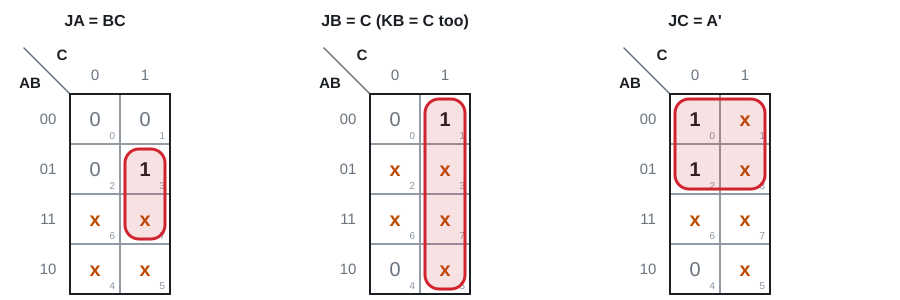
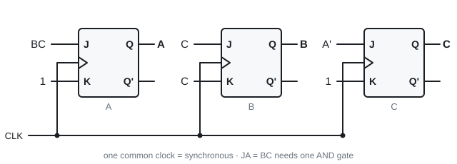
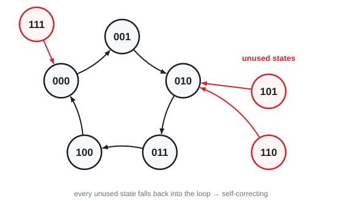
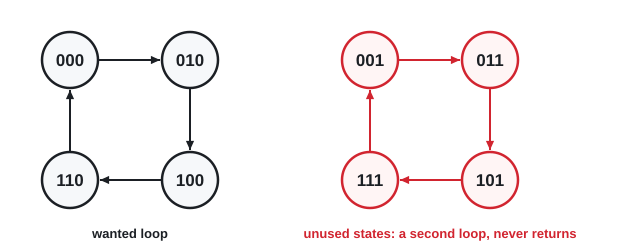
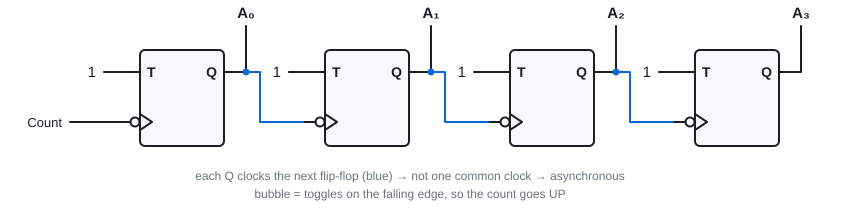
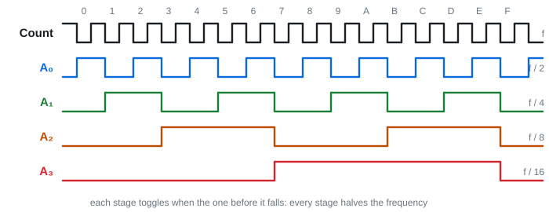

# 16 · Counters

Lectures 17–18 · ●●● · "design a modulo-N counter" is a standard exam question

**▶ Explainer videos** (tap to search YouTube):
- [synchronous counter design JK flip-flops](https://www.youtube.com/results?search_query=synchronous+counter+design+JK+flip-flops)
- [ripple counter explained](https://www.youtube.com/results?search_query=ripple+counter+explained)
- [BCD ripple counter](https://www.youtube.com/results?search_query=BCD+ripple+counter)

A **counter** is a sequential circuit with (usually) **no input**: every clock edge it steps to the next state. **The state itself is the output.**

**Modulo-N** = N states, then wrap. Modulo-5 counts 0, 1, 2, 3, 4, 0, …

| | Clock goes to | Name |
|---|---|---|
| **Synchronous** | every flip-flop, the same clock | all bits change together |
| **Ripple** | the first flip-flop only. Each Q clocks the next | asynchronous, bits change one after another |

---

## 1. Designing a synchronous counter ⭐

It is Topic 15 with no X. The count sequence **is** the state table: the next state is just the row below.

**Modulo-5 with JK flip-flops A B C (slides 4–8)**

| A B C | next | JA KA | JB KB | JC KC |
|---|---|---|---|---|
| 0 0 0 | 0 0 1 | 0 x | 0 x | 1 x |
| 0 0 1 | 0 1 0 | 0 x | 1 x | x 1 |
| 0 1 0 | 0 1 1 | 0 x | x 0 | 1 x |
| 0 1 1 | 1 0 0 | 1 x | x 1 | x 1 |
| 1 0 0 | 0 0 0 | x 1 | 0 x | 0 x |
| 101, 110, 111 | unused | x x | x x | x x |

Each JK pair comes from the excitation table (0→0: 0x · 0→1: 1x · 1→0: x1 · 1→1: x0).

K-map each column. The three unused states are **don't cares in every map**.

**JA = BC · KA = 1 · JB = C · KB = C · JC = A' · KC = 1**

> **Apply:** in the row 0 1 1 → 1 0 0, explain JB KB = x 1.

Answer

B goes 1 → 0. From 1 you can **reset** (01) or **toggle** (11). K = 1 in both, J can be anything → **x 1**.

---

## 2. Unused states: always check them ⭐

You treated 101, 110, 111 as don't cares, so the K-map **decided** what they do. Noise or power-up could put the counter there. **Push each one through your equations and see where it goes.**

| A B C | JA KA | JB KB | JC KC | next |
|---|---|---|---|---|
| 1 0 1 | 0 1 | 1 1 | 0 1 | **0 1 0** |
| 1 1 0 | 0 1 | 0 0 | 0 1 | **0 1 0** |
| 1 1 1 | 1 1 | 1 1 | 0 1 | **0 0 0** |

All three fall back into the loop → the counter is **self-correcting**. ✓

**If one did not return** (it loops among unused states forever): give that unused state a real next state, for example 000, and redo the K-maps.

**What going wrong looks like:** count 0, 2, 4, 6 with JK flip-flops. The minimal answer is JA = KA = B, JB = KB = 1, JC = KC = 0. C never changes, so if C ever becomes 1 the counter runs 1, 3, 5, 7 forever.

> **Apply:** a counter uses 6 of the 8 states of three flip-flops. How many unused states must you check, and what are you checking?

Answer

**2.** For each: work out the next state from the final equations, and follow it until it reaches a valid state.

---

## 3. Binary ripple counter

T flip-flops with **T = 1** (always toggle). The count pulses clock the first one. **Each Q is the clock of the next.**

With **falling-edge** flip-flops: A₀ toggles on every pulse. A₁ toggles each time A₀ **falls** (1 → 0). That is exactly when binary counting carries, so it counts **up**: 0000, 0001, 0010, …, 1111, 0000.

**Frequency divider:** each stage halves the frequency. n stages divide by **2ⁿ**.

**The slide-16 exercise:**
- **Count down:** clock each stage from the previous **Q'** instead of Q (or keep Q and use rising-edge flip-flops).
- **With JK flip-flops:** J = K = 1. **With D flip-flops:** D = Q' (its own inverted output).

**Ripple against synchronous:** ripple is simpler (no gates) but slow. The change has to pass through every flip-flop in turn, and the outputs are briefly wrong while it does.

> **Apply:** a 4-stage ripple counter is fed 1 MHz. What frequency is on A₃?

Answer

1 MHz ÷ 2⁴ = **62.5 kHz**.

> **Apply:** how many flip-flops for a ripple counter that divides by 32?

Answer

32 = 2⁵ → **5**.

---

## 4. BCD (decade) ripple counter

Counts 0000 to 1001 (0 to 9), then back to 0000. Four falling-edge JK flip-flops Q₈ Q₄ Q₂ Q₁.

| Flip-flop | Clock | J | K | So it… |
|---|---|---|---|---|
| Q₁ | count pulses | 1 | 1 | toggles every pulse |
| Q₂ | Q₁ | **Q₈'** | 1 | toggles when Q₁ falls, **but only while Q₈ = 0** |
| Q₄ | Q₂ | 1 | 1 | toggles when Q₂ falls |
| Q₈ | Q₁ | **Q₂Q₄** | 1 | sets when Q₁ falls with Q₂ = Q₄ = 1 (7 → 8), clears on the next fall of Q₁ (9 → 0) |

**Why 9 → 0:** at 1001, Q₁ falls. Q₂ would normally toggle to 1, but J₂ = Q₈' = 0 so it stays 0. Q₈ has J = 0, K = 1 so it resets. Result 0000.

**More digits:** chain decade counters, one per decimal digit. Each decade's Q₈ clocks the next (it falls on 9 → 0, which is the carry).

> **Apply:** how many flip-flops for a counter that counts 000 to 999 in BCD?

Answer

3 decades × 4 = **12**.

---

## Exam drill

**Design a synchronous modulo-6 counter (0 to 5) with JK flip-flops. Check the unused states.**

Answer

| A B C | next | JA KA | JB KB | JC KC |
|---|---|---|---|---|
| 0 0 0 | 0 0 1 | 0 x | 0 x | 1 x |
| 0 0 1 | 0 1 0 | 0 x | 1 x | x 1 |
| 0 1 0 | 0 1 1 | 0 x | x 0 | 1 x |
| 0 1 1 | 1 0 0 | 1 x | x 1 | x 1 |
| 1 0 0 | 1 0 1 | x 0 | 0 x | 1 x |
| 1 0 1 | 0 0 0 | x 1 | 0 x | x 1 |

Don't cares: 110, 111.

**JA = BC · KA = C · JB = A'C · KB = C · JC = 1 · KC = 1**

Unused: 110 → JA KA = 00, JB KB = 00, C toggles → **111**. 111 → A toggles to 0, JB KB = 01 resets B, C toggles to 0 → **000**. Both return. ✓

**Design a 2-bit up/down counter with T flip-flops. X = 1 counts up, X = 0 counts down.**

Answer

| A B | X | next | TA TB |
|---|---|---|---|
| 0 0 | 0 | 1 1 | 1 1 |
| 0 0 | 1 | 0 1 | 0 1 |
| 0 1 | 0 | 0 0 | 0 1 |
| 0 1 | 1 | 1 0 | 1 1 |
| 1 0 | 0 | 0 1 | 1 1 |
| 1 0 | 1 | 1 1 | 0 1 |
| 1 1 | 0 | 1 0 | 0 1 |
| 1 1 | 1 | 0 0 | 1 1 |

T = 1 where the bit changes.

**TB = 1 · TA = B'X' + BX** (= XNOR of B and X)

Sense check: counting up, A flips when B = 1. Counting down, A flips when B = 0. ✓

**Traps:** unused states are don't cares **and** must be checked afterwards · synchronous = one shared clock · ripple with falling-edge flip-flops clocked from Q counts up · n stages divide by 2ⁿ, not by n.

---

Next: [17 · Registers, ring and Johnson counters](17-registers.md) · [Final exam practice](../final-exam-practice.md)
