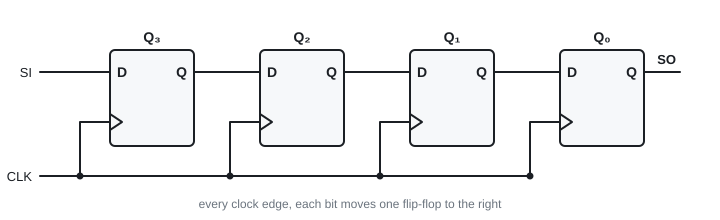
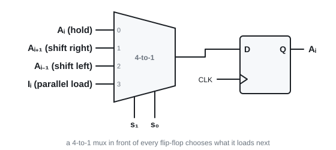
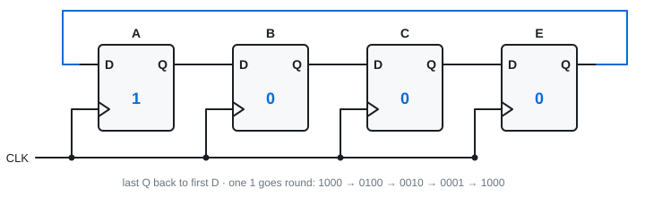
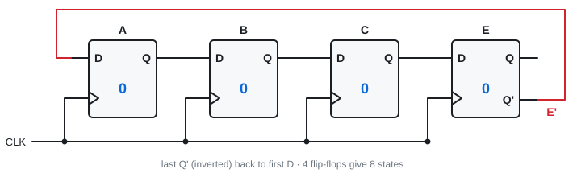

# 17 · Registers, ring counter, Johnson counter

Lectures 19–20 · ●● · short "trace it" and "how many flip-flops" questions

**▶ Explainer videos** (tap to search YouTube):
- [shift register explained SISO SIPO](https://www.youtube.com/results?search_query=shift+register+explained+SISO+SIPO)
- [universal shift register](https://www.youtube.com/results?search_query=universal+shift+register)
- [ring counter and Johnson counter](https://www.youtube.com/results?search_query=ring+counter+and+Johnson+counter)

A **register** = a row of flip-flops sharing one clock. Each holds one bit. n flip-flops store an n-bit word. Gates around them decide **how** new data gets in.

---

## 1. Parallel-load register

All bits go in at once (**parallel**), on one clock edge. A common **clear** input wipes it to 0000.

Problem: a plain D register reloads on **every** edge. Add a **Load** control:

| Load | On the clock edge |
|---|---|
| 1 | take in the new inputs I₃…I₀ |
| 0 | keep the old word (each Q is fed back to its own D) |

So each flip-flop gets **D = Load·I + Load'·Q**: a 2-to-1 mux.

> **Apply:** a register holds 1010. Load = 0, inputs are 0111, one clock edge arrives. Contents?

Answer

**1010.** Load = 0 means hold.

---

## 2. Shift register

Flip-flops in a chain: each Q feeds the next D. **Every clock edge, every bit moves one place.** A new bit enters at the serial input (SI). The last bit leaves at the serial output (SO).

**Slide 10:** register starts 0000, the word 1001 arrives one bit per clock.

| After edge | SI was | Q₃ Q₂ Q₁ Q₀ |
|---|---|---|
| start | – | 0 0 0 0 |
| 1 | 1 | 1 0 0 0 |
| 2 | 0 | 0 1 0 0 |
| 3 | 0 | 0 0 1 0 |
| 4 | 1 | 1 0 0 1 |

An n-bit word takes **n clock edges** to load serially, and n more to shift out.

**As a sequence detector (slide 11):** the register always holds the last 4 input bits. AND the four outputs (with the right ones inverted) and the gate gives 1 exactly when those bits are the pattern. No state diagram needed.

> **Apply:** 4-bit shift-right register holds 1011. SI = 0 for two edges. Contents?

Answer

1011 → 0101 → **0010**.

---

## 3. Serial transfer and serial addition

**Serial transfer:** shift register A's output goes into register B's input. After n edges B holds what A held. To stop A losing its word, wire **A's output back to A's own input** (it recirculates).

**Slide 14** (A = 1011, B = 0010, both shift right, A recirculates):

| | A | B |
|---|---|---|
| start | 1011 | 0010 |
| T1 | 1101 | 1001 |
| T2 | 1110 | 1100 |
| T3 | 0111 | 0110 |
| T4 | 1011 | 1011 |

After 4 edges B = A's word, and A is back where it started.

**Serial adder:** two shift registers feed **one full adder**, one bit pair per clock, LSB first. A single **D flip-flop stores the carry** for the next bit. The sum shifts back into register A.

| | Parallel adder (Topic 10) | Serial adder |
|---|---|---|
| Hardware | n full adders | **1** full adder + 1 flip-flop |
| Time | one step | n clock edges |

> **Apply:** what is the D flip-flop in a serial adder for?

Answer

It **holds the carry** from this bit so it can be added to the next bit on the next clock edge.

---

## 4. Universal shift register

One register that can do everything. In front of **each** flip-flop sits a **4-to-1 mux**. Two select lines s₁s₀ choose what that flip-flop loads.

| s₁ s₀ | Mux input | Operation |
|---|---|---|
| 0 0 | 0 | **no change** (own output fed back) |
| 0 1 | 1 | **shift right** |
| 1 0 | 2 | **shift left** |
| 1 1 | 3 | **parallel load** |

A 4-bit one needs 4 flip-flops and 4 muxes.

> **Apply:** s₁s₀ = 10. What happens on the next edge?

Answer

**Shift left.**

---

## 5. Ring counter

A shift register joined into a circle (last Q → first D) holding **a single 1**.

1000 → 0100 → 0010 → 0001 → 1000 …

Each output is high for one clock in turn: ready-made **timing signals**, no decoder needed.

**Cost: n flip-flops give only n states.** Alternative for 2ⁿ timing signals: an n-bit binary counter + an n-to-2ⁿ decoder (fewer flip-flops, more gates).

---

## 6. Johnson (switch-tail) counter

Same circle, but feed back the **inverted** last output (Q').

**k flip-flops give 2k states.** The register fills with 1s from the left, then with 0s:

| Step | A B C E | Decode with |
|---|---|---|
| 0 | 0 0 0 0 | A'E' |
| 1 | 1 0 0 0 | AB' |
| 2 | 1 1 0 0 | BC' |
| 3 | 1 1 1 0 | CE' |
| 4 | 1 1 1 1 | AE |
| 5 | 0 1 1 1 | A'B |
| 6 | 0 0 1 1 | B'C |
| 7 | 0 0 0 1 | C'E |

**Decoding:** every state needs only **one 2-input AND gate**. Look for the place where the pattern changes from 1 to 0 (or the two ends). For example 1100 is the only state with B = 1 and C = 0 → BC'.

| For 8 timing signals | Flip-flops | Gates |
|---|---|---|
| Ring counter | 8 | 0 |
| Johnson counter | 4 | 8 two-input ANDs |
| Binary counter + decoder | 3 | 8 three-input ANDs |

> **Apply:** a 5-flip-flop Johnson counter. How many states? How many for a 5-flip-flop ring counter?

Answer

Johnson **10**. Ring **5**.

> **Apply:** 3-bit Johnson counter, start 000. Write the sequence.

Answer

000 → 100 → 110 → 111 → 011 → 001 → 000. Six states (2 × 3).

---

## Exam drill (slide 10 exercise)

**Use a 3-bit Johnson counter and gates to make a binary counter output counting 0 to 5.**

Answer

Johnson states in order, and the binary number each should show:

| A B C | Count | Y₂ Y₁ Y₀ |
|---|---|---|
| 0 0 0 | 0 | 0 0 0 |
| 1 0 0 | 1 | 0 0 1 |
| 1 1 0 | 2 | 0 1 0 |
| 1 1 1 | 3 | 0 1 1 |
| 0 1 1 | 4 | 1 0 0 |
| 0 0 1 | 5 | 1 0 1 |

010 and 101 never happen → don't cares. K-map each output:

**Y₂ = A'C · Y₁ = AB · Y₀ = AB' + AC + B'C**

Circuit: 3 D flip-flops in a ring with C' fed back to the first D, plus those gates on the outputs.

**Traps:** Johnson = 2k states, ring = k · ring counter must be started with exactly one 1 · serial needs n clocks, parallel needs 1 · universal register: 00 hold, 01 right, 10 left, 11 load.

---

Next: [18 · Memory](18-memory.md) · [Final exam practice](../final-exam-practice.md)
