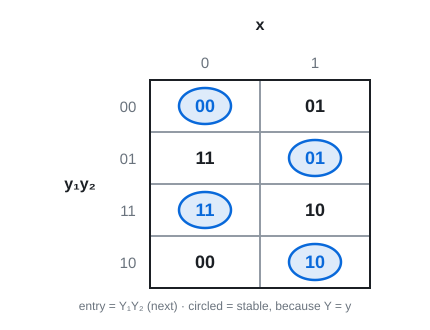
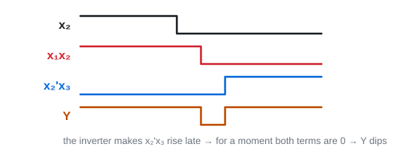
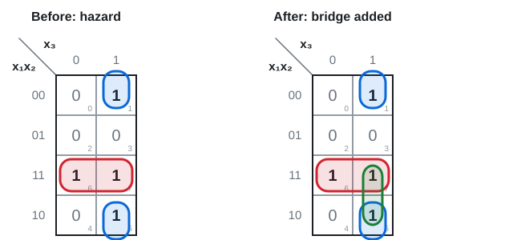

# 20 · Asynchronous logic: stability, races, hazards

Lectures 23–24 · ●● · definitions + the transition table + fixing a hazard with a K-map

**▶ Explainer videos** (tap to search YouTube):
- [asynchronous sequential circuit transition table](https://www.youtube.com/results?search_query=asynchronous+sequential+circuit+transition+table)
- [critical race vs non critical race](https://www.youtube.com/results?search_query=critical+race+vs+non+critical+race)
- [static hazard K-map removal](https://www.youtube.com/results?search_query=static+hazard+K-map+removal)

**Asynchronous sequential circuit:** has feedback (so it has memory) but **no clock**. The state changes as soon as an input changes. The memory is latches or just the gate delays.

Used for: speed (no waiting for a clock), joining two circuits with different clocks. Hard to design.

---

## 1. The two names for the feedback wire

Cut each feedback loop. The same wire now has two ends:

| Symbol | Name | Is the… |
|---|---|---|
| **y** (small) | **secondary** variable | **present** state (what goes into the logic) |
| **Y** (capital) | **excitation** variable | **next** state (what the logic produces) |

After the delay, y becomes Y.

**Stable** = **Y = y**. Nothing is trying to change.
**Unstable** = Y ≠ y. The circuit is on its way somewhere else.

**Total state** = internal state + inputs (y₁y₂ and x together).

---

## 2. Transition table ⭐

**Method (slide 14):**
1. Find every feedback loop. Label its output Y and its input y.
2. Write each Y as a function of the inputs x and the y's.
3. Make a map: **rows = y, columns = x, entry = Y.**
4. **Circle** every entry where Y equals the row's y. Those are the stable states.

**Slide 15:** Y₁ = xy₁ + x'y₂ · Y₂ = xy₁' + x'y₂

**One entry done slowly (row y₁y₂ = 01, column x = 0):**
Y₁ = 0·0 + 1·1 = 1. Y₂ = 0·1 + 1·1 = 1. Entry **11**. Row is 01, so 11 ≠ 01 → unstable, not circled.

**Reading it:** x changes → move **sideways** to the new column. If the entry is not circled, move **up or down** to the row it names. Repeat until you land on a circle.

Example: stable at 00 with x = 0. x → 1: entry 01 (unstable) → go to row 01 → entry 01, circled. Settled.

**Flow table** = the same table with letters (a, b, c, d) in place of the binary codes.

> **Apply:** the circuit is stable in row 01 with x = 1. x changes to 0. Where does it settle?

Answer

Column x = 0, row 01: entry 11 → go to row 11. Row 11, x = 0: entry 11, circled. **Settles at y₁y₂ = 11.**

---

## 3. Stability and fundamental mode

**A column with no circle = the circuit oscillates** for that input.

**Slide 18:** Y = (x₁y)'x₂ = x₁'x₂ + y'x₂. With x₁x₂ = 11: Y = y'. So y = 0 gives Y = 1, then y = 1 gives Y = 0, for ever. Period of oscillation = **2 × the loop delay**.

**Fundamental mode** (the rule that keeps asynchronous circuits predictable):
- inputs change **one at a time**, and
- only **after the circuit has settled** to a stable state.

> **Apply:** Y = x'y + xy'. For which input value is the circuit unstable?

Answer

x = 0: Y = y → always stable. x = 1: Y = y' → never equal → **oscillates when x = 1**.

---

## 4. Races

**Race:** **two or more state variables** must change after one input change. Unequal delays mean you cannot know which changes first.

00 → 11 might really go 00 → **10** → 11 or 00 → **01** → 11.

| | Final stable state | OK? |
|---|---|---|
| **Non-critical race** | the same whichever variable wins | harmless |
| **Critical race** | **different** depending on which wins | must be removed |

**Fix:** choose the state codes so that **only one state variable changes** on every transition (neighbours differ by one bit, like Gray code).

> **Apply:** a transition goes from state 01 to state 10. Is there a race?

Answer

**Yes**: both bits change. Whether it is critical depends on where the in-between states 00 and 11 lead.

---

## 5. Hazards ⭐

**Hazard:** a short unwanted **glitch** at an output, because two paths to the output have different delays. Happens in plain combinational logic too.

| Hazard | Output should | Actually does |
|---|---|---|
| **Static-1** | stay 1 | 1 → **0** → 1 |
| **Static-0** | stay 0 | 0 → **1** → 0 |
| **Dynamic** | change once | changes **three or more** times |

**Where static-1 comes from (slides 33–36):** Y = x₁x₂ + x₂'x₃, inputs 111, then x₂ drops to 0.

Term x₁x₂ switches off straight away. Term x₂'x₃ switches on a little later (x₂ has to pass through the inverter first). For that moment both are 0 → Y dips to 0.

**On the K-map:** the input moves from cell 111 to cell 101. Those two 1s are neighbours but sit in **different groups**. That gap is the hazard.

**Fix: add a redundant group that covers both cells.** Here x₁x₃:

**Y = x₁x₂ + x₂'x₃ + x₁x₃**

The new term stays 1 during the change and holds the output up.

**Static-0** is the same story in product-of-sums form: Y = (x₁ + x₂')(x₂ + x₃) → add **(x₁ + x₃)**.

**Rule: two adjacent 1s (SOP) or adjacent 0s (POS) not sharing a group = hazard. Bridge them.**

> **Apply:** F = A'B + AC. Find the hazard and fix it.

Answer

A'B covers cells 010, 011. AC covers 101, 111. Cells **011 and 111** are neighbours (only A changes) in different groups → static-1 hazard when BC = 11 and A changes.

Bridge = the pair 011, 111 = **BC**. Hazard-free: **F = A'B + AC + BC**.

(The consensus term from Topic 6 is not always "redundant" after all.)

---

## Summary table

| Problem | What it is | Cure |
|---|---|---|
| Instability | no stable state for some input | redesign the feedback |
| Critical race | two state bits change, result depends on delays | one-bit-change state codes |
| Static hazard | glitch from unequal path delays | redundant bridging term from the K-map |
| Everything | | operate in **fundamental mode** |

**Traps:** small y = present, capital Y = next · stable means Y = y · a race needs **two state variables** changing, a hazard is about **path delays** · the hazard fix adds a term that Boolean algebra says is redundant.

---

Next: [21 · Transistor logic](21-transistor-logic.md) · [Final exam practice](../final-exam-practice.md)
