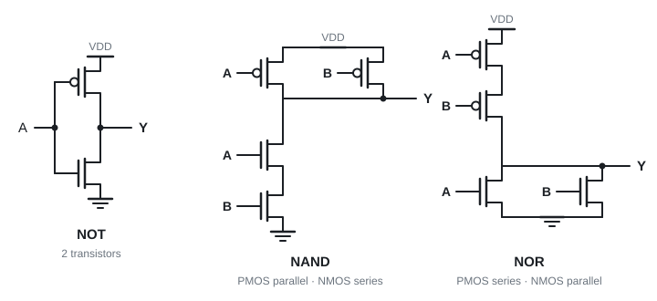

# 21 · Physical transistor logic (NMOS, CMOS)

Lecture 25 · ● · recognise the circuits, know which transistors are on

**▶ Explainer videos** (tap to search YouTube):
- [CMOS inverter NAND NOR explained](https://www.youtube.com/results?search_query=CMOS+inverter+NAND+NOR+explained)
- [CMOS transmission gate](https://www.youtube.com/results?search_query=CMOS+transmission+gate)

---

## 1. Transistors as switches

**Positive logic:** high voltage = 1, low = 0. (Negative logic is the other way round.)

A MOS transistor is a switch controlled by its **gate** voltage.

| | Gate HIGH (1) | Gate LOW (0) | Symbol |
|---|---|---|---|
| **NMOS** | **on** (closed) | off | plain gate |
| **PMOS** | off | **on** (closed) | **bubble** on the gate |

**NMOS: on with 1. PMOS: on with 0.** Everything else follows from this.

---

## 2. NMOS inverter and its problem

One NMOS between output and ground, a resistor (or an always-on MOSFET used as a load) up to the supply.

- A = 0: transistor off, no current, Y pulled **high**.
- A = 1: transistor on, Y connected to ground → **low**.

**Problem:** while A = 1, current flows through the load all the time → wasted power.

---

## 3. CMOS: one of each ⭐

**Complementary MOS:** a **PMOS network pulls up** to VDD, an **NMOS network pulls down** to ground. For any input exactly one network is on, so **no steady current flows**.

| Gate | PMOS (top) | NMOS (bottom) | Transistors |
|---|---|---|---|
| NOT | 1 | 1 | 2 |
| **NAND** | **parallel** | **series** | 4 |
| **NOR** | **series** | **parallel** | 4 |

**Why NAND looks like that:** the output is 0 only when A **and** B are 1 → both NMOS must conduct → **series** to ground. Any 0 input turns on a PMOS → **parallel** to VDD.

**NOR is the mirror image.** The two networks are always opposite shapes.

| NAND: A B | NMOS A, B | PMOS A, B | Y |
|---|---|---|---|
| 0 0 | off, off | on, on | 1 |
| 0 1 | off, on | on, off | 1 |
| 1 0 | on, off | off, on | 1 |
| 1 1 | on, on | off, off | **0** |

> **Apply:** CMOS NOR, A = 1, B = 0. Which transistors are on? What is Y?

Answer

NMOS A **on** (B off). PMOS B on, PMOS A **off**, and they are in series, so the path to VDD is broken. Y is pulled to ground through NMOS A → **Y = 0**.

> **Apply:** why does CMOS use less power than NMOS logic?

Answer

In a steady state one of the two networks is always off, so there is no path from VDD to ground and **no current flows**.

---

## 4. Transmission gate

An NMOS and a PMOS side by side, with opposite control signals N and P.

| N | P | Between X and Y |
|---|---|---|
| 1 | 0 | both on → **closed switch** |
| 0 | 1 | both off → **open** |

Cheap building block:

| Built with transmission gates | Transistors |
|---|---|
| XOR (2 transmission gates + 2 inverters) | **8** |
| D latch | **10** |
| 4-to-1 multiplexer | **16** |

**Traps:** PMOS has the bubble and turns on with 0 · NAND = NMOS in series, NOR = NMOS in parallel · CMOS AND = NAND + inverter (6 transistors), which is why NAND and NOR are the "natural" gates (Topic 9).

---

That's the last topic. Now do the [final exam practice](../final-exam-practice.md) and re-read the [cheat sheet](../cheat-sheet.md).
