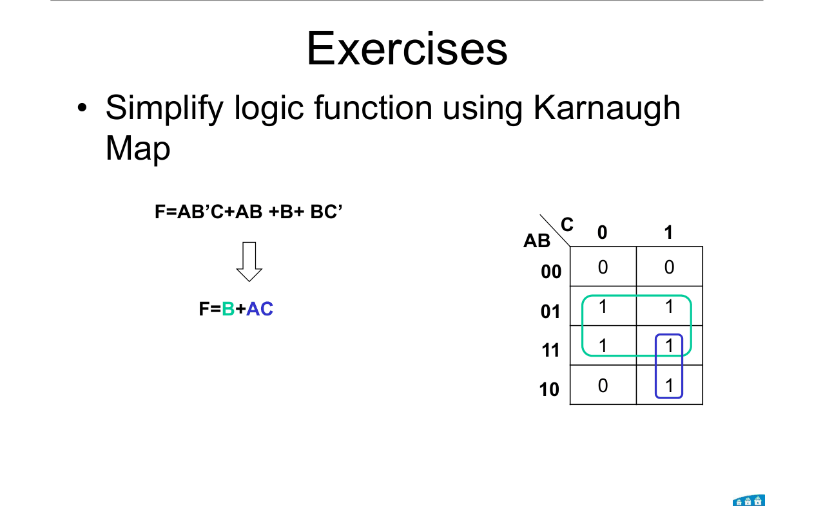
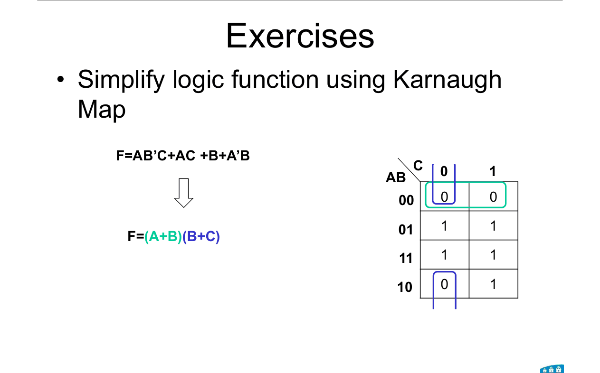

# Topic 8 — End-of-topic test

Try each question first.
Then click to check.

Each answer says which notes section (§) it comes from.

Draw every map yourself on paper. AB down the side, Gray order 00, 01, 11, 10.

---

## Part A: Slide exercises

### S1 (Lecture 5, slides 23 to 25)

F = AB'C + AB + B + BC'

1. Fill the K-map straight from the expression.
2. Find the minimum SOP.
3. Find the minimum POS.

Answer

**1. Fill** (§9):

B fills rows 01 and 11. AB'C adds cell 5. The others are already covered.

| AB \ C | 0 | 1 |
|---|---|---|
| **00** | 0 | 0 |
| **01** | 1 | 1 |
| **11** | 1 | 1 |
| **10** | 0 | 1 |

 

**2. SOP** (group the 1s):

Rows 01 and 11 (group of 4): B = 1 → **B**

Cells 7 and 5 (column C = 1, rows 11 and 10): A = 1, C = 1 → **AC**

**F = B + AC**

 

**3. POS** (group the 0s):

Cells 0 and 1 (row 00): A = 0, B = 0 → **(A + B)**

Cells 0 and 4 (column 0, wraps top to bottom): B = 0, C = 0 → **(B + C)**

**F = (A + B)(B + C)**

From: §5, §8, §9, Rules 1 to 3

---

### S2 (Lecture 5, slide 26)

Simplify F = (A + B + C)(B + C')(C' + D)(A + B' + C + D).

Give the minimum SOP and minimum POS.

Answer

**Fill the 0s** (each sum term is 0 where all its letters are 0):

| Sum term | 0 when | Cells |
|---|---|---|
| (A + B + C) | A = 0, B = 0, C = 0 | 0, 1 |
| (B + C') | B = 0, C = 1 | 2, 3, 10, 11 |
| (C' + D) | C = 1, D = 0 | 2, 6, 10, 14 |
| (A + B' + C + D) | A = 0, B = 1, C = 0, D = 0 | 4 |

Every other cell is 1.

| AB \ CD | 00 | 01 | 11 | 10 |
|---|---|---|---|---|
| **00** | 0 | 0 | 0 | 0 |
| **01** | 0 | 1 | 1 | 0 |
| **11** | 1 | 1 | 1 | 0 |
| **10** | 1 | 1 | 0 | 0 |

 

**SOP:**

Cells 8, 9, 12, 13 (quad): A = 1, C = 0 → **AC'**

Cells 5, 7, 13, 15 (quad): B = 1, D = 1 → **BD**

**F = AC' + BD**

 

**POS:**

Row 00 (cells 0 to 3): A = 0, B = 0 → **(A + B)**

Cells 0, 2, 4, 6 (wraps left to right): A = 0, D = 0 → **(A + D)**

Cells 2, 3, 10, 11: B = 0, C = 1 → **(B + C')**

Column CD = 10 (cells 2, 6, 14, 10): C = 1, D = 0 → **(C' + D)**

**F = (A + B)(A + D)(B + C')(C' + D)**

 

**Cheaper:** the SOP (2 terms, 4 letters).

From: §4, §5, §8, §9, §10

---

### S3 (Lecture 5, slide 27)

Simplify F = (A + C')D + BC + ACD'.

Give the minimum SOP and minimum POS. Which is cheaper?

Answer

**Expand first:** F = AD + C'D + BC + ACD'

Then fill each term's cells:

| AB \ CD | 00 | 01 | 11 | 10 |
|---|---|---|---|---|
| **00** | 0 | 1 | 0 | 0 |
| **01** | 0 | 1 | 1 | 1 |
| **11** | 0 | 1 | 1 | 1 |
| **10** | 0 | 1 | 1 | 1 |

 

**SOP:**

Column CD = 01 (cells 1, 5, 13, 9): C = 0, D = 1 → **C'D**

Cells 7, 6, 15, 14: B = 1, C = 1 → **BC**

Cells 15, 14, 11, 10: A = 1, C = 1 → **AC**

**F = C'D + BC + AC** (3 terms, 6 letters)

 

**POS:**

Column CD = 00 (cells 0, 4, 12, 8): C = 0, D = 0 → **(C + D)**

Cells 3 and 2: A = 0, B = 0, C = 1 → **(A + B + C')**

**F = (C + D)(A + B + C')** (2 terms, 5 letters)

 

**The POS is cheaper here.** That's why you always check both.

From: §5, §8, §9, §10

---

## Part B: Midterm-style questions

---

### M1: True or false

1. A K-map's rows go 00, 01, 10, 11.
2. A group of 6 cells is allowed if they form a rectangle.
3. The four corners of a 4-variable map can form one group.
4. A 1 may be in more than one group.
5. In a group of 4 in a 4-variable map, 2 letters remain.
6. When grouping 0s for POS, a letter that stays 0 is written barred.

Answer

1. **False.** 00, 01, **11, 10** (Gray order). (§3)
2. **False.** Only 1, 2, 4, 8 or 16. (§5, Rule 1)
3. **True.** The map wraps both ways. (§4)
4. **True.** Overlapping is fine. (§5, Rule 1)
5. **True.** 4 = 2², so 2 letters cancel, 2 remain. (§5, Rule 2)
6. **False.** For 0s, 0 → plain. (§8, Rule 3)

---

### M2: Multiple choice

In the lecturer's 4-variable map (AB rows, CD columns), which minterm is in row AB = 11, column CD = 10?

- A. m₁₀
- B. m₁₂
- C. m₁₄
- D. m₁₅

Answer

**C.**

ABCD = 1110 = 14.

From: §4

---

### M3: Minimise (study guide)

F(A, B, C, D) = Σm(0, 2, 5, 7, 8, 10, 13, 15). Find the minimum SOP.

Answer

| AB \ CD | 00 | 01 | 11 | 10 |
|---|---|---|---|---|
| **00** | 1 | 0 | 0 | 1 |
| **01** | 0 | 1 | 1 | 0 |
| **11** | 0 | 1 | 1 | 0 |
| **10** | 1 | 0 | 0 | 1 |

The four corners (0, 2, 8, 10): B = 0, D = 0 → **B'D'**

The centre square (5, 7, 13, 15): B = 1, D = 1 → **BD**

**F = B'D' + BD**

From: §4, §5

---

### M4: Minimise

F(A, B, C) = Σm(1, 3, 4, 6). Find the minimum SOP.

Answer

| AB \ C | 0 | 1 |
|---|---|---|
| **00** | 0 | 1 |
| **01** | 0 | 1 |
| **11** | 1 | 0 |
| **10** | 1 | 0 |

Cells 1, 3: A = 0, C = 1 → **A'C**

Cells 6, 4: A = 1, C = 0 → **AC'**

**F = A'C + AC'**

(This is A ⊕ C, the XOR from Topic 10. B doesn't matter at all.)

From: §3, §5

---

### M5: SOP and POS

F(A, B, C, D) = Σm(0, 1, 2, 5, 8, 9, 10).

1. Find the minimum SOP.
2. Find the minimum POS.
3. Which is cheaper?

Answer

| AB \ CD | 00 | 01 | 11 | 10 |
|---|---|---|---|---|
| **00** | 1 | 1 | 0 | 1 |
| **01** | 0 | 1 | 0 | 0 |
| **11** | 0 | 0 | 0 | 0 |
| **10** | 1 | 1 | 0 | 1 |

 

**1. SOP**

Cells 0, 1, 8, 9 (top and bottom rows wrap): B = 0, C = 0 → **B'C'**

Corners 0, 2, 8, 10: B = 0, D = 0 → **B'D'**

Cells 1, 5: A = 0, C = 0, D = 1 → **A'C'D**

**F = B'C' + B'D' + A'C'D** (3 terms, 7 letters)

 

**2. POS**

Column CD = 11 (3, 7, 15, 11): C = 1, D = 1 → **(C' + D')**

Cells 4, 6, 12, 14 (wraps left to right): B = 1, D = 0 → **(B' + D)**

Row AB = 11 (12 to 15): A = 1, B = 1 → **(A' + B')**

**F = (C' + D')(B' + D)(A' + B')** (3 terms, 6 letters)

 

**3.** The **POS** is cheaper by one letter.

From: §5, §8, §10

---

### M6: Spot the mistake

A student minimises F(A, B, C) = Σm(0, 1, 2, 3, 4) and writes F = A' + B'C'.

Another writes F = A'B' + A'B + AB'C'. Which is minimal? What did the other student miss?

Answer

| AB \ C | 0 | 1 |
|---|---|---|
| **00** | 1 | 1 |
| **01** | 1 | 1 |
| **11** | 0 | 0 |
| **10** | 1 | 0 |

Rows 00 and 01 together (group of 4): A = 0 → **A'**

Cells 0 and 4 (wraps): B = 0, C = 0 → **B'C'**

**F = A' + B'C'** is minimal.

The second student used two groups of 2 instead of one group of 4, and a group of 1 instead of a group of 2. **Groups must be as big as possible.**

From: §3, §5, Rule 1

---

### M7: Explain

Why must the rows and columns of a K-map be in Gray order?

Answer

So that cells next to each other differ in **exactly one** variable.

Then grouping two neighbours cancels that variable: xy + xy' = x.

In normal binary order (01 next to 10), two bits change, and the cells wouldn't combine.

From: §3, §5 "Why it works"

